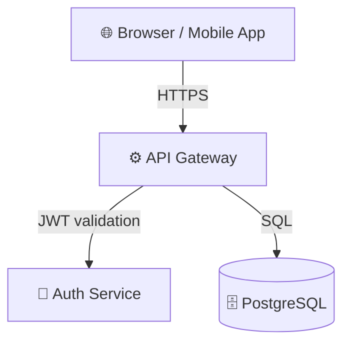

# System Architecture & UML Diagramming Skill

---
name: system-architecture
description: >
  Makes the AI agent produce Architecture Diagrams, Data Flow Diagrams, Entity
  Relationship Diagrams, and Sequence Diagrams using Mermaid.js or PlantUML
  BEFORE writing any implementation code. Activate this skill for any feature
  that spans multiple services, introduces a new data model, or requires
  cross-team API contracts.
---

## Purpose

Code written without an architectural blueprint tends to be tightly coupled,
hard to test, and expensive to change. This skill enforces a **design-first**
workflow:

```
Requirement → Architecture Diagram → Stakeholder Approval → Code
```

The diagrams serve as the single source of truth that all subsequent tasks
(code, tests, docs) must align to.

---

## Diagram Types & When to Use Them

| Diagram Type | Use When | Tool |
|---|---|---|
| System Context | New project / new service boundary | Mermaid `C4Context` or `graph` |
| Data Flow Diagram | Data moves between services / external APIs | Mermaid `graph LR` |
| Entity Relationship Diagram | New DB tables / schema changes | Mermaid `erDiagram` |
| Sequence Diagram | Multi-step API calls / async flows | Mermaid `sequenceDiagram` |
| Component Diagram | Monolith module boundaries | Mermaid `graph TB` |
| State Machine | Complex business state transitions | Mermaid `stateDiagram-v2` |
| Class Diagram | OOP domain model | Mermaid `classDiagram` |

---

## Diagramming Protocol

### Step 1 — Identify Diagram Scope

From the Requirement Summary Card, answer:
- What **components** are involved? (services, databases, queues, CDNs, clients)
- What **data** flows between them and in which direction?
- What **new entities** are being created or modified?
- What **sequences of calls** happen during the primary happy path?

### Step 2 — Produce Diagrams in Order

Always produce in this order (skip if not applicable):

1. **System Context Diagram** — shows the new component in relation to everything else
2. **Data Flow Diagram** — shows how data moves end-to-end
3. **ERD** — shows the data model
4. **Sequence Diagram** — shows the primary request/response flow

### Step 3 — Present for Approval

Output each diagram in a fenced Mermaid code block, followed by a plain-English
description:

````markdown
## System Context Diagram



**What this shows**: The client communicates only with the API Gateway.
The API Gateway delegates authentication to a dedicated Auth Service
and persists data in PostgreSQL.
````

Wait for the user to respond with one of:
- ✅ **Approved** — proceed to implementation
- ✏️ **Change X** — revise the diagram and re-present
- ❓ **Question** — answer and re-present if needed

### Step 4 — Lock the Architecture

Once approved, save the diagrams to `docs/architecture/`:

```
docs/
  architecture/
    context.md          ← System Context Diagram
    data-flow.md        ← Data Flow Diagram
    erd.md              ← Entity Relationship Diagram
    sequences/
      <feature-name>.md ← Sequence Diagrams (one per feature)
```

---

## Architecture Principles to Enforce

Before finalising any diagram, verify these principles are met:

### Separation of Concerns
- Each service/module has exactly one reason to change
- UI logic never leaks into business logic layer
- Database queries never appear in controllers/handlers

### Dependency Direction
- Dependencies always flow **inward** (toward the domain/core)
- Infrastructure (DB, HTTP, queue) depends on domain, not the other way around

### Bounded Contexts
- Mark clear boundaries between domains
- Cross-boundary communication only through well-defined interfaces / events

### Scalability Checkpoints
- Identify any **single points of failure** and flag them: `⚠️ SPOF`
- Identify any **N+1 query** risks in the data flow
- Mark components that will need **horizontal scaling** eventually

---

## Mermaid Quick Reference

```mermaid
%% System / Component diagram
graph LR
  A[Service A] -->|REST| B[Service B]
  B --> C[(Database)]

%% Sequence
sequenceDiagram
  Client->>+API: POST /login
  API->>+AuthService: validate(token)
  AuthService-->>-API: {userId}
  API-->>-Client: 200 OK {jwt}

%% ERD
erDiagram
  USER {
    uuid id PK
    string email
    string password_hash
  }
  POST {
    uuid id PK
    uuid author_id FK
    string title
  }
  USER ||--o{ POST : "writes"

%% State machine
stateDiagram-v2
  [*] --> Draft
  Draft --> Submitted : submit()
  Submitted --> Approved : approve()
  Submitted --> Rejected : reject()
  Approved --> Published : publish()
```

---

## Rules the Agent MUST Follow

1. **No code before diagrams** — for any feature touching ≥2 services or introducing a new DB table, diagrams MUST be produced and approved first.
2. **Diagrams are living docs** — if implementation reveals a discrepancy with the diagram, update the diagram file and note the change.
3. **Cite the diagram in code** — add a comment at the top of key files: `// See: docs/architecture/context.md`.
4. **Flag anti-patterns** — if the approved design contains a known anti-pattern (e.g., circular dependencies, God Object), flag it with `⚠️ ANTI-PATTERN` before implementing.
