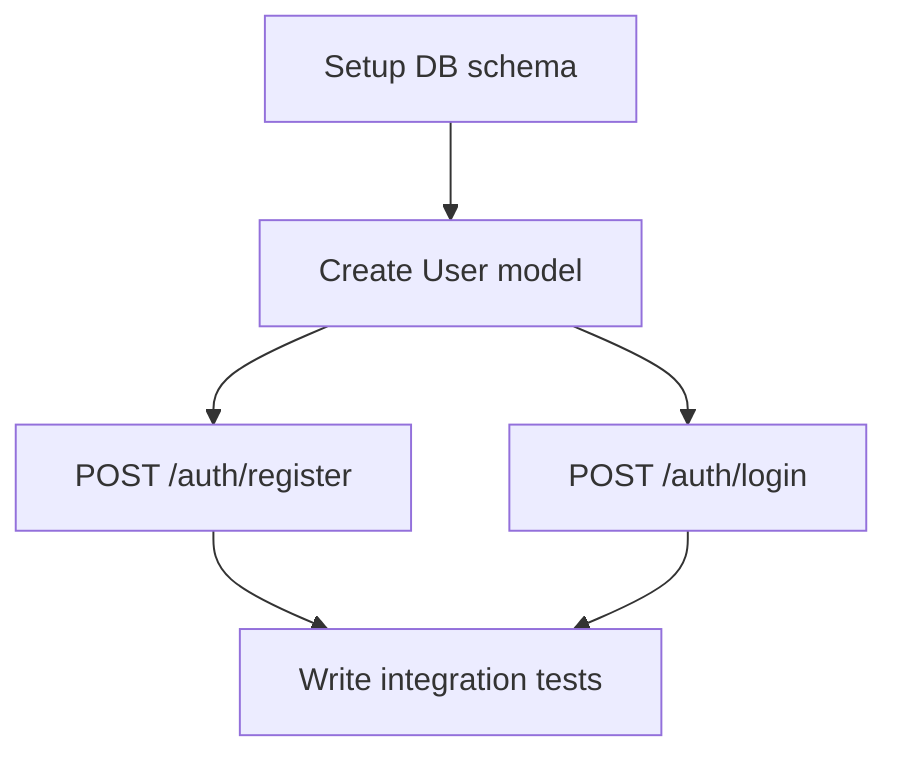

# Task Breakdown & Sub-tasking Skill

---
name: task-breakdown
description: >
  Decomposes large, complex requirements into atomic, trackable sub-tasks before
  any implementation begins. Produces Markdown checklists, Jira-ready ticket
  descriptions, or Trello card drafts. Use this skill whenever the scope spans
  more than one file, feature, or system boundary.
---

## Purpose

Large requirements are never completed reliably in a single pass. This skill
enforces a **decompose-then-execute** discipline that ensures:

- Nothing is forgotten (every acceptance criterion maps to at least one task)
- Work is reviewable in small increments
- Progress is visible and trackable
- Rollback is easy (atomic changes per task)

---

## Decomposition Protocol

### Step 1 — Parse the Requirement

Read the Requirement Summary Card (from the `clarification-interviewer` skill) or
the raw user request and identify:

- **Functional slices** — each distinct user-facing behaviour
- **Non-functional tasks** — tests, docs, migrations, config
- **Cross-cutting concerns** — auth, logging, error handling, observability
- **Infrastructure tasks** — CI/CD, environment setup, secrets management

### Step 2 — Build the Task Tree

Organise tasks using a **3-level hierarchy**:

```
Epic → Story → Task
```

| Level | Scope | Example |
|-------|-------|---------|
| Epic | Whole feature | "User Authentication System" |
| Story | User-observable behaviour | "User can log in with email + password" |
| Task | Single atomic change | "Create `POST /auth/login` endpoint" |

### Step 3 — Size Each Task

Apply the **T-shirt sizing** rule: every Task must be **S (≤2h)** or **M (≤4h)**.
If a task is larger, split it further.

### Step 4 — Sequence & Dependency Mapping

Identify task dependencies and produce an ordered execution plan:



---

## Output Formats

### Markdown Checklist (default)

```markdown
## 📋 Task Breakdown — <Feature Name>

### Epic: <Name>

#### Story 1: <User-facing behaviour>
- [ ] **T-01** · S · <atomic task description>
  - Acceptance: <what "done" looks like>
  - Files affected: `src/routes/auth.ts`, `src/models/user.ts`
- [ ] **T-02** · M · <atomic task description>
  - Acceptance: …
  - Files affected: …

#### Story 2: …
```

### Jira Ticket Format (on request)

```markdown
**Summary**: <Task title>
**Type**: Task / Bug / Story
**Priority**: P1 / P2 / P3
**Story Points**: 1 / 2 / 3 / 5
**Description**:
  As a <actor>, I want <goal> so that <value>.
**Acceptance Criteria**:
  - [ ] Given … When … Then …
**Dependencies**: <ticket IDs>
**Labels**: backend, auth, needs-review
```

### Trello Card Format (on request)

```markdown
**Card Name**: <Task title>
**List**: To Do / In Progress / Review / Done
**Description**: <2-3 sentence summary>
**Checklist**:
  - [ ] <sub-step 1>
  - [ ] <sub-step 2>
**Labels**: 🔴 High / 🟡 Medium / 🟢 Low
**Due Date**: <if known>
```

---

## Execution Rules

1. **Never skip decomposition for multi-file changes** — if a feature touches more than 2 files, this skill MUST be run first.
2. **One commit per task** — when implementing, each task in the checklist corresponds to exactly one Git commit (use `task-breakdown` task ID in commit message, e.g. `feat(auth): T-03 create login endpoint`).
3. **Check off as you go** — after each task is implemented and tested, mark it `[x]` and report progress to the user.
4. **Replan on blockers** — if a task reveals new unknowns, pause, add new tasks to the list, and surface the update to the user.
5. **Never implement ahead of the plan** — do not start Task N+1 before Task N is checked off.

---

## Integration with Other Skills

| Skill | How it connects |
|-------|-----------------|
| `clarification-interviewer` | Task breakdown consumes the Requirement Summary Card |
| `system-architecture` | Architecture diagrams inform the task dependency graph |
| `git-version-control` | Each task = one atomic commit |
| `tdd-test-runner` | Each task must have a corresponding test task paired with it |
