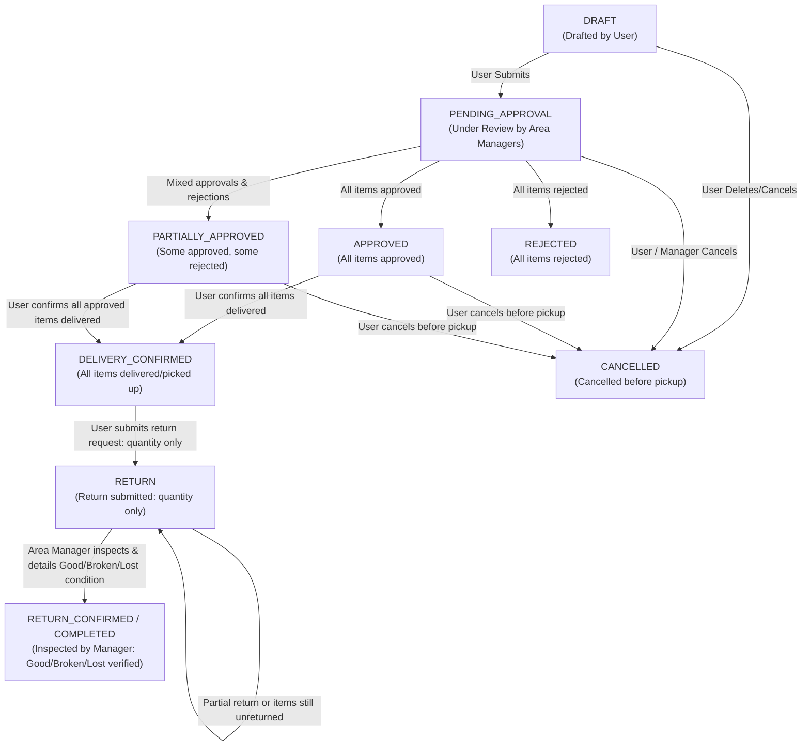
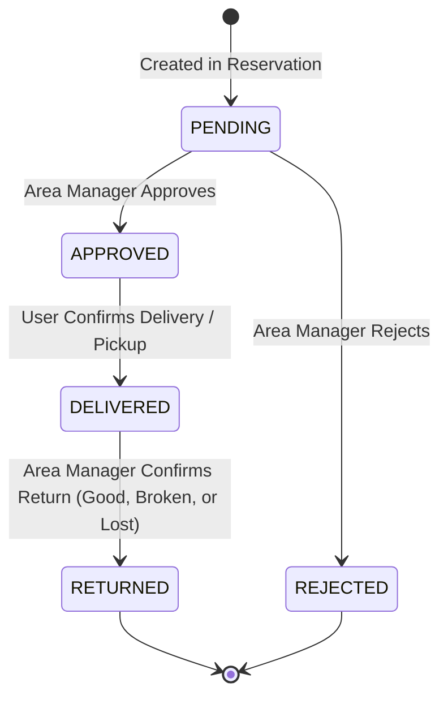
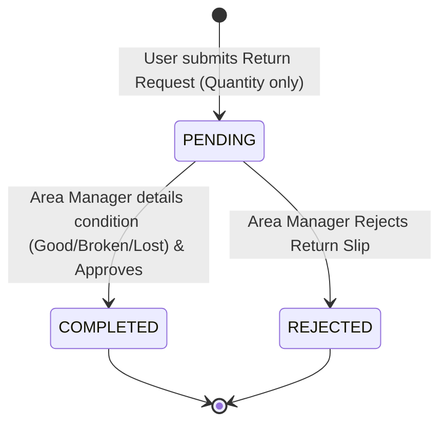
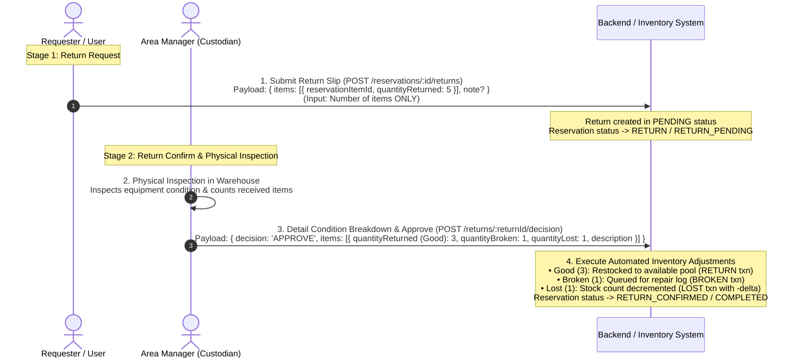

# Asset Reservation System: Lifecycle, Actors, States & Algorithms Specification

This document provides an end-to-end technical specification and architecture guide for the Asset Reservation & Return system. It details the **state machines**, **actors & permissions**, **action sequences**, and **underlying algorithms** for conflict detection, asset locking, delivery confirmation, and physical return inspection.

---

## 1. Domain Separation Architecture

The system enforces clear separation of concerns across three distinct state layers:

```
┌────────────────────────────────────────────────────────────────────────────────────────┐
│ 1. Master Asset Catalog Status (Physical Equipment in Warehouse)                      │
│    • ACTIVE  - Operational and available for scheduling                              │
│    • BROKEN  - Damaged / under repair / maintenance                                   │
│    • LOST    - Missing / unreturned (deducted from pool, eligible for recovery)       │
└─────────────────────────────────────┬──────────────────────────────────────────────────┘
                                      │
                                      ▼ (Allocated across time slots)
┌────────────────────────────────────────────────────────────────────────────────────────┐
│ 2. Reservation Lifecycle Status (Booking Event Level)                                  │
│    • DRAFT                - Initial draft saved by requester                           │
│    • PENDING_APPROVAL     - Submitted, awaiting Area Manager approvals                 │
│    • PARTIALLY_APPROVED   - Some items approved, others rejected                       │
│    • APPROVED             - All requested equipment approved, locked in calendar       │
│    • DELIVERY_CONFIRMED   - All approved items picked up / delivered to requester      │
│    • RETURN               - Return slip submitted (quantity only), awaiting inspection │
│    • RETURN_CONFIRMED     - All items verified returned & restored; event completed    │
│    • REJECTED             - All requested items rejected by Area Managers              │
│    • CANCELLED            - Cancelled before equipment pickup; locks released          │
└─────────────────────────────────────┬──────────────────────────────────────────────────┘
                                      │
                                      ▼ (Granular item tracking)
┌────────────────────────────────────────────────────────────────────────────────────────┐
│ 3. Line-Item & Return Statuses                                                         │
│    • ReservationItem : PENDING → APPROVED / REJECTED → DELIVERED → RETURNED            │
│    • Return Record   : PENDING → APPROVED (COMPLETED) / REJECTED                       │
└────────────────────────────────────────────────────────────────────────────────────────┘
```

---

## 2. Actors, Roles & Permission Matrix

| Actor / Role | Scoped Permissions | Who Requests? | Who Actions? | Permitted Actions |
| :--- | :--- | :---: | :---: | :--- |
| **Requester** *(User / Staff)* | `reservation:create`<br>`reservation:update` | **Yes** | **Yes** | • Create draft / submit reservation.<br>• Submit change requests (dates, items, participants).<br>• Confirm delivery / pickup of equipment (`DELIVERED`).<br>• **Submit return request with item quantity only**.<br>• Cancel reservation before pickup. |
| **Co-Participant** *(User)* | Linked in `ReservationParticipant` | No | **Yes** | • View reservation details.<br>• Initiate return request with item quantity on behalf of requester. |
| **Area Manager** *(Asset Custodian)* | `reservation:approve`<br>`reservation:reject`<br>`return:approve`<br>*(Scoped by Management Area)* | No | **Yes** | • Review & approve/reject items belonging to their area.<br>• Review & approve/reject change requests.<br>• **Physically inspect equipment in warehouse and classify condition (Good, Broken, Lost)** before return confirmation.<br>• Approve/reject return slips (triggers inventory updates). |
| **Admin** | Global system access | **Yes** | **Yes** | • Global override across all management areas.<br>• Force cancellation, approval, or inventory correction. |

---

## 3. State Machines

### 3.1 Reservation Lifecycle State Diagram



### 3.2 Reservation Item State Lifecycle



### 3.3 Return Record State Lifecycle



---

## 4. Algorithms & Business Logic

### 4.1 Time-Slot Availability & Conflict Detection Algorithm

When a reservation is submitted, updated, or approved, the system evaluates time overlap against existing approved bookings to prevent overbooking:

#### Overlap Formula
An existing booking conflicts if:
$$\text{Existing.start\_at} < \text{Requested.end\_at} \quad\land\quad \text{Existing.end\_at} > \text{Requested.start\_at}$$

#### Allocation Calculation
```ts
// 1. Fetch total warehouse inventory for asset
const totalQuantity = asset.totalQuantity;

// 2. Sum overlapping approved & active reservations
const approvedQuantity = overlappingItems
  .filter(item => 
    ['APPROVED', 'PREPARED', 'CHECKED_OUT', 'DELIVERED'].includes(item.status) &&
    ['APPROVED', 'PARTIALLY_APPROVED', 'DELIVERY_CONFIRMED', 'ACTIVE', 'RETURN', 'RETURN_PENDING'].includes(item.reservation.status)
  )
  .reduce((sum, item) => sum + item.quantity, 0);

// 3. Compute available headroom
const availableQuantity = Math.max(0, totalQuantity - approvedQuantity);

// 4. Assert constraint
if (requestedQuantity > availableQuantity) {
  throw new ApiException(409, "RESERVATION_CONFLICT", `Only ${availableQuantity} units available.`);
}
```

---

### 4.2 Multi-Area Item Decision & Status Derivation

Because a single reservation can request equipment from multiple management areas, approval is granular at the item level:

1. **Area Check**: An Area Manager can only approve/reject items whose `asset.managementAreaId` matches their permission scope.
2. **Concurrency Locking**: Items and assets are locked within a `Serializable` transaction.
3. **Status Derivation Rule**:
   ```ts
   function deriveReservationStatus(itemStatuses: string[]): string {
     if (itemStatuses.every(s => s === 'APPROVED')) return 'APPROVED';
     if (itemStatuses.every(s => s === 'REJECTED')) return 'REJECTED';
     if (itemStatuses.every(s => ['APPROVED', 'REJECTED'].includes(s))) return 'PARTIALLY_APPROVED';
     return 'PENDING_APPROVAL'; // Some items are still pending
   }
   ```

---

### 4.3 Delivery Confirmation Algorithm (Pickup)

1. Requester calls `POST /reservations/:id/delivery-confirm` (optionally specifying an array of `itemIds`).
2. Target items are verified to be in `APPROVED`, `PREPARED`, or `CHECKED_OUT` state.
3. Selected items are updated to `DELIVERED`, recording `checkedOutBy = actor.id` and `checkedOutAt = now()`.
4. **Auto-Transition Trigger**:
   - The system checks all active items (excluding `REJECTED` items).
   - If **all** active items are in `DELIVERED` or `RETURNED`, the reservation status transitions to `DELIVERY_CONFIRMED`.

---

### 4.4 Return Flow: Return Request (Quantity Only) vs. Return Confirm (Condition Breakdown)

The return workflow clearly separates **User Submission** from **Custodian Inspection**:



#### Step-by-Step Breakdown

1. **Step 1: Return Request (User / Submitter)**
   - When the event concludes, the user hands over physical items and submits `POST /reservations/:id/returns`.
   - **Input**: The user inputs **only the number of items** being returned per asset line.
   - The user **does not** classify technical condition (`Good`, `Broken`, `Lost`).
   - **Validation Constraint**: $\text{quantityReturned} \le \text{RemainingUnreturnedQuantity}$.
   - **State**: Reservation transitions to `RETURN` (or `RETURN_PENDING`).

2. **Step 2: Return Confirm & Physical Inspection (Area Manager / Custodian)**
   - The Area Manager receives the physical equipment at the warehouse and conducts inspection.
   - **This is where the condition is detailed & categorized**:
     - 🟢 **Good / Intact (`quantityReturned`)**: Operational units returned in working order $\rightarrow$ Restocked into the available inventory pool for new bookings.
     - 🟡 **Broken / Damaged (`quantityBroken`)**: Units damaged during use $\rightarrow$ Logged into the repair/maintenance queue (master stock total maintained).
     - 🔴 **Lost / Missing (`quantityLost`)**: Units unaccounted for or unreturned $\rightarrow$ Warehouse total stock count is decremented (`totalQuantity -= lost`).
     - **Item Description / Notes**: Optional remarks describing defects or missing parts.

3. **Step 3: Approval Execution & Inventory State Transitions (`APPROVE`)**
   ```ts
   // 1. Mark Return as COMPLETED
   returnRecord.status = 'COMPLETED';

   // 2. Create AssetTransactionBatch
   const batch = createTransactionBatch(actor.id, `Return for ${reservation.eventName}`);

   // 3. Process each line item based on Area Manager's physical inspection
   for (const line of returnRecord.items) {
     const assetId = line.reservationItem.assetId;
     
     // A. Lost Recovery:
     // If this return brings back units that were marked LOST in a prior return slip:
     const priorNetLost = calculatePriorNetLost(line.reservationItemId);
     const recoveredFromLost = Math.min(priorNetLost, line.quantityReturned + line.quantityBroken);
     
     if (recoveredFromLost > 0) {
       // Restore totalQuantity in Master Asset catalog
       incrementAssetTotalQuantity(assetId, recoveredFromLost);
     }

     // B. Good / Intact Return
     if (line.quantityReturned > 0) {
       createAssetTransaction({
         batchId: batch.id,
         assetId,
         transactionType: 'RETURN',
         quantityDelta: recoveredFromLost > 0 ? recoveredFromLost : 0,
         reason: line.description ?? 'Returned intact'
       });
     }

     // C. Broken Assets (queued for repair log)
     if (line.quantityBroken > 0) {
       createAssetTransaction({
         batchId: batch.id,
         assetId,
         transactionType: 'BROKEN',
         quantityDelta: 0,
         reason: line.description ?? 'Returned damaged/broken'
       });
     }

     // D. Lost Assets (deduct from warehouse total stock)
     if (line.quantityLost > 0) {
       decrementAssetTotalQuantity(assetId, line.quantityLost);
       createAssetTransaction({
         batchId: batch.id,
         assetId,
         transactionType: 'LOST',
         quantityDelta: -line.quantityLost,
         reason: line.description ?? 'Missing / lost during return'
       });
     }

     // 4. Update ReservationItem to RETURNED if cumulative returns equal requested quantity
     if (cumulativeReturned(line.reservationItemId) >= line.reservationItem.quantity) {
       line.reservationItem.status = 'RETURNED';
     }
   }

   // 5. Complete Reservation when all non-rejected items are RETURNED
   if (allItems.filter(i => i.status !== 'REJECTED').every(i => i.status === 'RETURNED')) {
     reservation.status = 'COMPLETED'; // (RETURN_CONFIRMED)
   }
   ```

---

## 5. API Endpoint Reference

| Step | Endpoint | Method | Required Role / Permission | Request Payload Summary | State Result |
| :---: | :--- | :---: | :--- | :--- | :--- |
| **1** | `/api/v1/reservations` | `POST` | User (`reservation:create`) | `{ eventName, startAt, endAt, items, participantIds, status? }` | `DRAFT` or `PENDING_APPROVAL` |
| **2** | `/api/v1/reservations/:id/submit` | `POST` | Requester / Manager | `{ expectedUpdatedAt }` | `PENDING_APPROVAL` |
| **3** | `/api/v1/reservations/:id/items/decision` | `POST` | Area Manager (`reservation:approve`) | `{ itemIds: [...], decision: 'APPROVE' \| 'REJECT', comment? }` | Items: `APPROVED`/`REJECTED`<br>Res: `APPROVED` / `PARTIALLY_APPROVED` |
| **4** | `/api/v1/reservations/:id/change-requests` | `POST` | Requester | `{ changeData: { startAt?, endAt?, items?, participantIds? }, reason? }` | Change Request `PENDING` |
| **5** | `/api/v1/reservations/:id/change-requests/:changeRequestId/decision` | `POST` | Area Manager (`reservation:approve`) | `{ decision: 'APPROVE' \| 'REJECT', comment? }` | Applies changes or rejects |
| **6** | `/api/v1/reservations/:id/delivery-confirm` | `POST` | Requester / Manager | `{ itemIds?: [...] }` | Items: `DELIVERED`<br>Res: `DELIVERY_CONFIRMED` |
| **7** | `/api/v1/reservations/:id/returns` | `POST` | Requester / Participant | `{ items: [{ reservationItemId, quantityReturned }], note? }`<br>*(Input: Number of items only)* | Return `PENDING`<br>Res: `RETURN` |
| **8** | `/api/v1/reservations/:id/returns/:returnId/decision` | `POST` | Area Manager (`return:approve`) | `{ decision: 'APPROVE' \| 'REJECT', items: [{ reservationItemId, quantityReturned (Good), quantityBroken, quantityLost, description? }], description? }`<br>*(Inspect & detail Good, Broken, Lost breakdown)* | Return `COMPLETED`<br>Inventory updated<br>Res: `COMPLETED` |
| **9** | `/api/v1/reservations/:id/cancel` | `POST` | Requester / Admin | `{ reason? }` | `CANCELLED` |
