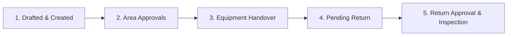
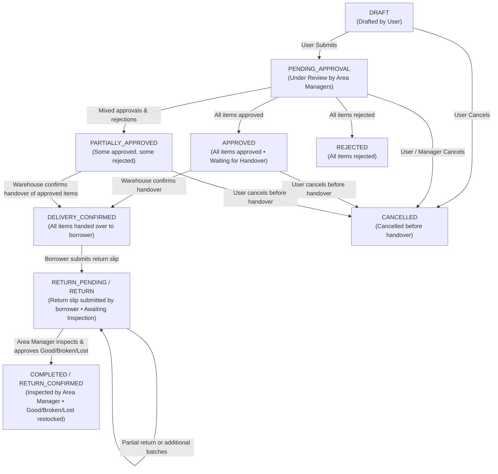
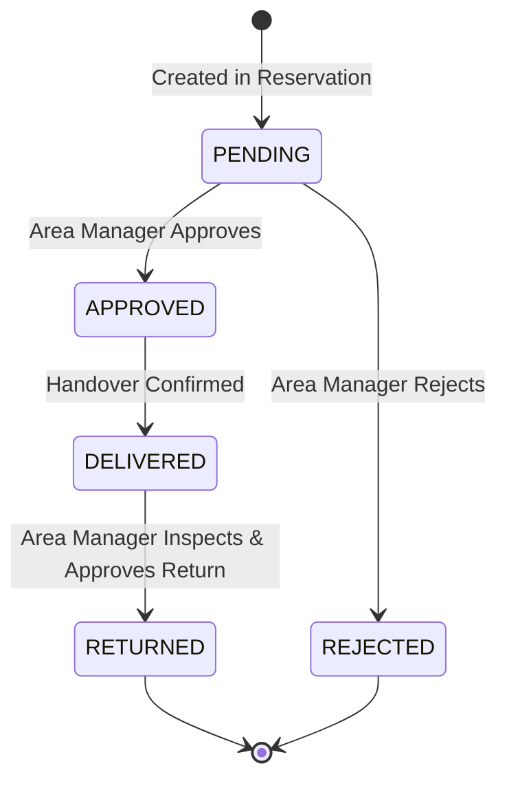
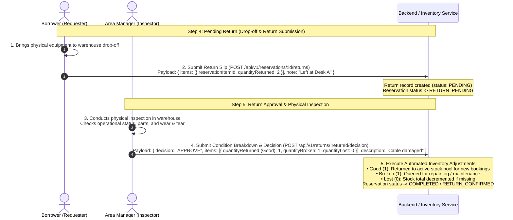

# Asset Reservation System: Lifecycle, Actors, States & Flow Specification

This document provides the technical specification and workflow guide for the Asset Reservation & Return system. It details the **5-step lifecycle**, **actors & permissions**, **state machines**, **UI manifest interactions**, and **underlying algorithms** for conflict detection, asset locking, delivery confirmation (handover), and return inspection (Good, Broken, Lost).

---

## 1. 5-Step Lifecycle Overview

The complete reservation lifecycle consists of 5 sequential phases:



| Step | Phase Name | Primary Actor | Action Summary | Status Badge & Theme |
| :---: | :--- | :--- | :--- | :--- |
| **1** | **Drafted & Created** | Requester / User | Select dates & equipment items, add co-participants, submit draft. | `DRAFT` / `PENDING_APPROVAL` (Yellow/Slate) |
| **2** | **Area Approvals** | Area Manager(s) | Review requested items in Reserved Equipment Manifest, adjust approval quantities, approve or reject. | `PENDING_APPROVAL` → `APPROVED` (Blue) |
| **3** | **Equipment Handover** | Warehouse Staff / Requester | Physical pickup at warehouse. Confirm handover of approved items. | `APPROVED` (Blue) → `DELIVERY_CONFIRMED` (Green) |
| **4** | **Pending Return** | Requester / Borrower | Equipment in use. At event conclusion, borrower returns equipment to warehouse and submits return slip with quantities and drop-off notes. | `DELIVERY_CONFIRMED` / `RETURN_PENDING` (Amber/Orange) |
| **5** | **Return Approval & Inspection** | Area Manager (Inspector) | Physically inspect returned items in warehouse. Record condition breakdown (**Good**, **Broken**, **Lost**), add remarks, and approve restock. | `RETURN_PENDING` → `COMPLETED` / `RETURN_CONFIRMED` (Green) |

---

## 2. Actors, Roles & Permission Matrix

| Actor / Role | Scoped Permissions | Who Requests? | Who Actions? | Permitted Actions |
| :--- | :--- | :---: | :---: | :--- |
| **Requester** *(Borrower / User)* | `reservation:create`<br>`reservation:update` | **Yes** | **Yes** | • Create draft / submit reservation.<br>• Submit change requests (dates, items, participants).<br>• Confirm equipment handover (`DELIVERED`).<br>• **Submit return slip with item quantity and drop-off notes**.<br>• Cancel reservation before pickup. |
| **Co-Participant** *(User)* | Linked in `ReservationParticipant` | No | **Yes** | • View reservation details.<br>• Submit return slip on behalf of requester. |
| **Area Manager** *(Asset Custodian)* | `reservation:approve`<br>`reservation:reject`<br>`return:approve`<br>*(Scoped by Management Area)* | No | **Yes** | • Review & approve/reject items belonging to their area.<br>• Adjust approved item quantities.<br>• Review & approve/reject change requests.<br>• **Physically inspect equipment and record Good, Broken, and Lost quantities** in manifest checklist.<br>• Approve/reject return slips (triggers automated inventory updates). |
| **Admin** | Global system access | **Yes** | **Yes** | • Global override across all management areas.<br>• Force cancellation, approval, or inventory correction. |

---

## 3. State Machines

### 3.1 Reservation Lifecycle State Diagram



### 3.2 Line-Item Lifecycle



---

## 4. Unified Manifest Interaction Model

All operational lifecycle actions are consolidated into the **Reserved Equipment Manifest** for consistency:

```
┌────────────────────────────────────────────────────────────────────────────────────────┐
│ Reserved Equipment Manifest (Uniform Manifest Interaction)                            │
├────────────────────────────────────────────────────────────────────────────────────────┤
│ 1. Area Approval Mode:                                                                 │
│    • Top Bar: [Remark input] [Approve Selected] [Reject Selected]                      │
│    • Row: [✓] [Image] [Name + Area] [Approve Qty / Total] [Pending Badge]              │
│                                                                                        │
│ 2. Handover Mode:                                                                      │
│    • Top Bar: [Confirm Handover (X items)]                                             │
│    • Row: [✓] [Image] [Name + Area] [Qty units] [Approved Badge]                       │
│                                                                                        │
│ 3. Pending Return Mode (Borrower Submission):                                          │
│    • Top Bar: [Drop-off note input] [Submit Return (X items)]                          │
│    • Row: [✓] [Image] [Name + Area] [Return Qty / Remaining] [Pending Return Badge]   │
│                                                                                        │
│ 4. Return Approval & Inspection Mode (Area Manager Inspection):                        │
│    • Top Bar: [Inspection remarks] [Approve Return] [Reject Return]                    │
│    • Grid Header: [✓] [Image] [Equipment & Area] [Good] [Broken] [Lost]                │
│    • Row: [✓] [Image] [Name + Area] [Good input] [Broken input] [Lost input]           │
└────────────────────────────────────────────────────────────────────────────────────────┘
```

---

## 5. Return & Inspection Flow (Step 4 vs. Step 5)

The return workflow strictly separates **Borrower Submission** from **Custodian Inspection**:



### Condition Classification Matrix

| Condition | Form Field | Color Indicator | Warehouse Inventory Effect |
| :--- | :--- | :---: | :--- |
| **Good** | `quantityReturned` | 🟢 Green | Restocked into available inventory pool for new bookings. |
| **Broken** | `quantityBroken` | 🟡 Amber | Logged into repair/maintenance queue; master stock total maintained. |
| **Lost** | `quantityLost` | 🔴 Red | Decremented from total warehouse catalog stock (`totalQuantity -= lost`). |

---

## 6. Algorithms & Business Logic

### 6.1 Conflict Detection & Overlap Calculation

When a reservation is submitted, updated, or approved, the system evaluates time overlap against existing approved bookings:

$$\text{Existing.start\_at} < \text{Requested.end\_at} \quad\land\quad \text{Existing.end\_at} > \text{Requested.start\_at}$$

```ts
// Sum overlapping approved reservations
const approvedQuantity = overlappingItems
  .filter(item => 
    ['APPROVED', 'PREPARED', 'CHECKED_OUT', 'DELIVERED'].includes(item.status) &&
    ['APPROVED', 'PARTIALLY_APPROVED', 'DELIVERY_CONFIRMED', 'ACTIVE', 'RETURN_PENDING'].includes(item.reservation.status)
  )
  .reduce((sum, item) => sum + item.quantity, 0);

// Available headroom
const availableQuantity = Math.max(0, asset.totalQuantity - approvedQuantity);

if (requestedQuantity > availableQuantity) {
  throw new ApiException(409, "RESERVATION_CONFLICT", `Only ${availableQuantity} units available.`);
}
```

---

## 7. API Endpoint Reference

| Step | Endpoint | Method | Required Permission | Payload Summary | Result State |
| :---: | :--- | :---: | :--- | :--- | :--- |
| **1** | `/api/v1/reservations` | `POST` | User (`reservation:create`) | `{ eventName, startAt, endAt, items, participantIds }` | `DRAFT` / `PENDING_APPROVAL` |
| **2** | `/api/v1/reservations/:id/items/decision` | `POST` | Area Manager (`reservation:approve`) | `{ itemIds: [...], decision: 'APPROVE' \| 'REJECT', comment? }` | Items: `APPROVED`/`REJECTED`<br>Res: `APPROVED` |
| **3** | `/api/v1/reservations/:id/delivery-confirm` | `POST` | Requester / Staff | `{ itemIds?: [...] }` | Items: `DELIVERED`<br>Res: `DELIVERY_CONFIRMED` |
| **4** | `/api/v1/reservations/:id/returns` | `POST` | Requester / Participant | `{ items: [{ reservationItemId, quantityReturned }], note? }` | Return: `PENDING`<br>Res: `RETURN_PENDING` |
| **5** | `/api/v1/returns/:returnId/decision` | `POST` | Area Manager (`return:approve`) | `{ decision: 'APPROVE' \| 'REJECT', items: [{ reservationItemId, quantityReturned, quantityBroken, quantityLost, description? }], description? }` | Return: `COMPLETED`<br>Res: `COMPLETED` |
| **—** | `/api/v1/reservations/:id/cancel` | `POST` | Requester / Admin | `{ reason? }` | `CANCELLED` |
