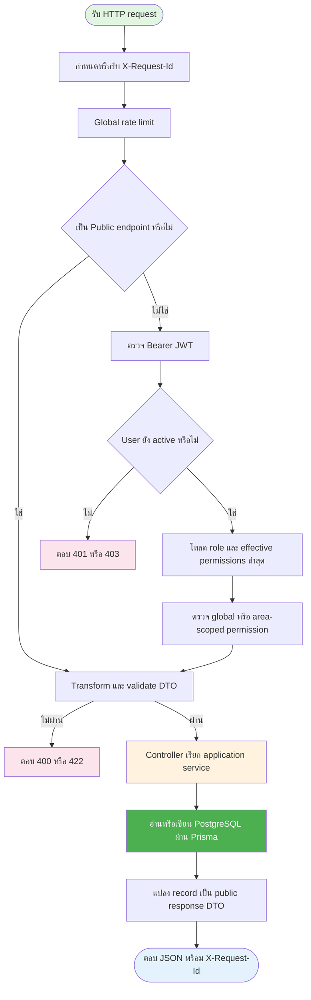

# API algorithms and validation

[← Backend specification](README.md) · [Auth and permission API](auth-and-permission-api.md) · [Database and concurrency](database-and-concurrency.md)

เอกสารนี้อธิบาย algorithm ของ endpoint ที่มี implementation อยู่ใน `backend/src` โดยยึด controller, service, guard และ DTO ใน source code เป็นหลัก สำหรับรายชื่อ endpoint ทั้งหมด, path และ request/response shape ให้ดู [`contracts/openapi.yaml`](contracts/openapi.yaml) และ [`contracts/paths/`](contracts/paths/) — เอกสารนี้ไม่ซ้ำ endpoint catalog แต่ระบุ path ที่เกี่ยวข้องไว้ในหัวข้อย่อยแทน

สำหรับความหมายทางธุรกิจของ status และ lifecycle (เช่น เหตุผลที่ reservation เปลี่ยนเป็น `PARTIALLY_APPROVED`) ให้ดู [software_spec/lifecycle-and-state-machines.md](../software_spec/lifecycle-and-state-machines.md) เอกสารนี้อธิบายเฉพาะว่า backend คำนวณ/บังคับ transition เหล่านั้นอย่างไร

## 1. กติกากลางของทุก request

### 1.1 Request pipeline



ลำดับกลางมีรายละเอียดดังนี้:

1. Fastify กำหนด request ID ใหม่ หรือยอมรับ `X-Request-Id` ที่ตรงรูปแบบ `[A-Za-z0-9._:-]{1,128}`
2. Throttler จำกัดค่าเริ่มต้น 100 requests ต่อนาที ส่วน login จำกัด 10 requests ต่อนาที
3. ยกเว้น `POST /auth/login` ทุก endpoint ต้องส่ง `Authorization: Bearer <accessToken>`
4. Authentication guard ตรวจลายเซ็นและอายุ JWT จากนั้นใช้ `sub` โหลด user, profile, role และ management-area assignment ใหม่จากฐานข้อมูลทุก request
5. Account ที่ inactive ถูกปฏิเสธก่อนเข้า controller
6. Validation pipe ทำ type transformation, ลบ field ที่ไม่อยู่ใน DTO และปฏิเสธ unknown field ด้วย `422 VALIDATION_ERROR`
7. Service ตรวจ permission และ business invariant เพิ่มเติมก่อนอ่านหรือเขียนข้อมูล
8. Exception filter แปลง error เป็นรูปแบบเดียวกันและส่ง request ID กลับทั้ง header และ body

### 1.2 Authentication และ permission scope

Effective permission ของผู้ใช้คำนวณดังนี้:

- Role assignment ที่ `managementAreaId = null` ให้ global permission
- Role assignment ที่มี `managementAreaId` ให้ permission เฉพาะ area นั้น
- Permission ที่มีผลใน area คือ union ระหว่าง global permission กับ scoped permission ของ area
- Frontend ใช้ `capabilities` เพื่อแสดงหรือซ่อน UI ได้ แต่ backend ตรวจ permission ซ้ำทุก request

Permission key ที่มีอยู่ในระบบและความหมายเชิงธุรกิจของแต่ละ key เป็นของ [software_spec/permissions-and-rbac.md](../software_spec/permissions-and-rbac.md) — algorithm นี้เพียงคำนวณ union ของ scope เท่านั้น

### 1.3 Validation และชนิดข้อมูล

| รายการ             | กติกา                                            |
| ------------------ | ------------------------------------------------ |
| ID                 | UUID และ path parameter ตรวจด้วย `ParseUUIDPipe` |
| Date/time          | ISO 8601 พร้อม timezone                          |
| JSON field         | camelCase                                        |
| Unknown body field | ปฏิเสธด้วย `422 VALIDATION_ERROR`                |
| Pagination limit   | ค่าเริ่มต้น 20, ต่ำสุด 1, สูงสุด 100             |
| Search             | trim ช่องว่างและยาวไม่เกิน 100 ตัวอักษร          |
| Picture            | รับ URL ไม่ได้รับ binary upload โดยตรง           |

### 1.4 Cursor pagination algorithm

Endpoint แบบ list ใช้ keyset pagination ร่วมกัน:

1. Decode `cursor` จาก Base64URL เป็น `{ createdAt, id }`
2. ถ้า decode ไม่ได้หรือวันที่ไม่ถูกต้อง ตอบ `400 INVALID_REQUEST`
3. Query แถวที่เก่ากว่า cursor ด้วยเงื่อนไข `createdAt < cursor.createdAt` หรือวันที่เท่ากันแต่ `id < cursor.id`
4. เรียง `createdAt DESC, id DESC`
5. อ่าน `limit + 1` แถวเพื่อรู้ว่ายังมีหน้าถัดไปหรือไม่
6. คืนเพียง `limit` แถว และ encode แถวสุดท้ายเป็น `pageInfo.nextCursor`

### 1.5 Optimistic concurrency

Endpoint ที่รับ `expectedUpdatedAt` ใช้ค่านี้ในเงื่อนไข update:

```text
UPDATE ... WHERE id = :id AND updated_at = :expectedUpdatedAt
```

ถ้าแก้ไขได้ 0 แถว หมายถึงข้อมูลถูกเปลี่ยนหลัง client โหลดมา ระบบตอบ `409 STALE_WRITE` เพื่อให้ client reload ก่อนบันทึกอีกครั้ง สำหรับ retry policy ของ transaction conflict ให้ดู [database-and-concurrency.md](database-and-concurrency.md)

### 1.6 Error response

```json
{
  "error": {
    "code": "VALIDATION_ERROR",
    "message": "The request contains invalid fields.",
    "fields": {
      "name": "name must be shorter than or equal to 40 characters"
    },
    "requestId": "b8cdfa2d-07b2-41df-9bed-7d77998acf08"
  }
}
```

Error กลางที่พบบ่อย:

| HTTP | Code                      | ความหมาย                                        |
| ---- | ------------------------- | ----------------------------------------------- |
| 400  | `INVALID_REQUEST`         | Path/query/cursor ไม่ถูกต้อง                    |
| 401  | `AUTHENTICATION_REQUIRED` | ไม่มี token, token หมดอายุ หรือตรวจสอบไม่ได้    |
| 403  | `ACCOUNT_INACTIVE`        | Account ถูกปิดใช้งาน                            |
| 403  | `PERMISSION_DENIED`       | ไม่มี global หรือ scoped permission ที่ต้องใช้  |
| 409  | `STALE_WRITE`             | `expectedUpdatedAt` ไม่ตรงข้อมูลล่าสุด          |
| 409  | `CONCURRENT_MODIFICATION` | Database transaction ชนกับ request อื่น         |
| 422  | `VALIDATION_ERROR`        | Body หรือ query ไม่ผ่าน DTO/business validation |
| 429  | `RATE_LIMITED`            | เรียก API เกิน rate limit                       |
| 500  | `INTERNAL_ERROR`          | Error ที่ไม่ได้ map เป็น domain error           |

Endpoint-specific error code (เช่น `USERNAME_ALREADY_EXISTS`, `LAST_GLOBAL_ADMIN`) ระบุไว้ในหัวข้อ algorithm ของ endpoint นั้น และต้องตรงกับ `contracts/components/schemas/` — ห้ามเพิ่ม error code ใหม่ในเอกสารนี้โดยไม่เพิ่มใน OpenAPI contract ด้วย

Documentation route (`GET /api/docs`, `GET /api/docs/openapi.json`) สร้างโดย Swagger module โดยตรงจาก `contracts/dist/openapi.bundle.yaml` (สร้างผ่าน `npm run openapi:bundle`) ไม่ผ่าน controller หากไม่พบไฟล์ bundle ตอน startup ระบบจะ log warning และไม่เปิด Swagger UI สำหรับ Docker development ให้เปิด `http://localhost:${BACKEND_HOST_PORT}/api/docs`

## 2. Authentication และ session APIs

### 2.1 `POST /auth/login`

สถานะสำเร็จ: `200 OK` · Authorization: Public · Input: `username`, `password`

Algorithm:

1. Normalize username ด้วย trim และแปลงเป็นตัวพิมพ์เล็ก
2. ตรวจความยาว username ไม่เกิน 50 และ password ยาว 1–1024 ตัวอักษร
3. ค้น user ด้วย username
4. ถ้าไม่พบ user ให้ verify password เทียบ dummy Argon2 hash เพื่อลดความแตกต่างของ response timing ระหว่าง user ที่มีและไม่มีจริง
5. Verify password ด้วย Argon2; ถ้าไม่ผ่านตอบ `401 INVALID_CREDENTIALS`
6. ตรวจ `User.isActive`; ถ้าปิดอยู่ตอบ `403 ACCOUNT_INACTIVE`
7. โหลด profile, role assignments, role permissions และ management areas
8. คำนวณ global/scoped effective permissions และเรียง role ให้ผลลัพธ์คงที่
9. สร้าง JWT ที่มี `sub = userId` และ `jti` แบบ UUID โดยใช้อายุจาก `JWT_ACCESS_TTL_SECONDS`
10. คืน `accessToken`, `tokenType`, `expiresIn` และ `session`

### 2.2 `GET /auth/google/login` · `GET /auth/microsoft/login`

สถานะสำเร็จ: `302` redirect ไปหน้า consent ของ provider · Authorization: Public

วิธี login ทางเลือกสำหรับ user ที่ link บัญชี provider นั้นไว้แล้วเท่านั้น — ไม่มี auto-provisioning ด้วย email ถ้า identity ยังไม่ได้ link จะ redirect กลับไป `/login` พร้อม `?googleError=not_linked` หรือ `?microsoftError=not_linked` รายละเอียดเต็มอยู่ที่ [integrations/google-microsoft-auth-and-notifications.md](integrations/google-microsoft-auth-and-notifications.md) และ [integrations/oauth-setup.md](integrations/oauth-setup.md)

### 2.3 `GET /auth/me` · `GET /bff/session`

สถานะสำเร็จ: `200 OK` · Authorization: Active user

1. Authentication guard ตรวจ JWT และโหลด user/role ล่าสุดจากฐานข้อมูล
2. สร้าง session context ที่มี user, role assignments, global permissions และ permissions แยกตาม area
3. คำนวณ `linkedProviders` (provider ที่ user คนนี้ link ไว้จริง) และ `accountLinkRequired` (derive จาก `REQUIRE_ACCOUNT_LINK` + มี provider config หรือไม่ — ดู [integrations/oauth-setup.md §1](integrations/oauth-setup.md#1-how-the-mode-toggle-works)) เป็น field บังคับใน `SessionUser` ทั้งสอง endpoint
4. คืน `{ session: actor }`

`GET /bff/session` ใช้ algorithm เดียวกัน เป็น BFF-facing alias สำหรับ frontend shell

### 2.4 `POST /auth/logout`

สถานะสำเร็จ: `204 No Content` · Authorization: Active user

Server ไม่ได้เก็บ token blacklist หรือ refresh-token session ใน implementation ปัจจุบัน ดังนั้น client ต้องลบ access token เอง และ token เดิมยังใช้ได้จนหมดอายุหากยังถูกเก็บไว้

## 3. Permission และ role APIs

### 3.1 `GET /permissions`

Authorization: Active user

1. อ่าน immutable permission catalog จาก application constant ไม่ query ตาราง permission
2. Map แต่ละรายการเป็น `key`, `resource`, `action`, `description`
3. คืน `{ data: Permission[] }`

### 3.2 `GET /roles`

Authorization: Active user

1. Query roles เรียงตามชื่อจากน้อยไปมาก
2. Normalize permissions โดยตัดค่าที่ไม่อยู่ใน catalog, ตัดค่าซ้ำ และเรียงตามตัวอักษร
3. แปลงวันที่เป็น ISO 8601
4. คืน `{ data: Role[] }`

### 3.3 `POST /roles`

Global ADMIN ส่ง name, description และ permission set ระบบ trim ชื่อ ตรวจ unique แบบ case-insensitive, normalize permission dependencies และบันทึกชื่อเป็น uppercase ถ้าชื่อซ้ำตอบ 409

### 3.4 `PATCH /roles/:roleId`

Authorization: ต้องมี global role ชื่อ `ADMIN`; area-scoped ADMIN ไม่เพียงพอ · Input: `description?`, `permissions?`, `expectedUpdatedAt`

1. ตรวจ `roleId` เป็น UUID และ body ตาม DTO
2. บังคับให้ส่ง field ที่แก้ได้อย่างน้อยหนึ่งค่า
3. ค้น role; ถ้าไม่พบตอบ `404 ROLE_NOT_FOUND`
4. Normalize permission set
5. ถ้าแก้ role `ADMIN` ต้องคง `user:disable` และ `role:assign`; มิฉะนั้นตอบ `422 VALIDATION_ERROR`
6. Update ด้วยเงื่อนไข `id + expectedUpdatedAt`
7. ถ้าไม่มีแถวถูกแก้ ตอบ `409 STALE_WRITE`
8. โหลด role ล่าสุด, normalize และคืน response

## 4. User administration APIs

`Global user-admin permission` หมายถึงมีอย่างน้อยหนึ่ง permission จาก `user:create`, `user:disable`, `role:assign` ใน global scope

### 4.1 `GET /users`

Authorization: Global user-admin permission · Query: `search?`, `isActive?`, `roleId?`, `areaId?`, `cursor?`, `limit?`

1. Decode cursor และสร้าง filter ตาม query ที่ส่งมา
2. Search แบบ case-insensitive จาก email หรือ profile name
3. ถ้ามี `roleId`/`areaId` ใช้ relation filter หา user ที่มี role assignment ตรงเงื่อนไข
4. Query `limit + 1` เรียง `createdAt DESC, id DESC`
5. Include profile, distinct role references และนับจำนวน role assignments เพื่อรองรับ multi-role filter ใน frontend
6. สร้าง `pageInfo` ตาม cursor algorithm
7. คืน user summary พร้อม `roleCount` และ `roles`

### 4.2 `POST /users`

Authorization: Global `user:create` · Input: `username`, `password`

1. Normalize username ด้วย trim และ lowercase; validate ตรง `^[a-z0-9._-]{3,50}$`; validate password 8–128 ตัวอักษร
2. Hash password ด้วย Argon2
3. สร้าง UUID และ insert `User` โดย `email = null`, ไม่มี `UserProfile` ตอนสร้าง — ทั้งสองถูกเติมทีหลังตอน link บัญชี
4. Include profile (จะเป็น `null`), auth identity และ role assignments เพื่อสร้าง user detail response
5. ถ้า username ซ้ำ ตอบ `409 USERNAME_ALREADY_EXISTS`

### 4.3 `GET /users/:userId`

1. ตรวจ `userId` เป็น UUID
2. Query user พร้อม profile, auth providers และ role assignments
3. แต่ละ assignment include role, management area และผู้มอบ role
4. รวม provider จาก password และ external identities แล้วตัดค่าซ้ำ/เรียง
5. ถ้าไม่พบ user ตอบ `404 USER_NOT_FOUND`; มิฉะนั้นคืน user detail

### 4.4 `PATCH /users/:userId/status`

Authorization: Global `user:disable` · Input: `isActive`, `expectedUpdatedAt`

1. ป้องกัน actor ปิด account ของตนเองด้วย `409 SELF_DEACTIVATION_NOT_ALLOWED`
2. เปิด Serializable transaction
3. ค้น target user; ถ้าไม่พบตอบ `404 USER_NOT_FOUND`
4. ถ้ากำลังปิด active user ให้ตรวจว่า target เป็น global ADMIN หรือไม่
5. ถ้าเป็น global ADMIN และเหลือ active global ADMIN ไม่เกินหนึ่งคน ตอบ `409 LAST_GLOBAL_ADMIN`
6. Update status ด้วย `id + expectedUpdatedAt`; ถ้าไม่ตรงตอบ `409 STALE_WRITE`
7. Commit transaction แล้วโหลด user detail ล่าสุดกลับไป

### 4.5 `POST /users/:userId/role-assignments`

Authorization: Global `role:assign` · Input: `roleId`, `managementAreaId` ซึ่งเป็น UUID หรือ `null`

1. Query target user, role และ management area แบบขนาน
2. ถ้าไม่พบ resource ใด ตอบ `USER_NOT_FOUND`, `ROLE_NOT_FOUND` หรือ `MANAGEMENT_AREA_NOT_FOUND`
3. สร้าง UUID ของ assignment และบันทึก `assignedBy` จาก actor; client เลือกผู้มอบ role ไม่ได้
4. `managementAreaId = null` สร้าง global assignment ส่วน UUID สร้าง scoped assignment
5. Database partial unique indexes ป้องกัน role/scope ซ้ำ
6. ถ้าซ้ำ ตอบ `409 ROLE_ASSIGNMENT_ALREADY_EXISTS`
7. คืน assignment พร้อม role, area และผู้มอบ role

### 4.6 `DELETE /users/:userId/role-assignments/:assignmentId`

Authorization: Global `role:assign`

1. เปิด Serializable transaction
2. ค้น assignment ด้วยทั้ง `assignmentId` และ `userId` เพื่อป้องกันลบ assignment ของ user คนอื่นจาก path ที่ไม่ตรงกัน
3. ถ้าไม่พบ ตอบ `404 ROLE_ASSIGNMENT_NOT_FOUND`
4. ถ้าเป็น global ADMIN ของ active user ให้นับ active global admins
5. ถ้าเป็นคนสุดท้าย ตอบ `409 LAST_GLOBAL_ADMIN`
6. ลบ assignment และ commit; response ไม่มี body

## 5. Management area API

### 5.1 `GET /management-areas`

Authorization: Active user · Query: `search?`, `cursor?`, `limit?`

1. Decode cursor
2. ถ้ามี search ให้ค้น name/description แบบ case-insensitive
3. Query `limit + 1` เรียง `createdAt DESC, id DESC`
4. สร้าง cursor ของหน้าถัดไปและคืน `{ data, pageInfo }`

หมายเหตุ: endpoint ปัจจุบันเป็น lookup list และไม่ได้กรองตาม management-area assignments ของ actor

### 5.2 `GET /management-areas/:id`

Global ADMIN เท่านั้น คืน metadata พร้อม `assetCount` และ `userRoleCount`; UUID ไม่ถูกต้องตอบ 400 และไม่พบตอบ 404

### 5.3 `POST /management-areas`

Global ADMIN เท่านั้น รับ name ที่ trim แล้วและ description optional ตรวจชื่อ unique ก่อนสร้าง UUID/timestamps ชื่อซ้ำตอบ 409

### 5.4 `PATCH /management-areas/:id`

Global ADMIN เท่านั้น แก้เฉพาะ field ที่ส่งมา ตรวจชื่อซ้ำและอัปเดต `updatedAt`

### 5.5 `DELETE /management-areas/:id`

Global ADMIN เท่านั้น ปฏิเสธเมื่อ area ยังมี asset แล้วลบ record; relation constraint อื่นยังเป็น database safety net

## 6. Asset APIs

### 6.1 Asset summary algorithm

หลาย endpoint คืน asset summary โดยใช้กติกาเดียวกัน:

1. `unitCounts` คำนวณจากการนับแถว `AssetUnit` ของ asset นั้น แยกตาม status (`ACTIVE`, `RESERVED`, `CHECKED_OUT`, `BROKEN`, `LOST`, `IN_REPAIR`, `INACTIVE`) ด้วย `groupBy` — ไม่มี quantity column เก็บไว้ที่ `Asset`
2. `totalQuantity = unitCounts.total` (นับทุก unit ยกเว้น `INACTIVE`)
3. `allocatedQuantity` คือจำนวน `AssetUnit` คนละตัวที่มี assignment สถานะ active (`ASSIGNED` หรือ `CHECKED_OUT`) overlap ช่วงเวลาที่ถาม โดยนับ serial เดิมเพียงครั้งเดียวแม้มีหลาย assignment
4. เมื่อไม่ส่ง date range: `availableQuantity = unitCounts.active`; เมื่อส่ง date range: `availableQuantity = max(unitCounts.active + unitCounts.reserved + unitCounts.checkedOut - allocatedQuantity, 0)` เพื่อคง unit ที่ถูกกันสิทธิ์อยู่ใน schedulable pool ก่อนหักเฉพาะ serial ที่ไม่ว่างจริง และไม่เคยนับ `BROKEN`/`LOST`/`IN_REPAIR`/`INACTIVE` เป็น capacity
5. `isActive` เป็น boolean ตรงๆ บน `Asset`; status ระดับ asset ไม่มีแล้ว — status ย้ายไปอยู่ระดับ `AssetUnit` แต่ละชิ้น
6. `owner` มาจาก `Asset.createdBy`; asset เก่าก่อนมี creator tracking อาจเป็น `null`
7. `capabilities` คำนวณเฉพาะ actor ปัจจุบันจาก permission ใน management area ของ asset

### 6.2 `GET /assets`

Authorization: Scoped `asset:view` · Query: `search?`, `areaId?`, `isActive?`, `cursor?`, `limit?`

1. หา area ที่ actor มี `asset:view`; global permission หมายถึงทุก area
2. ถ้าไม่มี view permission เลย ตอบ `403 PERMISSION_DENIED`
3. ถ้าระบุ `areaId` ที่อยู่นอก scope ตอบ `403`
4. สร้าง filter จาก area scope, `isActive`, search (ครอบคลุม `partNumber` ด้วย) และ cursor
5. Query assets `limit + 1` พร้อม management area และ owner
6. Query unit counts (`groupBy` บน `AssetUnit.status`) และ allocated quantities ของ asset ทั้งหน้าแบบ `GROUP BY assetId` ครั้งเดียว เพื่อหลีกเลี่ยง N+1
7. คำนวณ available quantity/capabilities และคืน `{ data, pageInfo }`

### 6.3 `POST /assets`

Authorization: Scoped `asset:create` ของ management area · Input: `name`, `managementAreaId`, `partNumber?`, `description?`, `pictureUrl?`, `isActive?`

1. Validate ชื่อไม่ว่างและยาวไม่เกิน 40 ตัวอักษร, `partNumber` ไม่เกิน 100 ตัวอักษร และ picture เป็น URL
2. เรียก batch-create algorithm ด้วยรายการเดียว
3. บันทึก actor เป็น `createdById`; client ระบุ owner เองไม่ได้
4. Asset ถูกสร้างโดยไม่มี unit ใดๆ (0 units) เสมอ — การลงทะเบียนหน่วยจริงทำแยกผ่าน `POST /assets/:assetId/units` (§6.6)
5. คืน asset summary; ถ้าชื่อซ้ำภายใน area ตอบ `409 ASSET_NAME_ALREADY_EXISTS`

### 6.4 `POST /assets/batch`

Authorization: Scoped `asset:create` ครบทุก management area ใน batch · Input: `items` 1–100 รายการ และ `description?`

1. ปฏิเสธชื่อ asset ซ้ำภายใน management area เดียวกันใน request
2. ตรวจ `asset:create` ทีละ item ก่อนเขียนข้อมูล
3. Query ตรวจ management areas ทั้งหมดแบบ batch
4. เตรียม UUID, owner และ default `isActive = true`
5. Insert assets ทั้งหมดด้วย `createMany` (ไม่มี unit/ledger เกี่ยวข้อง เพราะยังไม่มี unit ให้ลงทะเบียน)
6. โหลด asset ที่สร้างทั้งหมดกลับไป; ถ้าบรรทัดใดล้มเหลวทั้ง batch rollback
7. เรียง response ตามลำดับ input เดิม

### 6.5 `POST /assets/batch-remove`

Authorization: Scoped `asset:delete` ครบทุก asset · Input: `items` 1–100 รายการ แต่ละรายการมี `assetId`, `expectedUpdatedAt`

1. ปฏิเสธ asset ID ซ้ำใน request
2. Query assets ทั้งหมดและตรวจว่าพบครบ; ถ้าไม่ครบตอบ `404 ASSET_NOT_FOUND`
3. ตรวจ `asset:delete` ตาม area ของทุก asset
4. เรียง asset ตาม UUID เพื่อให้ลำดับ update คงที่
5. เปิด transaction แล้ว update `isActive = false` ทีละรายการด้วย optimistic concurrency
6. ถ้ารายการใด stale ให้ rollback ทั้ง batch และตอบ `409 STALE_WRITE`
7. คืน ID และ status `INACTIVE` ของทุก asset

เส้นนี้เป็น soft removal เพื่อรักษา reservation relation, unit และ unit event history ไม่ได้ลบ row จริง

### 6.6 `POST /assets/:assetId/units` — ลงทะเบียนหน่วยใหม่ (register)

Authorization: Scoped `asset:update` · Input: `serialNumbers` 1–200 รายการ (unique ทั้งใน request และเทียบกับฐานข้อมูล), `reason?`

1. Trim และตรวจ serial number แต่ละตัวไม่ว่าง ไม่เกิน 100 ตัวอักษร และไม่ซ้ำกันเองใน request
2. ตรวจ `asset:update` ใน area ของ asset
3. สร้าง `AssetUnitEventBatch` หนึ่งรายการ (`performedBy` = actor)
4. สร้าง `AssetUnit` หนึ่งแถวต่อ serial number ด้วย `status = ACTIVE`
5. สร้าง `AssetUnitEvent` หนึ่งรายการต่อ unit (`eventType = REGISTERED`, `toStatus = ACTIVE`) ผูกกับ batch เดียวกัน
6. ถ้า serial number ใดชนกับที่มีอยู่แล้ว (`serial_number` เป็น unique ทั้งระบบ) ตอบ `409 SERIAL_NUMBER_ALREADY_EXISTS`
7. คืนรายการ `AssetUnit` ที่สร้าง

### 6.7 `GET /assets/:assetId/units` — ดูรายการ unit ของ asset

Authorization: Scoped `asset:view` · Query: `status?`, `from?`, `to?`, `search?`, `cursor?`, `limit?` — คืนแบบ paginated เหมือน list endpoint อื่นๆ ถ้าส่งช่วงเวลาต้องส่งทั้ง `from` และ `to` และ `to > from`; ระบบคืนเฉพาะ unit ที่สถานะทางกายภาพอยู่ใน schedulable pool และไม่มี `ASSIGNED`/`CHECKED_OUT` assignment ที่ overlap ด้วยเงื่อนไข `assignmentStartAt < to AND assignmentEndAt > from`

### 6.8 `POST /assets/units/batch-retire` — ปลดระวางหน่วย

Authorization: Scoped `asset:update` ตาม area ของแต่ละ unit · Input: `items` 1–200 รายการ แต่ละรายการมี `assetUnitId`, `expectedUpdatedAt`; มี `reason?` ระดับ batch

1. โหลด unit ทั้งหมดตาม ID พร้อม asset/area และเรียงตาม UUID เพื่อลด deadlock
2. ตรวจ `asset:update` ตาม area ของทุก unit
3. ภายใน serializable transaction ให้ lock unit แล้วปฏิเสธ (`409`) เมื่อสถานะทางกายภาพเป็น legacy `RESERVED`/`CHECKED_OUT` หรือมี `ReservationItemUnit` สถานะ `ASSIGNED`/`CHECKED_OUT` อยู่ในปัจจุบันหรืออนาคต
4. เปลี่ยน `status = INACTIVE` ทีละ unit ด้วย optimistic concurrency (`expectedUpdatedAt`); stale ตอบ `409 STALE_WRITE`
5. เขียน `AssetUnitEvent` (`eventType = RETIRED`) หนึ่งรายการต่อ unit ใน `AssetUnitEventBatch` เดียวกัน
6. คืนรายการ unit ที่ปลดระวางแล้ว

### 6.9 `PATCH /assets/units/:assetUnitId/status` — ปรับสถานะ unit ด้วยมือ

Authorization: Scoped `asset:update` ใน area ของ unit · Input: `status` (จำกัดเฉพาะ `ACTIVE`, `BROKEN`, `LOST`, `IN_REPAIR`, `INACTIVE` — `CHECKED_OUT` ระบบจัดการผ่าน handover/return และ `RESERVED` เป็น legacy compatibility เท่านั้น), `reason?`, `expectedUpdatedAt`

1. โหลด unit; ถ้าไม่พบตอบ `404`
2. ตรวจ `asset:update` ใน area ของ asset ที่ unit สังกัด
3. ถ้าเปลี่ยนเป็น `INACTIVE` ให้ปฏิเสธเมื่อมี current/future assignment ที่ยัง active จากนั้น update `status` ด้วย optimistic concurrency; stale ตอบ `409 STALE_WRITE`
4. เขียน `AssetUnitEvent` (`eventType = ADJUSTMENT`, `fromStatus`/`toStatus` ตามการเปลี่ยน) ใน batch ใหม่หนึ่งรายการ
5. คืน unit ล่าสุด

### 6.10 `GET /assets/:assetId`

Authorization: Scoped `asset:view`

1. Query asset พร้อม area, owner, unit สูงสุด 500 แถว (เรียงตาม serial number), reservation items ที่ยัง allocate quantity
2. ถ้าไม่พบตอบ `404 ASSET_NOT_FOUND`
3. ตรวจ `asset:view` ใน area หลังทราบ scope ของ asset
4. รวม unit counts (นับจาก unit ที่โหลดมา), allocated quantity และคำนวณ available quantity
5. Query `AssetUnitEvent` 50 รายการล่าสุดของ unit ทุกตัวใน asset นี้ เป็น unit event ledger
6. Query roles ทั้งหมดแล้วเลือก role ที่ permission set ปัจจุบันมี `asset:update` เป็น `editPolicy.roles`
7. คืน asset detail, actor capabilities, unit รายชิ้น, active reservation items และ unit event ledger พร้อมผู้ดำเนินการ

### 6.11 `PATCH /assets/:assetId`

Authorization: Scoped `asset:update` · Input: field ที่แก้ได้อย่างน้อยหนึ่งค่าจาก `name`, `managementAreaId`, `partNumber`, `description`, `pictureUrl` และต้องมี `expectedUpdatedAt`

1. ค้น asset; ถ้าไม่พบตอบ `404 ASSET_NOT_FOUND`
2. ตรวจ `asset:update` ใน area เดิม
3. ถ้าย้าย area ให้ตรวจ `asset:update` ใน area ใหม่ด้วย
4. ตรวจว่ามี editable field อย่างน้อยหนึ่งค่า
5. ตรวจ management area reference
6. Update เฉพาะ field ที่ส่งมาพร้อม optimistic concurrency
7. ถ้าชื่อซ้ำใน area ตอบ `409 ASSET_NAME_ALREADY_EXISTS`; ถ้า stale ตอบ `409 STALE_WRITE`
8. โหลด summary และ available quantity ล่าสุดกลับไป

Unit ไม่มีให้แก้ผ่าน endpoint นี้ ต้องใช้ `/assets/:assetId/units`, `/assets/units/batch-retire` หรือ `/assets/units/:assetUnitId/status` แทน (§6.6/6.8/6.9) เพื่อให้ unit event ledger กับ status เปลี่ยนพร้อมกันเสมอ

### 6.12 `PATCH /assets/:assetId/status`

Input: `status` เป็น `ACTIVE` หรือ `INACTIVE`, `expectedUpdatedAt`

1. ค้น asset และ area
2. ถ้าเปลี่ยนเป็น `INACTIVE` ต้องมี scoped `asset:delete`
3. ถ้าเปลี่ยนเป็น `ACTIVE` ต้องมี scoped `asset:update`
4. Map status เป็น `isActive` และ update ด้วย optimistic concurrency
5. คืน asset summary ล่าสุด

หมายเหตุ: นี่คือ asset-level active/inactive toggle เท่านั้น ไม่แตะ `AssetUnit.status` ของหน่วยที่มีอยู่

### 6.13 `DELETE /assets/:assetId`

Authorization: Scoped `asset:delete`

1. ค้น asset; ถ้าไม่พบตอบ `404 ASSET_NOT_FOUND`
2. ตรวจ permission ตาม management area
3. Update `isActive = false` และ `updatedAt`; ไม่มี hard delete และ endpoint นี้ไม่ใช้ `expectedUpdatedAt`
4. คืน asset summary ที่ status เป็น `INACTIVE`

## 7. Reservation APIs

Availability ใช้ช่วงเวลาแบบ half-open: overlap เมื่อ `existing.startAt < requested.endAt` และ `existing.endAt > requested.startAt` ดังนั้นรายการที่จบตรงเวลาเริ่มของอีกรายการไม่ชนกัน

- Schedulable pool นับ unit สถานะ `ACTIVE`, `RESERVED`, `CHECKED_OUT`; ไม่รวม `BROKEN`, `LOST`, `IN_REPAIR`, `INACTIVE` แล้วจึงหัก hard allocation ที่ overlap
- Hard allocation นับจำนวน `AssetUnit` คนละตัวที่มี assignment สถานะ `ASSIGNED`/`CHECKED_OUT` overlap ช่วงที่ถาม; serial เดิมนับครั้งเดียวแม้มีหลาย assignment
- Soft warning นับ item สถานะ `PENDING` ใน reservation สถานะ `PENDING_APPROVAL`
- Approval lock reservation แล้ว lock asset/unit ตาม UUID ใน `SERIALIZABLE` transaction ตรวจ serial ที่เลือกและช่วง assignment ซ้ำ และ retry `P2034` สูงสุด 3 ครั้ง (รายละเอียด retry policy: [database-and-concurrency.md](database-and-concurrency.md))
- Pending request ไม่กัน quantity แต่ detail จะคืน `PENDING_RESERVATION_OVERLAP`, `pendingQuantity` และ `pendingReservationCount`

Status transitions และความหมายทางธุรกิจของแต่ละ status: [software_spec/lifecycle-and-state-machines.md](../software_spec/lifecycle-and-state-machines.md)

### 7.1 `POST /reservations`

สร้าง `DRAFT` หรือ `PENDING_APPROVAL` พร้อม event details, assets และ participants โดย `items[]` **ต้องมีอย่างน้อย 1 รายการ** (สูงสุด 100) และแต่ละ item ขอได้ 1–200 units ตรวจ asset active, permission ทุก area, duplicate asset และ approved overlap ก่อนบันทึก ส่ง `items` ว่างหรือไม่ส่งเลยตอบ `422 VALIDATION_ERROR` — ไม่มี shortcut auto-approve สำหรับ reservation ที่ไม่มีอุปกรณ์อีกต่อไป ทุก reservation ต้องผ่าน approval workflow ตามปกติ

### 7.2 `GET /reservations`

รับ `view`, `status` (`ReservationStatus` §2), `areaId`, `search`, ช่วงเวลา และ opaque cursor แล้วบังคับ visibility จาก requester/participant หรือ permission ของ asset area โดยตรง ใช้ keyset pagination ตาม `(createdAt,id)` และคืน summary, item status counts และจำนวน decision ที่ actor ทำได้โดยไม่เกิด N+1 query

`view` (default `MINE`) มี 5 ค่า:

| ค่า                | ความหมาย                                                                                                            |
| ------------------ | ------------------------------------------------------------------------------------------------------------------- |
| `MINE`             | Reservation ที่ actor เป็น requester                                                                                |
| `PARTICIPATING`    | Reservation ที่ actor เป็น participant                                                                              |
| `APPROVALS`        | Reservation ที่กำลังรอ decision ของ actor อยู่ (มี `reservation:approve`/`reject` scope ครอบคลุมและยังไม่ตัดสิน)    |
| `APPROVAL_HISTORY` | Reservation ที่ actor เคยตัดสินไปแล้ว (approve/reject ในอดีต)                                                       |
| `ALL`              | ทุก reservation ที่อยู่ใน `reservation:view` scope ของ actor (global หรือเฉพาะ area ที่มี permission) ไม่จำกัดบทบาท |

### 7.3 `GET /reservations/:reservationId`

คืน requester, participants, item/asset/approval, availability, overlap warnings, returns, timestamps และ capabilities สำหรับ actor

`capabilities` มี 4 flag คำนวณสดต่อ request ตาม actor:

| Flag                 | True เมื่อ                                                                                                                                                                                                                    |
| -------------------- | ----------------------------------------------------------------------------------------------------------------------------------------------------------------------------------------------------------------------------- |
| `canSubmit`          | actor เป็น requester, reservation เป็น `DRAFT` (ตรงกับ precondition ของ §7.4)                                                                                                                                                 |
| `canConfirmDelivery` | actor เป็นเจ้าหน้าที่คลัง/Area Manager, reservation เป็น `APPROVED` หรือ `PARTIALLY_APPROVED` ที่มี item อยู่สถานะ `PREPARED` (ผูก serial unit ตอนอนุมัติแล้ว — ดู §7.5) อย่างน้อยหนึ่งรายการ (ตรงกับ precondition ของ §7.8) |
| `canReturn`          | actor เป็นผู้ยืม/participant, มี `ReservationItemUnit` อย่างน้อยหนึ่งหน่วยของ reservation นี้อยู่สถานะ `CHECKED_OUT` (ตรงกับ precondition ของ §8.2)                                                                           |
| `canDecideReturn`    | actor เป็น Area Manager ของ management area ที่ reservation นี้อยู่, มี `Return` อย่างน้อยหนึ่งใบของ reservation นี้อยู่สถานะ `PENDING` (ตรงกับ precondition ของ §8.3)                                                        |

### 7.4 `POST /reservations/:reservationId/submit`

เปลี่ยน `DRAFT` เป็น `PENDING_APPROVAL` ด้วย `expectedUpdatedAt` และตรวจ approved overlap ซ้ำ หากข้อมูล stale ตอบ `409 STALE_WRITE`

### 7.5 `POST /reservations/:reservationId/items/:itemId/decision`

Approve/reject เป็นราย item ตาม area permission เมื่อ `decision = APPROVE` ต้องส่ง `assetUnitIds[]` มาพร้อมกันในคำขอเดียว — นี่คือจุดที่ quantity-based allocation (ตั้งแต่ submit) กลายเป็น serial-numbered assignment จริง ไม่มีขั้นตอน "prepare" แยกต่างหากอีกต่อไป (breaking change จากรุ่นก่อนหน้าที่แยก approve กับ prepare เป็นคนละ endpoint — ดู [software_spec/lifecycle-and-state-machines.md §3](../software_spec/lifecycle-and-state-machines.md#reservation-item-status))

**Approve เป็น unit-based**: เลือก S/N ได้น้อยกว่าจำนวนที่ขอ (partial approval) แต่ reject ยังเป็น all-or-nothing ทั้ง item เหมือนเดิม ไม่มี concept "reject บาง unit ภายใน item เดียวกัน":

1. `assetUnitIds[]` ต้องมีจำนวนตั้งแต่ 1 ถึง quantity ที่ขอ (**อนุญาตน้อยกว่าได้ — ไม่บังคับเท่ากันอีกต่อไป**) ทุก unit ต้องเป็นของ `asset_id` เดียวกับ item และ unique กันเอง มิฉะนั้นตอบ `422`
2. รัน**ใน `SERIALIZABLE` transaction** — lock reservation ก่อนและตรวจ lifecycle state/time window ซ้ำ จากนั้น lock แถว `asset_units` ที่เลือกตาม UUID ที่ sort แล้ว ตรวจว่าทุก unit เป็นของ asset ที่ถูกต้องและสถานะทางกายภาพอยู่ใน schedulable pool (`ACTIVE`, `CHECKED_OUT`; รองรับ legacy `RESERVED` ชั่วคราว) และไม่มี assignment สถานะ `ASSIGNED`/`CHECKED_OUT` ที่ overlap ช่วง reservation ถ้ามีให้ตอบ `409 ASSET_UNIT_SCHEDULE_CONFLICT` ทั้งชุด — การตัดสินใช้ serial ที่เลือกจริงเป็น authoritative check ไม่ปฏิเสธจากผลรวม quantity ที่อาจนับ serial เดิมซ้ำ และ retry Prisma `P2034` สูงสุด 3 ครั้งตาม [database-and-concurrency.md](database-and-concurrency.md)
3. เมื่อผ่าน: สร้าง `ReservationItemUnit` หนึ่งแถวต่อ unit พร้อม `assignmentStartAt = Reservation.startAt`, `assignmentEndAt = Reservation.endAt` โดย **ไม่เปลี่ยน `AssetUnit.status` และไม่เขียน physical-status event** แล้วอัปเดต `reservation_items.status` เป็น `PREPARED` โดยตรง พร้อมตัด `quantity` ให้เท่ากับจำนวน unit ที่ approve จริงและบันทึก `prepared_by`/`prepared_at` — ทั้งหมด commit พร้อมกัน ฐานข้อมูลมี exclusion constraint เป็น safety net สำหรับ race ที่ application-level check ไม่ทัน
4. `decision = REJECT` ไม่ต้องส่ง `assetUnitIds` — item ทั้งใบไปเป็น `REJECTED` เหมือนเดิม (reject เป็นระดับ item เท่านั้น ไม่ใช่ unit-based)
5. คำนวณ reservation status ใหม่จากผลรวม item status (`APPROVED`/`PARTIALLY_APPROVED`/`REJECTED`) เหมือนเดิม — ชื่อ reservation-level status ยังคงเดิม แม้ item-level จะข้ามไป `PREPARED` ตรงแล้วก็ตาม

### 7.6 `POST /reservations/:reservationId/items/decision`

> Frontend ปัจจุบันเรียก endpoint นี้เสมอ แม้ตัดสินใจ item เดียว (batch ขนาด 1) — §7.5 คงไว้เป็น API surface สำหรับ client อื่น ไม่ใช่เส้นตาย

รับ `items[]` สูงสุด 100 รายการ แต่ละรายการระบุ `reservationItemId` และ (เมื่อ `decision = APPROVE`) `assetUnitIds[]` ของตัวเอง ตัดสินทั้งหมดใน transaction เดียว ล็อก `asset_units` ของทุก item ตาม UUID ที่ sort รวมกันทั้ง batch (กันสอง item แย่ง asset เดียวกันแล้ว deadlock) และ rollback ทั้งชุดเมื่อ item ใดไม่ผ่าน permission/state/availability/unit — เงื่อนไขต่อ item เหมือน §7.5 ทุกข้อ

### 7.7 `POST /reservations/:reservationId/cancel`

Requester หรือ actor ที่ manage reservation ได้ยกเลิกสถานะที่ยังไม่ถึง delivery พร้อม reason optional ภายใน serializable transaction ระบบ lock reservation และตรวจสถานะซ้ำก่อนเปลี่ยน reservation/item/approval ที่เกี่ยวข้องเป็น cancelled/rejected และลบ `ReservationItemUnit` ของ item ที่ `PREPARED` เพื่อคืนช่วงเวลา โดยไม่เปลี่ยน physical `AssetUnit.status` (ยกเว้น normalize legacy `RESERVED` เป็น `ACTIVE` ระหว่าง compatibility window) จึงไม่สามารถ commit CANCELLED ตามหลัง handover ที่ commit แล้วได้

### 7.8 `POST /reservations/:reservationId/delivery-confirm`

เจ้าหน้าที่คลังหรือ Area Manager ยืนยันการส่งมอบอุปกรณ์ **แบบ unit-based**: รับ `items[]` แต่ละรายการระบุ `reservationItemId` และ `reservationItemUnitIds[]` (optional) ของตัวเอง — ไม่ต้องส่งมอบทั้ง item พร้อมกัน (breaking change จากรุ่นก่อนหน้าที่รับแค่ `itemIds[]` และส่งมอบทั้ง item เสมอ — ดู [software_spec/lifecycle-and-state-machines.md §3](../software_spec/lifecycle-and-state-machines.md#reservation-item-status))

1. ภายใน serializable transaction ให้ lock reservation แล้วอ่านสถานะและช่วงเวลาใหม่; สถานะต้องเป็น `APPROVED` หรือ `PARTIALLY_APPROVED`/`DELIVERY_CONFIRMED` (รองรับยืนยัน handover เพิ่มเติมหลังบางรายการส่งมอบไปแล้ว) เพื่อไม่ให้ handover แข่งกับ cancellation
2. แต่ละ item ที่ระบุต้องอยู่สถานะ `PREPARED` และ actor ต้องผ่าน `canConfirmDelivery` ของ item นั้น — มิฉะนั้นตอบ `409`/`403`
3. ถ้าไม่ส่ง `reservationItemUnitIds` มาสำหรับ item ใด ให้ถือว่าส่งมอบ**ทุก unit ที่ยังเป็น `ASSIGNED`** ของ item นั้น (พฤติกรรมเดิม เท่ากับ full handover) ถ้าส่งมา ต้องเป็น `ReservationItemUnit.id` ของ item นั้นเองและอยู่สถานะ `ASSIGNED` เท่านั้น มิฉะนั้นตอบ `409`
4. `now` ต้องอยู่ในช่วง `[Reservation.startAt, Reservation.endAt)`; ก่อนเริ่มช่วงตอบ `409 HANDOVER_TOO_EARLY` และเมื่อหมดช่วงตอบ `409 HANDOVER_WINDOW_CLOSED`
5. Lock physical unit แล้วตรวจว่า `AssetUnit.status = ACTIVE` (รองรับ legacy `RESERVED` ชั่วคราว) จากนั้นอัปเดตเฉพาะ unit ที่เลือก: `ReservationItemUnit.status` จาก `ASSIGNED` เป็น `CHECKED_OUT`, `AssetUnit.status` เป็น `CHECKED_OUT`, เขียน `AssetUnitEvent` และ `ReservationItemUnit.checkedOutAt = now` ต่อหน่วย ถ้า physical unit ถูก checkout/เสีย/สูญหายอยู่ให้ตอบ `409 ASSET_UNIT_PHYSICALLY_UNAVAILABLE`
6. หลังอัปเดต ถ้า item นั้น**ไม่เหลือ unit สถานะ `ASSIGNED` อีกแล้ว** ให้เปลี่ยน `reservation_items.status` เป็น `DELIVERED` พร้อมบันทึก `checkedOutBy = actor.id`, `checkedOutAt = now` **ที่ระดับ item** — ถ้ายังมี unit ค้าง `ASSIGNED` อยู่ item ยังคง `PREPARED`
7. เปลี่ยนสถานะภาพรวมของ `reservations` เป็น `DELIVERY_CONFIRMED` เมื่อทุก item ที่ approved/active เป็น `DELIVERED` หรือ `RETURNED` ครบ

### 7.9 Past date/time validation (creation and reschedule)

`startAt` ต้องอยู่ในอนาคตเทียบกับเวลาปัจจุบัน (`startAt >= now`, อนุญาต clock skew/network grace 60 วินาที) ถ้า `startAt < now - 60s` backend ตอบ `422 VALIDATION_ERROR` พร้อมข้อความ `"The reservation start time cannot be in the past."` และ `endAt` ต้องมากกว่า `startAt` เสมอ (`endAt > startAt`) กฎนี้ครอบคลุมทั้งตอนสร้างและตอนแก้ไขกำหนดการ

## 8. Return & Inspection APIs

กระบวนการส่งคืนอุปกรณ์แบ่งเป็น 2 ระยะ:


### 8.1 `GET /returns` & `GET /returns/:returnId`

รองรับการดูรายการสลิปผ่านมุมมอง `view=MINE` (สลิปที่ตนเองส่งคืน), `APPROVALS` (สลิปในพื้นที่ที่ตนดูแล), `ALL` (ผู้ดูแลระบบ) แสดงรายการ `reservationItem` ในสลิป พร้อม asset unit (serial number) แต่ละชิ้นที่ผูกกับ item นั้น และผลการตัดสิน condition รายหน่วย

### 8.2 `POST /reservations/:reservationId/returns`

ผู้ยืมหรือ participant ส่งสลิปเพื่อคืนอุปกรณ์ ระบุ `items[]` แต่ละรายการมี `reservationItemId` และ `reservationItemUnitIds[]` (1–200 unit ต่อ item, unique) คือ asset unit ที่ยังไม่ได้คืน ตรวจว่า unit แต่ละตัวอยู่ในสถานะ checked-out ของ item นั้นจริง ก่อนสร้างสลิป สร้างเรคคอร์ด `returns` ในสถานะ `PENDING` เสมอ — ทุกสลิปต้องผ่านขั้นตรวจสภาพ (§8.3) ไม่มี self-approve ข้ามขั้นตอน

### 8.3 `POST /reservations/:reservationId/returns/:returnId/decision`

ผู้จัดการพื้นที่ตรวจรับสภาพอุปกรณ์เป็นรายหน่วย ระบุ `items[]` จัดกลุ่มตาม `reservationItemId` (`DecideReturnItemInput`) แต่ละ item มี `units[]` (`DecideReturnItemUnitInput`) ระบุ `reservationItemUnitId` คู่กับ `condition` เป็น `GOOD`, `BROKEN` หรือ `LOST` เท่านั้น ไม่มี field แบบ quantity ในระบบ — การจัดกลุ่มตาม item ทำให้ผูก `description` ต่อ item ได้ (บันทึกลง `ReturnItem.description` เมื่อ decision เป็น `APPROVE`) แยกจาก `description` ระดับสลิปทั้งใบใน `ReturnDecisionRequest`

- **`GOOD`**: asset unit กลับสู่ `status = ACTIVE` พร้อมใช้จองใหม่
- **`BROKEN`**: asset unit เปลี่ยนเป็น `status = BROKEN`
- **`LOST`**: asset unit เปลี่ยนเป็น `status = LOST`
- แต่ละการเปลี่ยนบันทึกใน `AssetUnitEvent` (`eventType` = `RETURNED_GOOD` / `RETURNED_BROKEN` / `RETURNED_LOST`) ไม่ใช่การหักลบ `totalQuantity` เพราะระบบไม่มี field นี้

ทุก unit ที่อยู่ในสลิปต้องถูกตัดสิน condition ครบก่อนเปลี่ยนสถานะ item เป็น `RETURNED`; ถ้า reject ทั้งสลิป ระบบลบ claim (`ReturnItemUnit`) เพื่อปลดปล่อย unit ให้ส่งสลิปใหม่ได้ โดยไม่แตะสถานะ item หรือ asset unit เดิม เมื่อทุก item ที่ active/approved ของ reservation กลายเป็น `RETURNED` ครบ สถานะการจองจะถูกปรับเป็น `COMPLETED` อัตโนมัติ

ผลของ decision ต่อสถานะ `reservation` ถูกบันทึกโดยตรงดังนี้:

- **APPROVE ครบทุก item**: `reservation.status` → `COMPLETED`
- **APPROVE บางส่วน (ยังมี item ค้าง)**: `reservation.status` กลับไป `DELIVERY_CONFIRMED` ทันที เพื่อรอส่งสลิปคืนเพิ่มเติม
- **REJECT**: ถ้าไม่มี `Return` อื่นของ reservation นี้ที่ยังสถานะ `PENDING` แล้ว `reservation.status` จะกลับไป `DELIVERY_CONFIRMED`; ถ้ายังมีสลิปอื่นค้างตัดสินอยู่ จะคงสถานะ `RETURN_PENDING` ไว้

การส่งสลิปคืน (§8.2) เปลี่ยน `reservation.status` จาก `DELIVERY_CONFIRMED` เป็น `RETURN_PENDING` ทันทีที่สร้างสลิปสำเร็จ

## 9. Upload API

### 9.1 `POST /uploads/image`

รับ `multipart/form-data` field `file` หนึ่งไฟล์ Fastify จำกัด 10 MiB ตรวจ MIME เป็น image, stream ไป `uploads/assets/{timestamp}-{uuid}.{ext}` และคืน public URL ใต้ `/uploads/assets/` ไฟล์ static ไม่ใช้ `/api/v1`

## 10. Response data ที่ควรรู้

Response shape เต็มของทุก endpoint กำหนดโดย [`contracts/components/schemas/`](contracts/components/schemas/) — ส่วนนี้เป็นเพียง type ที่คำนวณ derived (ไม่ตรงกับ Prisma model โดยตรง) เพื่อประกอบความเข้าใจ algorithm ด้านบน

```ts
type AssetUnitCounts = {
  total: number; // count of all units except INACTIVE
  active: number;
  reserved: number;
  checkedOut: number;
  broken: number;
  lost: number;
  inRepair: number;
  inactive: number;
};

type ListResponse<T> = {
  data: T[];
  pageInfo: {
    nextCursor: string | null;
    hasNextPage: boolean;
  };
};
```

เมื่อเพิ่ม เปลี่ยน หรือลบ route ต้องอัปเดตหัวข้อ algorithm ในเอกสารนี้พร้อมกับ controller/service และ `contracts/` เพื่อไม่ให้เอกสารคลาดจาก implementation
