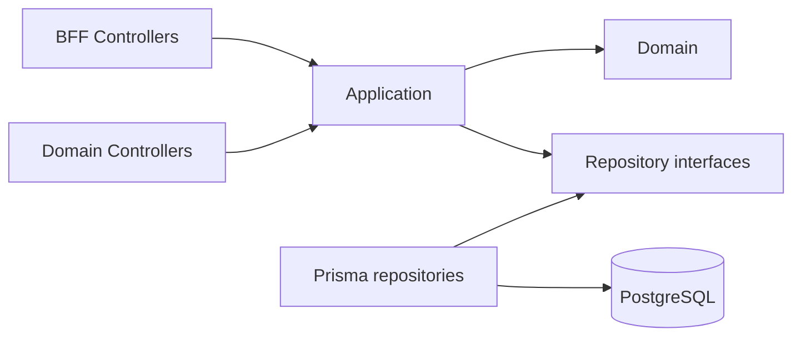

# Hybrid BFF architecture

[← Backend specification](../README.md)

## Layer model

```text
Presentation
├── BFF Controllers
└── Domain Controllers
        ↓
Application
├── Commands
├── Queries
└── Transaction orchestration
        ↓
Domain
├── Policies
├── State transitions
└── Validation rules
        ↓
Infrastructure
├── Prisma repositories
├── Authentication adapters
└── Logging/observability
```

### BFF Controllers

- ให้ response shape ตาม page/view
- รวมข้อมูลหลาย domain ผ่าน application query services
- คืน capabilities และ computed fields ที่ UI ต้องใช้
- ลด round trips และ payload ที่ไม่จำเป็น
- ไม่เขียนฐานข้อมูลและไม่มี business rule

### Domain Controllers

- รับ command/mutation ที่ใช้ซ้ำได้และไม่ผูกกับ layout
- ตรวจ DTO และส่งต่อ application command
- คืน resource/result หรือ structured error
- ไม่เรียก repository โดยข้าม application layer

### Application services

- เป็น entrypoint ของ use case
- บังคับ authorization และ scope
- จัด transaction boundary
- เรียก domain policy และ repositories
- ถูก reuse โดยทั้ง BFF และ Domain Controllers

### Infrastructure

- Prisma implementation
- PostgreSQL transactions
- Token/password adapters
- Logs, health checks และ external integration

## API surfaces

| Prefix      | Purpose                                         |
| ----------- | ------------------------------------------------ |
| /api/v1/bff | Page-oriented read endpoints                    |
| /api/v1     | Domain commands และ resource operations         |
| /api/docs   | OpenAPI/Swagger สำหรับ development/internal use |

BFF และ Domain API ต้องอยู่ใน NestJS application เดียวใน concept phase ห้าม deploy BFF เป็น service แยกจนกว่าจะมีเหตุผลจาก scaling หรือ team ownership

## Dependency direction



Dependency ต้องชี้เข้าหา application/domain ห้าม domain import NestJS, Prisma หรือ HTTP DTO

## Repository structure

โครงสร้างเป้าหมายด้านล่างเป็นภาพย่อ รายละเอียดการจัดไฟล์ กฎ dependency และ Prisma migration อยู่ที่ [Backend engineering conventions](../engineering-conventions-backend.md)

```text
asset-reservation/
├── frontend/
│   ├── src/
│   │   ├── app/
│   │   ├── pages/
│   │   ├── features/
│   │   ├── components/
│   │   └── api-generated/
│   └── package.json
├── backend/
│   ├── src/
│   │   ├── auth/
│   │   ├── users/
│   │   ├── access-control/
│   │   ├── management-areas/
│   │   ├── assets/
│   │   ├── reservations/
│   │   ├── returns/
│   │   ├── google-auth/
│   │   ├── microsoft-auth/
│   │   ├── email/
│   │   ├── email-templates/
│   │   ├── notification-settings/
│   │   ├── recognition/
│   │   ├── uploads/
│   │   ├── database/
│   │   └── common/
│   ├── prisma/
│   │   ├── schema.prisma
│   │   ├── models/
│   │   └── migrations/
│   ├── prisma.config.ts
│   └── package.json
├── docs/
├── docker-compose.yml
└── package.json
```

Frontend และ backend ต้องมี dependency, environment variables, build output และ Docker image แยกจากกัน

## Backend architecture

Backend ใช้ modular monolith โดยแบ่ง module ตาม business domain:

| Module                      | Responsibility                                                                          |
| --------------------------- | ------------------------------------------------------------------------------------------ |
| AuthModule                  | Password authentication, token issuance และ guards                                       |
| GoogleAuthModule            | Google OAuth login/connect/callback สำหรับ account linking                               |
| MicrosoftAuthModule         | Microsoft OAuth login/connect/callback สำหรับ account linking                            |
| UsersModule                 | User, self-service profile/password และ active state                                    |
| AccessControlModule         | Role, permissions และ ManagementArea scope                                               |
| ManagementAreasModule       | Management area lookup/administration                                                    |
| AssetsModule                | Asset CRUD, serial-numbered asset unit registration/retirement และ availability          |
| ReservationsModule          | Reservation, items, participants, approval, availability และ lifecycle                   |
| ReturnsModule               | Return slip, per-unit condition inspection (Good/Broken/Lost) และ completion              |
| RecognitionModule           | Proxy ไปยัง recognition-service ภายใน (image embedding/object detection) สำหรับจดจำ/ค้นหาทรัพย์สินจากภาพ — ดู [modules/recognition.md](../modules/recognition.md) |
| EmailModule                 | Email dispatch จาก lifecycle event (listener) — ดู [integrations/google-microsoft-auth-and-notifications.md](../integrations/google-microsoft-auth-and-notifications.md) |
| EmailTemplatesModule        | Admin-configurable email template CRUD — ดู [modules/email-templates.md](../modules/email-templates.md) |
| NotificationSettingsModule  | Global (singleton) notification setting, global-admin เท่านั้น — ดู [modules/notification-settings.md](../modules/notification-settings.md) |
| UploadsModule               | Multipart image upload endpoint                                                          |
| DatabaseModule              | PrismaClient singleton และ transaction utilities                                         |

Controller ต้องรับ/ตอบ DTO เท่านั้น Business rule อยู่ใน service/domain layer และ Prisma query อยู่ใน repository หรือ domain service ที่กำหนดชัดเจน
