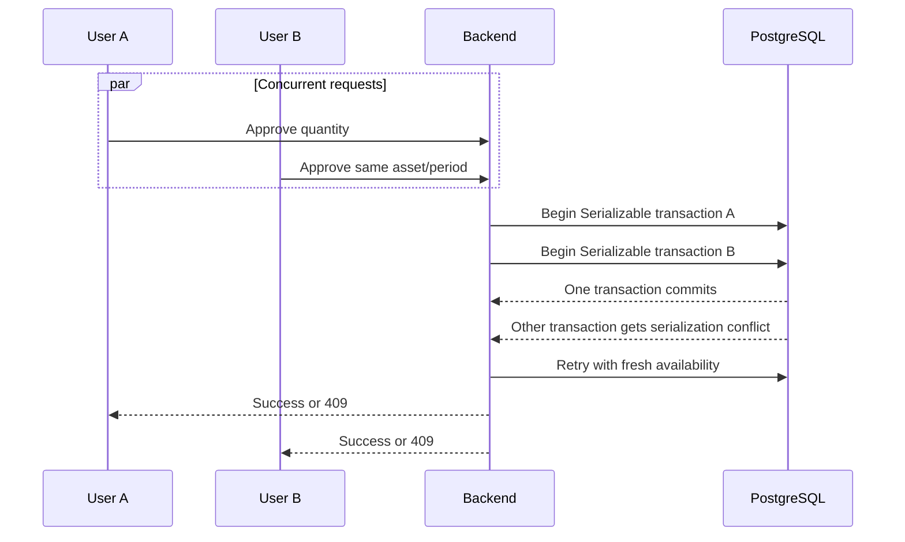

# Database and concurrency

[← Backend specification](README.md) · [Database schema](database-schema.md)

## Connection management

Backend ต้องสร้าง PrismaClient เพียง instance เดียวต่อ process และ reuse ตลอดอายุ application ห้ามสร้าง instance ใน controller, request handler หรือ service constructor หลายชุด

ค่าตั้งต้นสำหรับ concept แบบ backend process เดียว:

```ts
const adapter = new PrismaPg({
  connectionString: process.env.DATABASE_URL,
  max: 10,
  connectionTimeoutMillis: 5_000,
  idleTimeoutMillis: 30_000,
});

export const prisma = new PrismaClient({ adapter });
```

- ค่า pool ต้องไม่เกิน PostgreSQL `max_connections` หลังหัก connection สำหรับ administration และ migration (ค่า runtime ที่ tune ได้ผ่าน env var ดู [deployment-and-operations.md](deployment-and-operations.md))
- ต้องตั้ง connection timeout เพื่อไม่ให้ request รอไม่สิ้นสุด
- Backend ต้องปิด Prisma connection อย่าง graceful เมื่อได้รับ termination signal
- ยังไม่ใช้ PgBouncer ใน concept phase

## Concurrency และ transaction consistency

### Read operations

- ใช้ PostgreSQL default `READ COMMITTED`
- Query ต้องเลือกเฉพาะ field ที่ต้องใช้
- ห้ามถือ database transaction ระหว่างรอ user หรือ external I/O

### Critical write operations

ใช้ `Serializable` transaction สำหรับ:

- ตรวจ availability แล้ว submit ReservationItem (quantity-based, ก่อนเลือก unit จริง)
- Register/retire `AssetUnit` และเขียน `AssetUnitEvent`
- Approve item: ตรวจ quantity, lock unit และสร้าง `ReservationItemUnit` พร้อมช่วงเวลาในคำขอเดียวกัน (ไม่มีขั้น "prepare" แยก) โดยไม่เปลี่ยน physical `AssetUnit.status` — behavior เต็ม: [algorithms-and-validation.md §7.5](algorithms-and-validation.md#75-post-reservationsreservationiditemsitemiddecision)
- Check out หลาย item: เปลี่ยน `ReservationItemUnit`/`AssetUnit` เป็น CHECKED_OUT
- Cancel reservation: lock reservation แล้วตรวจสถานะซ้ำก่อนเปลี่ยนเป็น CANCELLED และคืน assignment
- Return approval: เขียน `ReturnItemUnit` (condition ต่อ serial) และปรับ `AssetUnit.status` ตาม condition, บันทึก lifecycle completion
- Aggregate Reservation status หลังตัดสิน item



### Retry policy

- Retry Prisma `P2034` write conflict/deadlock สูงสุด 3 attempts (ค่าคงที่ใน implementation ปัจจุบัน)
- ใช้ exponential backoff พร้อม jitter ระยะสั้น
- ทุก retry ต้องอ่าน availability/state ใหม่
- ถ้าหลัง retry quantity ไม่พอ ให้ตอบ `409 INSUFFICIENT_QUANTITY`; ถ้า unit ไม่อยู่ใน physical schedulable pool หรือมี active assignment ที่ overlap ให้ตอบ `409` (ฐานข้อมูลกัน race ด้วย exclusion constraint)
- ห้าม retry validation, permission หรือ unique-constraint error แบบไม่จำแนก

### Transaction rules

- Transaction ต้องสั้นและ deterministic
- Approval, handover และ cancellation ต้อง lock แถว `reservations` ก่อน แล้วอ่าน status/time window ซ้ำภายใน transaction เพื่อ serialize lifecycle transition ที่แข่งกัน
- Lock/order `asset_units` (ไม่ใช่ `assets`) ตาม UUID ที่ sort แล้วเมื่อ mutation แตะหลายหน่วยเพื่อลด deadlock
- ห้าม upload file, call HTTP service หรือส่ง notification ภายใน transaction
- Aggregate parent status และ child status ต้อง commit พร้อมกัน
- `AssetUnitEvent` และการเปลี่ยน `AssetUnit.status` ต้อง commit พร้อมกันเสมอ (ไม่มี stored quantity ให้ sync แล้ว — total/available คำนวณจากการนับแถว `asset_units` ตอน read)

## Database constraints และ indexes

Prisma schema มี comment สำหรับ check constraints แต่ Prisma schema language ยังไม่ enforce ทุกข้อ จึงต้องเพิ่ม raw SQL ใน migration:

```sql
CHECK (end_at > start_at)
CHECK (quantity > 0)                              -- reservation_items.quantity
```

Partial indexes/constraints ที่ Prisma schema language เขียนไม่ได้ต้องเพิ่มใน raw migration SQL:

```sql
-- assets: part_number ไม่ซ้ำภายใน management area เดียวกัน เมื่อมีค่า
CREATE UNIQUE INDEX assets_area_part_number_key
  ON assets (management_area_id, part_number)
  WHERE part_number IS NOT NULL;

CREATE EXTENSION IF NOT EXISTS btree_gist;

-- อนุญาต serial เดียวมีหลาย future assignment แต่ห้ามช่วง active ทับกัน
ALTER TABLE reservation_item_units
  ADD CONSTRAINT reservation_item_units_no_overlapping_assignments
  EXCLUDE USING GIST (
    asset_unit_id WITH =,
    tstzrange(assignment_start_at, assignment_end_at, '[)') WITH &&
  ) WHERE (status IN ('ASSIGNED', 'CHECKED_OUT'));
```

`asset_units.serial_number` และ `return_item_units.reservation_item_unit_id` เป็น UNIQUE ปกติ (ประกาศใน Prisma schema ได้ตรงๆ) — ตัวหลังคือสิ่งที่ทำให้ unit ที่ checked out หนึ่งชิ้นถูกปิดยอดคืนได้เพียงครั้งเดียวเท่านั้น แทนที่ business validation แบบข้ามหลายแถวที่ระบบเดิมต้องตรวจเองใน transaction

Indexes ที่ต้องประเมินก่อน production:

- Approval queue: `(approver_id, status)`
- Return approval queue: `(approver_id, status)`
- Asset filters: `(management_area_id, is_active)`
- Asset unit lookup: `(asset_id, status)`, `serial_number` (unique)
- User scope lookup: `(user_id)` และ `(management_area_id)`
- Calendar: ใช้ reservation date/status indexes ที่มีอยู่

ต้องยืนยัน index ด้วย query plan และ load test ห้ามเพิ่ม index ทุก foreign key โดยไม่มี query use case เพราะ index เพิ่มต้นทุนการเขียน ตารางและคอลัมน์ทั้งหมดอยู่ที่ [database-schema.md](database-schema.md)
