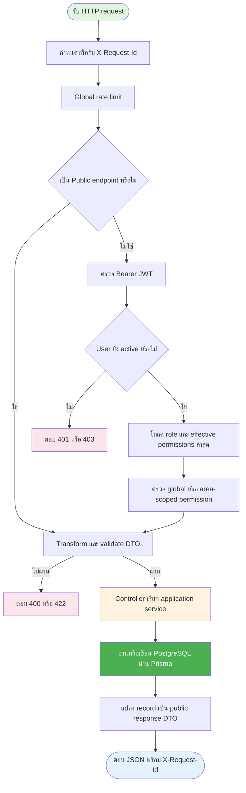
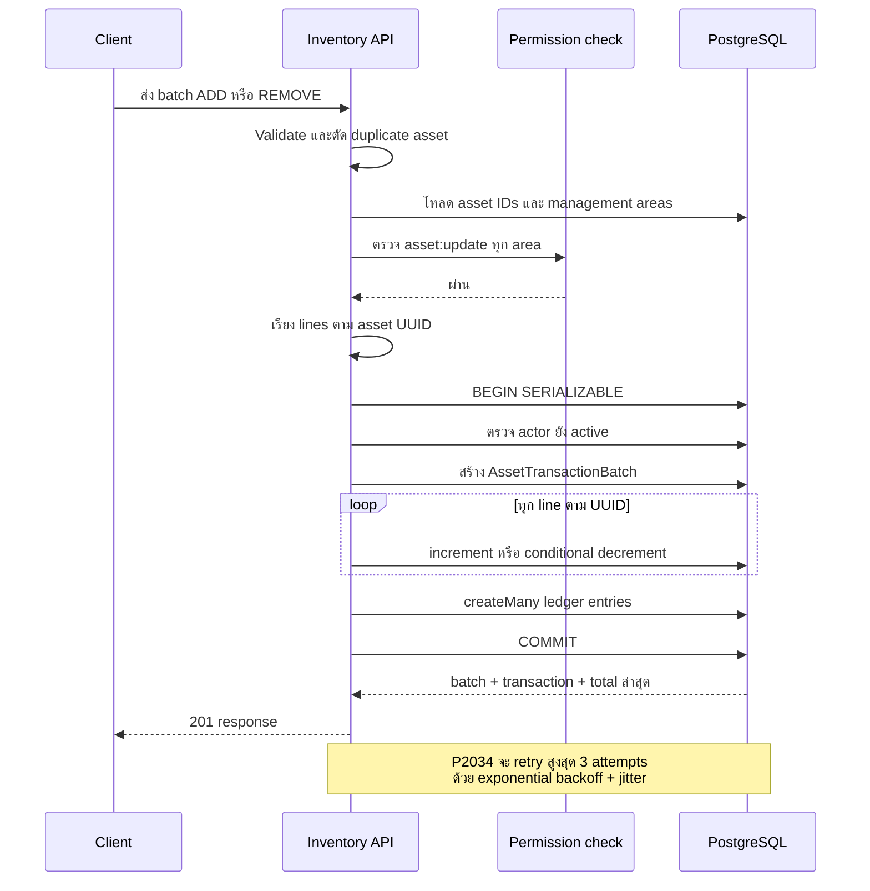
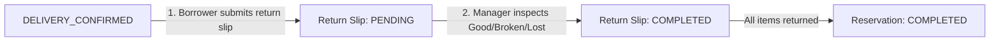

# API algorithm reference

[← Backend specification](../README.md) · [Auth and permission contract](authentication-and-permission-api.md) · [Database and concurrency](database-and-concurrency.md)

เอกสารนี้อธิบาย algorithm ของ endpoint ทุกเส้นที่มี implementation อยู่ใน `backend/src` ปัจจุบัน โดยยึด controller, service, guard และ DTO ใน source code เป็นหลัก ครอบคลุม application endpoint 35 เส้นภายใต้ base path `/api/v1` และ documentation route แบบมีเงื่อนไขอีก 2 เส้น

## 1. กติกากลางของทุก request

### 1.1 Request pipeline



ลำดับกลางมีรายละเอียดดังนี้:

1. Fastify กำหนด request ID ใหม่ หรือยอมรับ `X-Request-Id` ที่ตรงรูปแบบ `[A-Za-z0-9._:-]{1,128}`
2. Throttler จำกัดค่าเริ่มต้น 100 requests ต่อนาที ส่วน login จำกัด 10 requests ต่อนาที
3. ยกเว้น `POST /auth/login` ทุก endpoint ต้องส่ง `Authorization: Bearer <accessToken>`
4. Authentication guard ตรวจลายเซ็นและอายุ JWT จากนั้นใช้ `sub` โหลด user, profile, role และ management-area assignment ใหม่จากฐานข้อมูลทุก request
5. Account ที่ inactive ถูกปฏิเสธก่อนเข้า controller
6. Validation pipe ทำ type transformation, ลบ field ที่ไม่อยู่ใน DTO และปฏิเสธ unknown field ด้วย `422 VALIDATION_ERROR`
7. Service ตรวจ permission และ business invariant เพิ่มเติมก่อนอ่านหรือเขียนข้อมูล
8. Exception filter แปลง error เป็นรูปแบบเดียวกันและส่ง request ID กลับทั้ง header และ body

### 1.2 Authentication และ permission scope

Effective permission ของผู้ใช้คำนวณดังนี้:

- Role assignment ที่ `managementAreaId = null` ให้ global permission
- Role assignment ที่มี `managementAreaId` ให้ permission เฉพาะ area นั้น
- Permission ที่มีผลใน area คือ union ระหว่าง global permission กับ scoped permission ของ area
- Frontend ใช้ `capabilities` เพื่อแสดงหรือซ่อน UI ได้ แต่ backend ตรวจ permission ซ้ำทุก request

### 1.3 Validation และชนิดข้อมูล

| รายการ             | กติกา                                            |
| ------------------ | ------------------------------------------------ |
| ID                 | UUID และ path parameter ตรวจด้วย `ParseUUIDPipe` |
| Date/time          | ISO 8601 พร้อม timezone                          |
| JSON field         | camelCase                                        |
| Unknown body field | ปฏิเสธด้วย `422 VALIDATION_ERROR`                |
| Pagination limit   | ค่าเริ่มต้น 20, ต่ำสุด 1, สูงสุด 100             |
| Search             | trim ช่องว่างและยาวไม่เกิน 100 ตัวอักษร          |
| Picture            | รับ URL ไม่ได้รับ binary upload โดยตรง           |

### 1.4 Cursor pagination algorithm

Endpoint แบบ list ใช้ keyset pagination ร่วมกัน:

1. Decode `cursor` จาก Base64URL เป็น `{ createdAt, id }`
2. ถ้า decode ไม่ได้หรือวันที่ไม่ถูกต้อง ตอบ `400 INVALID_REQUEST`
3. Query แถวที่เก่ากว่า cursor ด้วยเงื่อนไข `createdAt < cursor.createdAt` หรือวันที่เท่ากันแต่ `id < cursor.id`
4. เรียง `createdAt DESC, id DESC`
5. อ่าน `limit + 1` แถวเพื่อรู้ว่ายังมีหน้าถัดไปหรือไม่
6. คืนเพียง `limit` แถว และ encode แถวสุดท้ายเป็น `pageInfo.nextCursor`

### 1.5 Optimistic concurrency

Endpoint ที่รับ `expectedUpdatedAt` ใช้ค่านี้ในเงื่อนไข update:

```text
UPDATE ... WHERE id = :id AND updated_at = :expectedUpdatedAt
```

ถ้าแก้ไขได้ 0 แถว หมายถึงข้อมูลถูกเปลี่ยนหลัง client โหลดมา ระบบตอบ `409 STALE_WRITE` เพื่อให้ client reload ก่อนบันทึกอีกครั้ง

### 1.6 Error response

```json
{
  "error": {
    "code": "VALIDATION_ERROR",
    "message": "The request contains invalid fields.",
    "fields": {
      "name": "name must be shorter than or equal to 150 characters"
    },
    "requestId": "b8cdfa2d-07b2-41df-9bed-7d77998acf08"
  }
}
```

Error กลางที่พบบ่อย:

| HTTP | Code                      | ความหมาย                                        |
| ---- | ------------------------- | ----------------------------------------------- |
| 400  | `INVALID_REQUEST`         | Path/query/cursor ไม่ถูกต้อง                    |
| 401  | `AUTHENTICATION_REQUIRED` | ไม่มี token, token หมดอายุ หรือตรวจสอบไม่ได้    |
| 403  | `ACCOUNT_INACTIVE`        | Account ถูกปิดใช้งาน                            |
| 403  | `PERMISSION_DENIED`       | ไม่มี global หรือ scoped permission ที่ต้องใช้  |
| 409  | `STALE_WRITE`             | `expectedUpdatedAt` ไม่ตรงข้อมูลล่าสุด          |
| 409  | `CONCURRENT_MODIFICATION` | Database transaction ชนกับ request อื่น         |
| 422  | `VALIDATION_ERROR`        | Body หรือ query ไม่ผ่าน DTO/business validation |
| 429  | `RATE_LIMITED`            | เรียก API เกิน rate limit                       |
| 500  | `INTERNAL_ERROR`          | Error ที่ไม่ได้ map เป็น domain error           |

## 2. Endpoint catalog

| Method | Path                                                                     | Authorization                                  | หน้าที่                    |
| ------ | ------------------------------------------------------------------------ | ---------------------------------------------- | -------------------------- |
| POST   | `/auth/login`                                                            | Public                                         | Login ด้วย email/password  |
| GET    | `/auth/me`                                                               | Active user                                    | อ่าน session context       |
| POST   | `/auth/logout`                                                           | Active user                                    | จบ session ฝั่ง client     |
| GET    | `/bff/session`                                                           | Active user                                    | อ่าน session สำหรับ BFF    |
| GET    | `/permissions`                                                           | Active user                                    | อ่าน permission catalog    |
| GET    | `/roles`                                                                 | Active user                                    | อ่าน role definitions      |
| POST   | `/roles`                                                                 | Global ADMIN                                   | สร้าง role                 |
| PATCH  | `/roles/:roleId`                                                         | Global ADMIN                                   | แก้ role                   |
| GET    | `/users`                                                                 | Global user-admin permission อย่างน้อยหนึ่งค่า | ค้นหา user                 |
| POST   | `/users`                                                                 | Global `user:create`                           | สร้าง user                 |
| GET    | `/users/:userId`                                                         | Global user-admin permission อย่างน้อยหนึ่งค่า | อ่าน user detail           |
| PATCH  | `/users/:userId/status`                                                  | Global `user:disable`                          | เปิด/ปิด account           |
| POST   | `/users/:userId/role-assignments`                                        | Global `role:assign`                           | เพิ่ม role assignment      |
| DELETE | `/users/:userId/role-assignments/:assignmentId`                          | Global `role:assign`                           | ลบ role assignment         |
| GET    | `/management-areas`                                                      | Active user                                    | ค้นหา management area      |
| GET    | `/management-areas/:id`                                                  | Global ADMIN                                   | อ่าน area และ relation counts |
| POST   | `/management-areas`                                                      | Global ADMIN                                   | สร้าง management area      |
| PATCH  | `/management-areas/:id`                                                  | Global ADMIN                                   | แก้ management area        |
| DELETE | `/management-areas/:id`                                                  | Global ADMIN                                   | ลบ area ที่ไม่มี asset     |
| GET    | `/assets`                                                                | Scoped `asset:view`                            | ค้นหา asset                |
| POST   | `/assets`                                                                | Scoped `asset:create`                          | สร้าง asset เดียว          |
| POST   | `/assets/batch`                                                          | Scoped `asset:create` ทุก area                 | สร้าง asset หลายรายการ     |
| POST   | `/assets/batch-remove`                                                   | Scoped `asset:delete` ทุก asset                | ปิดใช้งาน asset หลายรายการ |
| POST   | `/assets/inventory/batch-add`                                            | Scoped `asset:update` ทุก asset                | เพิ่ม quantity หลาย asset  |
| POST   | `/assets/inventory/batch-remove`                                         | Scoped `asset:update` ทุก asset                | ลด quantity หลาย asset     |
| GET    | `/assets/:assetId`                                                       | Scoped `asset:view`                            | อ่าน asset detail          |
| PATCH  | `/assets/:assetId`                                                       | Scoped `asset:update`                          | แก้ asset detail           |
| PATCH  | `/assets/:assetId/status`                                                | Scoped `asset:update` หรือ `asset:delete`      | เปลี่ยน status             |
| DELETE | `/assets/:assetId`                                                       | Scoped `asset:delete`                          | Soft delete asset          |
| POST   | `/assets/:assetId/template`                                              | Scoped `asset:create`                          | บันทึก asset เป็น template |
| GET    | `/asset-templates`                                                       | `asset:view` ในอย่างน้อยหนึ่ง scope            | ค้นหา template             |
| POST   | `/asset-templates`                                                       | `asset:create` ในอย่างน้อยหนึ่ง scope          | สร้าง template             |
| PATCH  | `/asset-templates/:templateId`                                           | `asset:update` ในอย่างน้อยหนึ่ง scope          | แก้ template               |
| POST   | `/reservations`                                                          | Scoped `reservation:create` ทุก asset area     | สร้าง reservation          |
| GET    | `/reservations`                                                          | Requester/participant หรือ scoped operator     | ค้นหาและ list reservations |
| GET    | `/reservations/:reservationId`                                           | Requester/participant หรือ scoped operator     | อ่าน reservation detail    |
| POST   | `/reservations/:reservationId/submit`                                    | Requester หรือ scoped `reservation:update`     | ส่ง draft ขออนุมัติ        |
| POST   | `/reservations/:reservationId/items/:itemId/decision`                    | Scoped `reservation:approve/reject`            | ตัดสิน item                |
| POST   | `/reservations/:reservationId/items/decision`                            | Scoped `reservation:approve/reject`            | ตัดสินหลาย item แบบ atomic |
| POST   | `/reservations/:reservationId/change-requests`                           | Requester เท่านั้น                             | ขอแก้ reservation          |
| POST   | `/reservations/:reservationId/change-requests/:changeRequestId/decision` | Scoped `reservation:approve/reject`            | ตัดสินคำขอแก้ไข            |
| POST   | `/reservations/:reservationId/cancel`                                    | Requester หรือ scoped `reservation:update`     | ยกเลิกและคืน allocation    |
| POST   | `/uploads/image`                                                         | Active user                                    | Upload image สูงสุด 10 MiB |

> ทุก path ในตารางต้องนำหน้าด้วย `/api/v1`

### 2.1 Documentation routes

สองเส้นต่อไปนี้สร้างโดย Swagger module โดยตรง ไม่ผ่าน controller และไม่ใช้ base path `/api/v1`:

| Method | Path                     | เงื่อนไข                            | Algorithm                                     |
| ------ | ------------------------ | ----------------------------------- | --------------------------------------------- |
| GET    | `/api/docs`              | เปิดเมื่อพบไฟล์ OpenAPI ตอน startup | Render Swagger UI จาก static OpenAPI contract |
| GET    | `/api/docs/openapi.json` | เปิดเมื่อพบไฟล์ OpenAPI ตอน startup | คืน contract เดียวกันในรูป JSON               |

OpenAPI source แยกตาม domain โดยมี `docs/backend_spec/contracts/openapi.yaml` เป็น root document และสร้าง runtime bundle ผ่าน `npm run openapi:bundle` ตอน startup ระบบ resolve contract จาก `OPENAPI_CONTRACT_PATH` หรือใช้ค่าเริ่มต้น `docs/backend_spec/contracts/dist/openapi.bundle.yaml` ถ้าพบไฟล์จึง register สอง route นี้ หากไม่พบจะ log warning และไม่เปิด Swagger UI contract เวอร์ชัน 1.4.0 ครอบคลุม application endpoint ปัจจุบันครบ 43 operations

สำหรับ Docker development ให้เปิด `http://localhost:${BACKEND_HOST_PORT}/api/docs` โดยค่าเริ่มต้น `BACKEND_HOST_PORT=3000` หากเข้าผ่าน Nginx ต้องให้ API location มี precedence เหนือ static-file regex เช่น `location ^~ /api/`; มิฉะนั้นไฟล์ `swagger-ui.css` และ `swagger-ui-*.js` อาจถูก Nginx หาใน frontend static directory แล้วตอบ 404 จน Swagger UI เป็นหน้าว่าง ส่วน `/api/docs/openapi.json` เป็น raw JSON จึงแสดงเป็นข้อความบนพื้นขาวตามปกติ

## 3. Authentication และ session APIs

### 3.1 `POST /auth/login`

สถานะสำเร็จ: `200 OK`  
Authorization: Public  
Input: `email`, `password`

Algorithm:

1. Normalize email ด้วย trim และแปลงเป็นตัวพิมพ์เล็ก
2. ตรวจรูปแบบ email, ความยาว email ไม่เกิน 255 และ password ยาว 1–1024 ตัวอักษร
3. ค้น user ด้วย email
4. ถ้าไม่พบ user ให้ verify password เทียบ dummy Argon2 hash เพื่อลดความแตกต่างของ response timing ระหว่าง user ที่มีและไม่มีจริง
5. Verify password ด้วย Argon2; ถ้าไม่ผ่านตอบ `401 INVALID_CREDENTIALS`
6. ตรวจ `User.isActive`; ถ้าปิดอยู่ตอบ `403 ACCOUNT_INACTIVE`
7. โหลด profile, role assignments, role permissions และ management areas
8. คำนวณ global/scoped effective permissions และเรียง role ให้ผลลัพธ์คงที่
9. สร้าง JWT ที่มี `sub = userId` และ `jti` แบบ UUID โดยใช้อายุจาก `JWT_ACCESS_TTL_SECONDS`
10. คืน `accessToken`, `tokenType`, `expiresIn` และ `session`

### 3.2 `GET /auth/me`

สถานะสำเร็จ: `200 OK`  
Authorization: Active user

Algorithm:

1. Authentication guard ตรวจ JWT และโหลด user/role ล่าสุดจากฐานข้อมูล
2. สร้าง session context ที่มี user, role assignments, global permissions และ permissions แยกตาม area
3. คืน `{ session: actor }`

### 3.3 `POST /auth/logout`

สถานะสำเร็จ: `204 No Content`  
Authorization: Active user

Algorithm:

1. Authentication guard ตรวจ token และ account ตามปกติ
2. Controller คืน `204` โดยไม่มี body
3. Server ไม่ได้เก็บ token blacklist หรือ refresh-token session ใน implementation ปัจจุบัน ดังนั้น client ต้องลบ access token เอง และ token เดิมยังใช้ได้จนหมดอายุหากยังถูกเก็บไว้

### 3.4 `GET /bff/session`

สถานะสำเร็จ: `200 OK`  
Authorization: Active user

Algorithm เหมือน `GET /auth/me` และคืน `{ session: actor }` เหมือนกัน เส้นนี้มีไว้เป็น BFF-facing alias สำหรับ frontend shell

## 4. Permission และ role APIs

### 4.1 `GET /permissions`

สถานะสำเร็จ: `200 OK`  
Authorization: Active user

Algorithm:

1. อ่าน immutable permission catalog จาก application constant ไม่ query ตาราง permission
2. Map แต่ละรายการเป็น `key`, `resource`, `action`, `description`
3. คืน `{ data: Permission[] }`

### 4.2 `GET /roles`

สถานะสำเร็จ: `200 OK`  
Authorization: Active user

Algorithm:

1. Query roles เรียงตามชื่อจากน้อยไปมาก
2. Normalize permissions โดยตัดค่าที่ไม่อยู่ใน catalog, ตัดค่าซ้ำ และเรียงตามตัวอักษร
3. แปลงวันที่เป็น ISO 8601
4. คืน `{ data: Role[] }`

### 4.3 `POST /roles`

Global ADMIN ส่ง name, description และ permission set ระบบ trim ชื่อ ตรวจ unique แบบ case-insensitive, normalize permission dependencies และบันทึกชื่อเป็น uppercase ถ้าชื่อซ้ำตอบ 409

### 4.4 `PATCH /roles/:roleId`

สถานะสำเร็จ: `200 OK`  
Authorization: ต้องมี global role ชื่อ `ADMIN`; area-scoped ADMIN ไม่เพียงพอ  
Input: `description?`, `permissions?`, `expectedUpdatedAt`

Algorithm:

1. ตรวจ `roleId` เป็น UUID และ body ตาม DTO
2. บังคับให้ส่ง field ที่แก้ได้อย่างน้อยหนึ่งค่า
3. ค้น role; ถ้าไม่พบตอบ `404 ROLE_NOT_FOUND`
4. Normalize permission set
5. ถ้าแก้ role `ADMIN` ต้องคง `user:disable` และ `role:assign`; มิฉะนั้นตอบ `422 VALIDATION_ERROR`
6. Update ด้วยเงื่อนไข `id + expectedUpdatedAt`
7. ถ้าไม่มีแถวถูกแก้ ตอบ `409 STALE_WRITE`
8. โหลด role ล่าสุด, normalize และคืน response

## 5. User administration APIs

`Global user-admin permission` หมายถึงมีอย่างน้อยหนึ่ง permission จาก `user:create`, `user:disable`, `role:assign` ใน global scope

### 5.1 `GET /users`

สถานะสำเร็จ: `200 OK`  
Authorization: Global user-admin permission  
Query: `search?`, `isActive?`, `roleId?`, `areaId?`, `cursor?`, `limit?`

Algorithm:

1. Decode cursor และสร้าง filter ตาม query ที่ส่งมา
2. Search แบบ case-insensitive จาก email หรือ profile name
3. ถ้ามี `roleId`/`areaId` ใช้ relation filter หา user ที่มี role assignment ตรงเงื่อนไข
4. Query `limit + 1` เรียง `createdAt DESC, id DESC`
5. Include profile, distinct role references และนับจำนวน role assignments เพื่อรองรับ multi-role filter ใน frontend
6. สร้าง `pageInfo` ตาม cursor algorithm
7. คืน user summary พร้อม `roleCount` และ `roles`

### 5.2 `POST /users`

สถานะสำเร็จ: `201 Created`  
Authorization: Global `user:create`  
Input: `email`, `password`, `profile`

Algorithm:

1. Normalize email; validate password 8–128 ตัวอักษร
2. Validate profile name, phone number และ profile picture URL
3. Hash password ด้วย Argon2
4. สร้าง UUID และ insert `User` พร้อม nested `UserProfile`
5. Include profile, auth identity และ role assignments เพื่อสร้าง user detail response
6. ถ้า email ซ้ำ ตอบ `409 EMAIL_ALREADY_EXISTS`

### 5.3 `GET /users/:userId`

สถานะสำเร็จ: `200 OK`  
Authorization: Global user-admin permission

Algorithm:

1. ตรวจ `userId` เป็น UUID
2. Query user พร้อม profile, auth providers และ role assignments
3. แต่ละ assignment include role, management area และผู้มอบ role
4. รวม provider จาก password และ external identities แล้วตัดค่าซ้ำ/เรียง
5. ถ้าไม่พบ user ตอบ `404 USER_NOT_FOUND`; มิฉะนั้นคืน user detail

### 5.4 `PATCH /users/:userId/status`

สถานะสำเร็จ: `200 OK`  
Authorization: Global `user:disable`  
Input: `isActive`, `expectedUpdatedAt`

Algorithm:

1. ป้องกัน actor ปิด account ของตนเองด้วย `409 SELF_DEACTIVATION_NOT_ALLOWED`
2. เปิด Serializable transaction
3. ค้น target user; ถ้าไม่พบตอบ `404 USER_NOT_FOUND`
4. ถ้ากำลังปิด active user ให้ตรวจว่า target เป็น global ADMIN หรือไม่
5. ถ้าเป็น global ADMIN และเหลือ active global ADMIN ไม่เกินหนึ่งคน ตอบ `409 LAST_GLOBAL_ADMIN`
6. Update status ด้วย `id + expectedUpdatedAt`; ถ้าไม่ตรงตอบ `409 STALE_WRITE`
7. Commit transaction แล้วโหลด user detail ล่าสุดกลับไป

### 5.5 `POST /users/:userId/role-assignments`

สถานะสำเร็จ: `201 Created`  
Authorization: Global `role:assign`  
Input: `roleId`, `managementAreaId` ซึ่งเป็น UUID หรือ `null`

Algorithm:

1. Query target user, role และ management area แบบขนาน
2. ถ้าไม่พบ resource ใด ตอบ `USER_NOT_FOUND`, `ROLE_NOT_FOUND` หรือ `MANAGEMENT_AREA_NOT_FOUND`
3. สร้าง UUID ของ assignment และบันทึก `assignedBy` จาก actor; client เลือกผู้มอบ role ไม่ได้
4. `managementAreaId = null` สร้าง global assignment ส่วน UUID สร้าง scoped assignment
5. Database partial unique indexes ป้องกัน role/scope ซ้ำ
6. ถ้าซ้ำ ตอบ `409 ROLE_ASSIGNMENT_ALREADY_EXISTS`
7. คืน assignment พร้อม role, area และผู้มอบ role

### 5.6 `DELETE /users/:userId/role-assignments/:assignmentId`

สถานะสำเร็จ: `204 No Content`  
Authorization: Global `role:assign`

Algorithm:

1. เปิด Serializable transaction
2. ค้น assignment ด้วยทั้ง `assignmentId` และ `userId` เพื่อป้องกันลบ assignment ของ user คนอื่นจาก path ที่ไม่ตรงกัน
3. ถ้าไม่พบ ตอบ `404 ROLE_ASSIGNMENT_NOT_FOUND`
4. ถ้าเป็น global ADMIN ของ active user ให้นับ active global admins
5. ถ้าเป็นคนสุดท้าย ตอบ `409 LAST_GLOBAL_ADMIN`
6. ลบ assignment และ commit; response ไม่มี body

## 6. Management area API

### 6.1 `GET /management-areas`

สถานะสำเร็จ: `200 OK`  
Authorization: Active user  
Query: `search?`, `cursor?`, `limit?`

Algorithm:

1. Decode cursor
2. ถ้ามี search ให้ค้น name/description แบบ case-insensitive
3. Query `limit + 1` เรียง `createdAt DESC, id DESC`
4. สร้าง cursor ของหน้าถัดไปและคืน `{ data, pageInfo }`

หมายเหตุ: endpoint ปัจจุบันเป็น lookup list และไม่ได้กรองตาม management-area assignments ของ actor

### 6.2 `GET /management-areas/:id`

Global ADMIN เท่านั้น คืน metadata พร้อม `assetCount` และ `userRoleCount`; UUID ไม่ถูกต้องตอบ 400 และไม่พบตอบ 404

### 6.3 `POST /management-areas`

Global ADMIN เท่านั้น รับ name ที่ trim แล้วและ description optional ตรวจชื่อ unique ก่อนสร้าง UUID/timestamps ชื่อซ้ำตอบ 409

### 6.4 `PATCH /management-areas/:id`

Global ADMIN เท่านั้น แก้เฉพาะ field ที่ส่งมา ตรวจชื่อซ้ำและอัปเดต `updatedAt`

### 6.5 `DELETE /management-areas/:id`

Global ADMIN เท่านั้น ปฏิเสธเมื่อ area ยังมี asset แล้วลบ record; relation constraint อื่นยังเป็น database safety net

## 7. Asset APIs

### 7.1 Asset summary algorithm

หลาย endpoint คืน asset summary โดยใช้กติกาเดียวกัน:

1. `allocatedQuantity` คือผลรวม `ReservationItem.quantity` ที่ item status เป็น `APPROVED`, `PREPARED` หรือ `CHECKED_OUT` และ reservation status เป็น `PARTIALLY_APPROVED`, `APPROVED` หรือ `ACTIVE`
2. `availableQuantity = max(totalQuantity - allocatedQuantity, 0)`
3. `status` map จาก `isActive`: `true → ACTIVE`, `false → INACTIVE`
4. `owner` มาจาก `Asset.createdBy`; asset เก่าก่อนมี creator tracking อาจเป็น `null`
5. `capabilities` คำนวณเฉพาะ actor ปัจจุบันจาก permission ใน management area ของ asset

### 7.2 `GET /assets`

สถานะสำเร็จ: `200 OK`  
Authorization: Scoped `asset:view`  
Query: `search?`, `areaId?`, `templateId?`, `isActive?`, `cursor?`, `limit?`

Algorithm:

1. หา area ที่ actor มี `asset:view`; global permission หมายถึงทุก area
2. ถ้าไม่มี view permission เลย ตอบ `403 PERMISSION_DENIED`
3. ถ้าระบุ `areaId` ที่อยู่นอก scope ตอบ `403`
4. สร้าง filter จาก area scope, template, status, search และ cursor
5. Query assets `limit + 1` พร้อม template, management area และ owner
6. Query allocated quantities ของ asset ทั้งหน้าแบบ `GROUP BY assetId` ครั้งเดียว เพื่อหลีกเลี่ยง N+1
7. คำนวณ available quantity/capabilities และคืน `{ data, pageInfo }`

### 7.3 `POST /assets`

สถานะสำเร็จ: `201 Created`  
Authorization: Scoped `asset:create` ของ management area  
Input: `name`, `managementAreaId`, `assetTemplateId?`, `description?`, `pictureUrl?`, `totalQuantity`, `isActive?`

Algorithm:

1. Validate ชื่อไม่ว่างและยาวไม่เกิน 150, quantity เป็น integer 0–2,147,483,647 และ picture เป็น URL
2. เรียก batch-create algorithm ด้วยรายการเดียว
3. บันทึก actor เป็น `createdById`; client ระบุ owner เองไม่ได้
4. ถ้า initial quantity มากกว่า 0 สร้าง opening `ADD` ledger ใน transaction เดียวกับ asset
5. คืน asset summary; ถ้าชื่อซ้ำภายใน area ตอบ `409 ASSET_NAME_ALREADY_EXISTS`

### 7.4 `POST /assets/batch`

สถานะสำเร็จ: `201 Created`  
Authorization: Scoped `asset:create` ครบทุก management area ใน batch  
Input: `items` 1–100 รายการ และ `description?`

Algorithm:

1. ปฏิเสธชื่อ asset ซ้ำภายใน management area เดียวกันใน request
2. ตรวจ `asset:create` ทีละ item ก่อนเขียนข้อมูล
3. Query ตรวจ management areas และ templates ทั้งหมดแบบ batch
4. เตรียม UUID, owner และ default `isActive = true`
5. เปิด Serializable transaction
6. Insert assets ทั้งหมดด้วย `createMany`
7. เลือกเฉพาะ asset ที่ quantity มากกว่า 0 แล้วสร้าง transaction batch หนึ่งรายการ
8. Insert opening `ADD` ledger ทุกบรรทัดด้วย `createMany`
9. โหลด asset ที่สร้างทั้งหมดและ commit พร้อมกัน; ถ้าบรรทัดใดล้มเหลวทั้ง batch rollback
10. เรียง response ตามลำดับ input เดิม

### 7.5 `POST /assets/batch-remove`

สถานะสำเร็จ: `201 Created`  
Authorization: Scoped `asset:delete` ครบทุก asset  
Input: `items` 1–100 รายการ แต่ละรายการมี `assetId`, `expectedUpdatedAt`

Algorithm:

1. ปฏิเสธ asset ID ซ้ำใน request
2. Query assets ทั้งหมดและตรวจว่าพบครบ; ถ้าไม่ครบตอบ `404 ASSET_NOT_FOUND`
3. ตรวจ `asset:delete` ตาม area ของทุก asset
4. เรียง asset ตาม UUID เพื่อให้ลำดับ update คงที่
5. เปิด transaction แล้ว update `isActive = false` ทีละรายการด้วย optimistic concurrency
6. ถ้ารายการใด stale ให้ rollback ทั้ง batch และตอบ `409 STALE_WRITE`
7. คืน ID และ status `INACTIVE` ของทุก asset

เส้นนี้เป็น soft removal เพื่อรักษา reservation relation และ inventory ledger ไม่ได้ลบ row จริง

### 7.6 `POST /assets/inventory/batch-add`

สถานะสำเร็จ: `201 Created`  
Authorization: Scoped `asset:update` ครบทุก asset  
Input: `items` 1–100 รายการ แต่ละรายการมี `assetId`, `quantity > 0`, `reason?`; มี `description?` ระดับ batch

Algorithm ใช้ shared inventory algorithm ในหัวข้อ 7.8 โดยกำหนด operation เป็น `ADD`, เพิ่ม `totalQuantity` และบันทึก `quantityDelta` เป็นค่าบวก

### 7.7 `POST /assets/inventory/batch-remove`

สถานะสำเร็จ: `201 Created`  
Authorization: Scoped `asset:update` ครบทุก asset  
Input เหมือน batch-add

Algorithm ใช้ shared inventory algorithm โดยกำหนด operation เป็น `REMOVE`, ลด `totalQuantity` และบันทึก `quantityDelta` เป็นค่าลบ ถ้าการลดทำให้ quantity ติดลบตอบ `409 INSUFFICIENT_QUANTITY`

### 7.8 Shared atomic inventory algorithm



รายละเอียด:

1. ปฏิเสธ duplicate asset lines และตรวจว่าพบ asset ครบทุก ID
2. ตรวจ `asset:update` ตาม area ของทุก assetก่อนเริ่ม transaction
3. เรียง UUID เพื่อลดโอกาส deadlock เมื่อหลาย request แตะ asset ชุดเดียวกัน
4. เปิด Serializable transaction และตรวจ actor ยัง active อีกครั้ง
5. สร้าง `AssetTransactionBatch` โดย `performedBy` มาจาก actor เท่านั้น
6. ADD ใช้ atomic increment
7. REMOVE ใช้ conditional update `WHERE totalQuantity >= quantity` แล้ว atomic decrement
8. ถ้า REMOVE update ไม่ได้ ตอบ `409 INSUFFICIENT_QUANTITY`; transaction rollback รวม batch/lines ก่อนหน้า
9. Insert ledger lines ทั้งหมดด้วย `createMany` และ commit พร้อมยอด asset
10. ถ้า Prisma แจ้ง write conflict/deadlock `P2034` ให้ retry สูงสุด 3 ครั้งด้วย backoff และ jitter; error อื่นไม่ retry

### 7.9 `GET /assets/:assetId`

สถานะสำเร็จ: `200 OK`  
Authorization: Scoped `asset:view`

Algorithm:

1. Query asset พร้อม template, area, owner, reservation items ที่ยัง allocate quantity และ ledger 50 รายการล่าสุด
2. ถ้าไม่พบตอบ `404 ASSET_NOT_FOUND`
3. ตรวจ `asset:view` ใน area หลังทราบ scope ของ asset
4. รวม allocated quantity และคำนวณ available quantity
5. Query roles ทั้งหมดแล้วเลือก role ที่ permission set ปัจจุบันมี `asset:update` เป็น `editPolicy.roles`
6. คืน asset detail, actor capabilities, active reservation items และ inventory ledger พร้อมผู้ดำเนินการ

### 7.10 `PATCH /assets/:assetId`

สถานะสำเร็จ: `200 OK`  
Authorization: Scoped `asset:update`  
Input: field ที่แก้ได้อย่างน้อยหนึ่งค่าจาก `name`, `managementAreaId`, `assetTemplateId`, `description`, `pictureUrl` และต้องมี `expectedUpdatedAt`

Algorithm:

1. ค้น asset; ถ้าไม่พบตอบ `404 ASSET_NOT_FOUND`
2. ตรวจ `asset:update` ใน area เดิม
3. ถ้าย้าย area ให้ตรวจ `asset:update` ใน area ใหม่ด้วย
4. ตรวจว่ามี editable field อย่างน้อยหนึ่งค่า
5. ตรวจ management area และ template reference
6. Update เฉพาะ field ที่ส่งมาพร้อม optimistic concurrency
7. ถ้าชื่อซ้ำใน area ตอบ `409 ASSET_NAME_ALREADY_EXISTS`; ถ้า stale ตอบ `409 STALE_WRITE`
8. โหลด summary และ available quantity ล่าสุดกลับไป

Quantity แก้ผ่าน endpoint นี้ไม่ได้ ต้องใช้ inventory batch เพื่อให้ ledger กับยอดรวมเปลี่ยนพร้อมกัน

### 7.11 `PATCH /assets/:assetId/status`

สถานะสำเร็จ: `200 OK`  
Input: `status` เป็น `ACTIVE` หรือ `INACTIVE`, `expectedUpdatedAt`

Algorithm:

1. ค้น asset และ area
2. ถ้าเปลี่ยนเป็น `INACTIVE` ต้องมี scoped `asset:delete`
3. ถ้าเปลี่ยนเป็น `ACTIVE` ต้องมี scoped `asset:update`
4. Map status เป็น `isActive` และ update ด้วย optimistic concurrency
5. คืน asset summary ล่าสุด

### 7.12 `DELETE /assets/:assetId`

สถานะสำเร็จ: `200 OK`  
Authorization: Scoped `asset:delete`

Algorithm:

1. ค้น asset; ถ้าไม่พบตอบ `404 ASSET_NOT_FOUND`
2. ตรวจ permission ตาม management area
3. Update `isActive = false` และ `updatedAt`; ไม่มี hard delete และ endpoint นี้ไม่ใช้ `expectedUpdatedAt`
4. คืน asset summary ที่ status เป็น `INACTIVE`

### 7.13 `POST /assets/:assetId/template`

สถานะสำเร็จ: `201 Created`  
Authorization: Scoped `asset:create` ใน area ของ source asset  
Input optional: `name?`, `description?`

Algorithm:

1. โหลดเฉพาะ name, description และ management area ของ source asset
2. ถ้าไม่พบตอบ `404 ASSET_NOT_FOUND`
3. ตรวจ `asset:create` ใน area นั้น
4. ใช้ input override ถ้ามี มิฉะนั้น copy name/description จาก asset
5. สร้าง template UUID ใหม่
6. ไม่ copy `pictureUrl`, quantity, owner, status หรือ management area
7. ถ้าชื่อ template ซ้ำทั้งระบบ ตอบ `409 ASSET_TEMPLATE_NAME_ALREADY_EXISTS`

## 8. Asset template APIs

Template มีเพียง name/description และใช้ร่วมกันทั้งระบบ จึงไม่มี picture หรือ management-area ownership

### 8.1 `GET /asset-templates`

สถานะสำเร็จ: `200 OK`  
Authorization: ต้องมี `asset:view` ใน global หรืออย่างน้อยหนึ่ง area  
Query: `search?`, `cursor?`, `limit?`

Algorithm:

1. ตรวจว่า actor มี `asset:view` อย่างน้อยหนึ่ง scope
2. Decode cursor และค้น name/description แบบ case-insensitive
3. Query `limit + 1` เรียง `createdAt DESC, id DESC`
4. คืน template DTO และ `pageInfo`

### 8.2 `POST /asset-templates`

สถานะสำเร็จ: `201 Created`  
Authorization: ต้องมี `asset:create` ใน global หรืออย่างน้อยหนึ่ง area  
Input: `name`, `description?`

Algorithm:

1. Trim/validate name และ description
2. สร้าง UUID และ insert template
3. ถ้าชื่อซ้ำทั้งระบบ ตอบ `409 ASSET_TEMPLATE_NAME_ALREADY_EXISTS`
4. คืน template พร้อม timestamps

### 8.3 `PATCH /asset-templates/:templateId`

สถานะสำเร็จ: `200 OK`  
Authorization: ต้องมี `asset:update` ใน global หรืออย่างน้อยหนึ่ง area  
Input: `name?`, `description?`, `expectedUpdatedAt`

Algorithm:

1. บังคับให้ส่ง editable field อย่างน้อยหนึ่งค่า
2. ค้น template; ถ้าไม่พบตอบ `404 ASSET_TEMPLATE_NOT_FOUND`
3. Update field ที่ส่งมาด้วย optimistic concurrency
4. ถ้าชื่อซ้ำตอบ `409 ASSET_TEMPLATE_NAME_ALREADY_EXISTS`
5. ถ้า timestamp ไม่ตรงตอบ `409 STALE_WRITE`
6. โหลดและคืน template ล่าสุด

## 9. Reservation APIs

Availability ใช้ช่วงเวลาแบบ half-open: overlap เมื่อ `existing.startAt < requested.endAt` และ `existing.endAt > requested.startAt` ดังนั้นรายการที่จบตรงเวลาเริ่มของอีกรายการไม่ชนกัน

- Hard allocation นับเฉพาะ item สถานะ `APPROVED`, `PREPARED`, `CHECKED_OUT` ใน reservation สถานะ `PARTIALLY_APPROVED`, `APPROVED`, `ACTIVE`
- Soft warning นับ item สถานะ `PENDING` ใน reservation สถานะ `PENDING_APPROVAL`
- Approval และการ approve change request lock asset row ตาม UUID, ตรวจ availability ซ้ำใน `SERIALIZABLE` transaction และ retry `P2034` สูงสุด 3 ครั้ง
- Pending request ไม่กัน quantity แต่ detail จะคืน `PENDING_RESERVATION_OVERLAP`, `pendingQuantity` และ `pendingReservationCount`

### 9.1 `POST /reservations`

สร้าง `DRAFT` หรือ `PENDING_APPROVAL` พร้อม event details, assets และ participants ตรวจ asset active, permission ทุก area, duplicate asset และ approved overlap ก่อนบันทึก
เมื่อสร้างหรือ submit ด้วยรายการ items ว่างเปล่า (zero items) สถานะจะถูกปรับเป็น `APPROVED` อัตโนมัติ โดยไม่ต้องผ่าน approval workflow สำหรับ event ที่ไม่มีการจอง asset

### 9.2 `GET /reservations`

รับ `view=MINE|APPROVALS|ALL`, `status`, `areaId`, `search`, ช่วงเวลา และ opaque cursor แล้วบังคับ visibility จาก requester/participant หรือ permission ของ asset area โดยตรง ใช้ keyset pagination ตาม `(createdAt,id)` และคืน summary, item status counts, pending change flag และจำนวน decision ที่ actor ทำได้โดยไม่เกิด N+1 query

### 9.3 `GET /reservations/:reservationId`

คืน requester, participants, item/asset/approval, availability, overlap warnings, change requests, returns, timestamps และ capabilities สำหรับ actor

### 9.4 `POST /reservations/:reservationId/submit`

เปลี่ยน `DRAFT` เป็น `PENDING_APPROVAL` ด้วย `expectedUpdatedAt` และตรวจ approved overlap ซ้ำ หากข้อมูล stale ตอบ `409 STALE_WRITE`

### 9.5 `POST /reservations/:reservationId/items/:itemId/decision`

Approve/reject เป็นราย item ตาม area permission เมื่อ approve ต้องมี quantity พอหลังหัก approved overlap อื่น แล้วคำนวณ reservation status ใหม่เป็น `PENDING_APPROVAL`, `PARTIALLY_APPROVED`, `APPROVED` หรือ `REJECTED`

### 9.6 `POST /reservations/:reservationId/items/decision`

รับ itemIds สูงสุด 100 รายการ ตัดสินทั้งหมดใน transaction เดียว ล็อก asset ตาม UUID และ rollback ทั้งชุดเมื่อ item ใดไม่ผ่าน permission/state/availability

### 9.7 `POST /reservations/:reservationId/change-requests`

สร้างคำขอแก้ไขหลัง submit โดย allowlist เฉพาะ `eventName`, `description`, `startAt`, `endAt`, `items`, `participantIds` และอนุญาต pending request ได้หนึ่งรายการต่อ reservation

### 9.8 `POST /reservations/:reservationId/change-requests/:changeRequestId/decision`

เมื่อ approve ระบบ apply event/time/item/participant changes และบันทึก reviewer ใน transaction เดียว ถ้า reservation เดิม approved รายการใหม่ถือว่า approved โดย reviewer นี้และต้องผ่าน conflict check ก่อน commit

### 9.9 `POST /reservations/:reservationId/cancel`

Requester หรือ actor ที่ manage reservation ได้ยกเลิกสถานะ `DRAFT`, `PENDING_APPROVAL`, `PARTIALLY_APPROVED`, `APPROVED` พร้อม reason optional แล้วเปลี่ยน reservation/item/approval ที่เกี่ยวข้องเป็น cancelled/rejected ตาม domain rule เพื่อคืน allocation

### 9.10 `POST /reservations/:reservationId/delivery-confirm`

เจ้าหน้าที่คลังหรือ Area Manager ยืนยันการส่งมอบอุปกรณ์ (Handover/Pickup):
1. ตรวจสอบสถานะการจองต้องเป็น `APPROVED` (หรือ `PARTIALLY_APPROVED` ที่มีรายการ approved)
2. อัปเดตสถานะของ `reservation_items` ที่อนุมัติเป็น `DELIVERED` พร้อมบันทึก `checkedOutBy = actor.id` และ `checkedOutAt = now`
3. เปลี่ยนสถานะภาพรวมของ `reservations` เป็น `DELIVERY_CONFIRMED`
4. สถานะจะส่งต่อเข้าสู่กระบวนการใช้งานและการรอส่งคืน (Pending Return)

## 10. Return & Inspection APIs

กระบวนการส่งคืนอุปกรณ์แบ่งเป็น 2 ระยะ (Two-phase return workflow):



### 10.1 `GET /returns` & `GET /returns/:returnId`
- รองรับการดูรายการสลิปผ่านมุมมอง `view=MINE` (สลิปที่ตนเองส่งคืน), `APPROVALS` (สลิปในพื้นที่ที่ตนดูแล), `ALL` (ผู้ดูแลระบบ)
- แสดงรายการอุปกรณ์ในสลิป, จำนวนที่ส่งคืน, และผลการตัดสินสภาพ

### 10.2 `POST /reservations/:reservationId/returns`
- ผู้ยืมหรือทีมงานส่งสลิปเพื่อคืนอุปกรณ์
- ตรวจสอบว่าจำนวนที่ส่งคืนไม่เกินยอดคงเหลือที่ยังไม่ได้ส่งคืน ($\text{quantityReturned} \le \text{ApprovedQty} - \text{PreviouslyReturnedQty}$)
- สร้างเรคคอร์ด `returns` ในสถานะ `PENDING`

### 10.3 `POST /reservations/:reservationId/returns/:returnId/decision`
- ผู้จัดการพื้นที่ตรวจรับสภาพอุปกรณ์และระบุตัวเลข:
  - **Good (`quantityReturned`)**: อุปกรณ์สภาพดี ไม่ลด `totalQuantity` ในคลัง
  - **Broken (`quantityBroken`)**: อุปกรณ์ชำรุดเสียหาย บันทึก Transaction `BROKEN` และตัดลดยอดสต็อก `totalQuantity -= Broken` ทันที
  - **Lost (`quantityLost`)**: อุปกรณ์สูญหาย บันทึก Transaction `LOST` และตัดลดยอดสต็อก `totalQuantity -= Lost` ทันที
- **Validation Guard**: ผลรวม $\text{Good} + \text{Broken} + \text{Lost}$ ต้องไม่เกินจำนวนอุปกรณ์ที่ระบุในสลิปนั้น หากเกินระบบจะ Reject ด้วย `422 VALIDATION_ERROR`
- เมื่อทุกรายการในคำขอจองได้รับการตรวจรับครบถ้วน สถานะการจองจะถูกปรับเป็น `COMPLETED` อัตโนมัติ

## 11. Upload API

### 11.1 `POST /uploads/image`

รับ `multipart/form-data` field `file` หนึ่งไฟล์ Fastify จำกัด 10 MiB ตรวจ MIME เป็น image, stream ไป `uploads/assets/{timestamp}-{uuid}.{ext}` และคืน public URL ใต้ `/uploads/assets/` ไฟล์ static ไม่ใช้ `/api/v1`

## 12. Response data ที่ควรรู้

### 12.1 Asset summary

```ts
type AssetSummary = {
  id: string;
  name: string;
  description: string | null;
  pictureUrl: string | null;
  totalQuantity: number;
  allocatedQuantity: number;
  availableQuantity: number;
  isActive: boolean;
  status: "ACTIVE" | "INACTIVE";
  assetTemplate: {
    id: string;
    name: string;
    description: string | null;
  } | null;
  managementArea: { id: string; name: string };
  owner: {
    id: string;
    email: string;
    name: string | null;
    profilePictureUrl: string | null;
  } | null;
  capabilities: {
    canEdit: boolean;
    canDeactivate: boolean;
    canAdjustQuantity: boolean;
  };
  createdAt: string;
  updatedAt: string;
};
```

### 12.2 List response

```ts
type ListResponse<T> = {
  data: T[];
  pageInfo: {
    nextCursor: string | null;
    hasNextPage: boolean;
  };
};
```

## 13. Source-code map

| Domain                     | Controller                                                                                             | Algorithm/service                                                                                                                                                                                                                  |
| -------------------------- | ------------------------------------------------------------------------------------------------------ | ---------------------------------------------------------------------------------------------------------------------------------------------------------------------------------------------------------------------------------- |
| Authentication/session     | [auth.controller.ts](../../../backend/src/auth/auth.controller.ts)                                     | [auth.service.ts](../../../backend/src/auth/auth.service.ts), [session.service.ts](../../../backend/src/auth/session.service.ts), guards                                                                                           |
| Permission/role            | [access-control.controller.ts](../../../backend/src/access-control/access-control.controller.ts)       | [access-control.service.ts](../../../backend/src/access-control/access-control.service.ts)                                                                                                                                         |
| Users/assignments          | [users.controller.ts](../../../backend/src/users/users.controller.ts)                                  | [users.service.ts](../../../backend/src/users/users.service.ts)                                                                                                                                                                    |
| Management areas           | [management-areas.controller.ts](../../../backend/src/management-areas/management-areas.controller.ts) | [management-areas.service.ts](../../../backend/src/management-areas/management-areas.service.ts)                                                                                                                                   |
| Assets/templates/inventory | [assets.controller.ts](../../../backend/src/assets/assets.controller.ts)                               | [assets.service.ts](../../../backend/src/assets/assets.service.ts), [asset-templates.service.ts](../../../backend/src/assets/asset-templates.service.ts), [inventory.service.ts](../../../backend/src/assets/inventory.service.ts) |
| Reservations               | [reservations.controller.ts](../../../backend/src/reservations/reservations.controller.ts)             | [reservations.service.ts](../../../backend/src/reservations/reservations.service.ts)                                                                                                                                               |
| Returns & Inspection       | [returns.controller.ts](../../../backend/src/returns/returns.controller.ts)                             | [returns.service.ts](../../../backend/src/returns/returns.service.ts)                                                                                                                                                             |

เมื่อเพิ่ม เปลี่ยน หรือลบ route ต้องอัปเดต endpoint catalog และหัวข้อ algorithm ในเอกสารนี้พร้อมกับ controller/service เพื่อไม่ให้เอกสารคลาดจาก implementation

