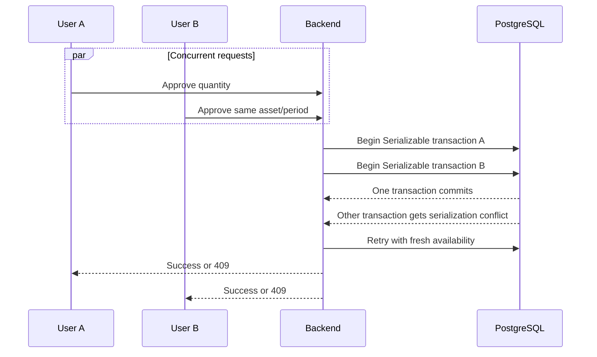

# Database and concurrency

[← Backend specification](../README.md)

## Connection management

Backend ต้องสร้าง PrismaClient เพียง instance เดียวต่อ process และ reuse ตลอดอายุ application ห้ามสร้าง instance ใน controller, request handler หรือ service constructor หลายชุด

ค่าตั้งต้นสำหรับ concept แบบ backend process เดียว:

```ts
const adapter = new PrismaPg({
  connectionString: process.env.DATABASE_URL,
  max: 10,
  connectionTimeoutMillis: 5_000,
  idleTimeoutMillis: 30_000,
});

export const prisma = new PrismaClient({ adapter });
```

- ค่า pool ต้องไม่เกิน PostgreSQL `max_connections` หลังหัก connection สำหรับ administration และ migration
- ต้องตั้ง connection timeout เพื่อไม่ให้ request รอไม่สิ้นสุด
- Backend ต้องปิด Prisma connection อย่าง graceful เมื่อได้รับ termination signal
- ยังไม่ใช้ PgBouncer ใน concept phase

## Concurrency และ transaction consistency

### Read operations

- ใช้ PostgreSQL default `READ COMMITTED`
- Query ต้องเลือกเฉพาะ field ที่ต้องใช้
- ห้ามถือ database transaction ระหว่างรอ user หรือ external I/O

### Critical write operations

ใช้ `Serializable` transaction สำหรับ:

- ตรวจ availability แล้ว submit/approve ReservationItem
- Inventory adjustment และ update `Asset.totalQuantity`
- Prepare/check out หลาย item
- Return approval, inventory ledger effects และ lifecycle completion
- Aggregate Reservation status หลังตัดสิน item



### Retry policy

- Retry Prisma `P2034` write conflict/deadlock สูงสุด 3 attempts
- ใช้ exponential backoff พร้อม jitter ระยะสั้น
- ทุก retry ต้องอ่าน availability/state ใหม่
- ถ้าหลัง retry quantity ไม่พอ ให้ตอบ `409 INSUFFICIENT_QUANTITY`
- ห้าม retry validation, permission หรือ unique-constraint error แบบไม่จำแนก

### Transaction rules

- Transaction ต้องสั้นและ deterministic
- Lock/order asset ตาม UUID ที่ sort แล้วเมื่อ mutation แตะหลาย asset เพื่อลด deadlock
- ห้าม upload file, call HTTP service หรือส่ง notification ภายใน transaction
- Aggregate parent status และ child status ต้อง commit พร้อมกัน
- Ledger entry และ `Asset.totalQuantity` ต้อง commit พร้อมกัน

## Database constraints และ indexes

Prisma schema มี comment สำหรับ check constraints แต่ Prisma schema language ยังไม่ enforce ทุกข้อ จึงต้องเพิ่ม raw SQL ใน migration:

```sql
CHECK (total_quantity >= 0)
CHECK (end_at > start_at)
CHECK (quantity > 0)
CHECK (quantity_returned >= 0)
CHECK (quantity_broken >= 0)
CHECK (quantity_lost >= 0)
```

Business validation ที่ข้ามหลายแถว เช่นยอดคืนรวมไม่เกินยอด checkout ต้องตรวจภายใน transaction

Indexes ที่ต้องประเมินก่อน production:

- Approval queue: `(approver_id, status)`
- Return approval queue: `(approver_id, status)`
- Asset filters: `(management_area_id, is_active)`
- User scope lookup: `(user_id)` และ `(management_area_id)`
- Calendar: ใช้ reservation date/status indexes ที่มีอยู่

ต้องยืนยัน index ด้วย query plan และ load test ห้ามเพิ่ม index ทุก foreign key โดยไม่มี query use case เพราะ index เพิ่มต้นทุนการเขียน
