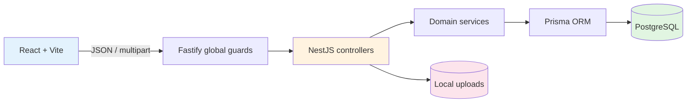

# Implemented API inventory

[← Backend specification](../README.md) · [OpenAPI contract](../contracts/README.md)

เอกสารนี้ตรวจจาก NestJS controllers ที่ register ใน `AppModule` ณ วันที่ 16 สิงหาคม 2026 ทุก endpoint อยู่ใต้ prefix `/api/v1` ยกเว้นไฟล์ที่ serve แบบ static ใต้ `/uploads/` ทุก route ต้องใช้ Bearer token นอกจาก `POST /auth/login`

## Architecture

Authentication guard สร้าง actor/session จาก JWT ทุก request, access guard บังคับ decorator ระดับ global และ service layer บังคับ management-area scope สำหรับ asset/reservation operations

## Authentication and session

| Method | Path | Behavior/access |
| --- | --- | --- |
| POST | `/auth/login` | Public, rate limit 10/minute, password login และคืน bearer token/session |
| GET | `/auth/me` | คืน current `SessionContext` |
| POST | `/auth/logout` | คืน 204; token เป็น stateless จึงไม่มี server-side revocation |
| GET | `/bff/session` | session endpoint ที่ frontend shell ใช้ |

## Access control and administration

| Method | Path | Behavior/access |
| --- | --- | --- |
| GET | `/permissions` | permission catalog; authenticated |
| GET | `/roles` | role list; authenticated |
| POST | `/roles` | สร้าง role และ normalize permission dependency; Global ADMIN |
| PATCH | `/roles/{roleId}` | แก้ description/permissions แบบ optimistic concurrency; Global ADMIN |
| GET | `/management-areas` | search/cursor list; authenticated |
| GET | `/management-areas/{id}` | detail พร้อม asset/user-role counts; Global ADMIN |
| POST | `/management-areas` | สร้าง area ชื่อ unique; Global ADMIN |
| PATCH | `/management-areas/{id}` | แก้ชื่อ/description; Global ADMIN |
| DELETE | `/management-areas/{id}` | ลบเมื่อไม่มี asset; Global ADMIN |
| GET | `/users` | search/status/role/area list; global user-admin permission อย่างน้อยหนึ่งรายการ |
| POST | `/users` | สร้าง password user; global `user:create` |
| GET | `/users/{userId}` | user profile/auth providers/role assignments; global user-admin permission |
| PATCH | `/users/{userId}/status` | enable/disable พร้อม `expectedUpdatedAt`; global `user:disable` |
| POST | `/users/{userId}/role-assignments` | assign global หรือ area-scoped role; global `role:assign` |
| DELETE | `/users/{userId}/role-assignments/{assignmentId}` | remove assignment, 204; global `role:assign` |

## Assets, inventory, templates and uploads

| Method | Path | Behavior/access |
| --- | --- | --- |
| GET | `/assets` | scoped search/filter/cursor list พร้อม availability/capabilities |
| POST | `/assets` | create one asset |
| POST | `/assets/batch` | create assets หลายรายการ |
| POST | `/assets/batch-remove` | soft-disable หลาย asset แบบ optimistic concurrency |
| POST | `/assets/inventory/batch-add` | atomic audited stock addition |
| POST | `/assets/inventory/batch-remove` | atomic audited stock removal |
| GET | `/assets/{assetId}` | detail, active allocations และ inventory ledger |
| PATCH | `/assets/{assetId}` | edit metadata พร้อม `expectedUpdatedAt` |
| PATCH | `/assets/{assetId}/status` | activate/deactivate พร้อม `expectedUpdatedAt` |
| DELETE | `/assets/{assetId}` | compatibility soft-deactivate endpoint |
| POST | `/assets/{assetId}/template` | save asset metadata เป็น template |
| GET | `/asset-templates` | scoped template list |
| POST | `/asset-templates` | create template |
| PATCH | `/asset-templates/{templateId}` | edit template แบบ optimistic concurrency |
| POST | `/uploads/image` | authenticated multipart upload, field `file`, หนึ่งไฟล์สูงสุด 10 MiB; คืน `/uploads/assets/{filename}` |

Asset/template/inventory services ตรวจ permission และ management-area scope ตาม operation ส่วน `/uploads/image` ปัจจุบันต้อง login แต่ไม่มี resource permission เพิ่มเติม Static file URL ใต้ `/uploads/` ไม่ผ่าน `/api/v1`

## Reservations

| Method | Path | Behavior/access |
| --- | --- | --- |
| GET | `/reservations` | views `MINE`, `APPROVALS`, `ALL`; status/area/search/date/cursor filters และ visibility policy |
| POST | `/reservations` | create DRAFT/PENDING; zero-item event auto-approve |
| GET | `/reservations/{reservationId}` | detail, availability, warnings, approvals, change requests และ capabilities |
| POST | `/reservations/{reservationId}/submit` | submit draft ด้วย optimistic concurrency; zero-item draft auto-approve |
| POST | `/reservations/{reservationId}/items/{itemId}/decision` | approve/reject item เดียว |
| POST | `/reservations/{reservationId}/items/decision` | atomic batch approve/reject |
| POST | `/reservations/{reservationId}/change-requests` | request post-submit schedule/item/participant changes |
| POST | `/reservations/{reservationId}/change-requests/{changeRequestId}/decision` | approve/reject change atomically |
| POST | `/reservations/{reservationId}/delivery-confirm` | confirm equipment handover/pickup; transitions items to `DELIVERED` and reservation to `DELIVERY_CONFIRMED` |
| POST | `/reservations/{reservationId}/cancel` | owner/manager cancellation พร้อม optional reason |

## Returns and inspection

| Method | Path | Behavior/access |
| --- | --- | --- |
| GET | `/returns` | views `MINE`, `APPROVALS`, `ALL`; status/area/reservationId filters และ cursor pagination |
| GET | `/returns/{returnId}` | return slip detail พร้อมรายการตรวจรับ, condition breakdown และ approval status |
| POST | `/reservations/{reservationId}/returns` | borrower/participant submits return slip สำหรับคืนอุปกรณ์; creates return in `PENDING` status |
| POST | `/reservations/{reservationId}/returns/{returnId}/decision` | area manager inspects & decides return with Good, Broken, Lost breakdown; auto-adjusts stock for Broken/Lost and completes reservation |

## Runtime behavior shared by every API

- DTO validation transform/whitelist ทำงาน globally; unknown fields ถูกปฏิเสธและ validation error ใช้ HTTP 422
- Error response มี `{ error: { code, message, fields?, requestId } }` และ response มี `X-Request-Id`
- Global throttle ค่าเริ่มต้น 100 requests/minute; login override เป็น 10/minute
- Swagger UI อยู่ที่ `/api/docs` และ JSON ที่ `/api/docs/openapi.json` เมื่อ bundle contract พบตอน startup
- CORS origins, proxy trust, JWT TTL, database pool และ contract path กำหนดผ่าน environment configuration

## Contract coverage audit

OpenAPI modular source register endpoint ทั้งหมดในตารางนี้ รวม role creation, management-area CRUD, cancellation และ upload แล้ว คำสั่ง `npm run openapi:bundle` เป็นตัวตรวจ `$ref` และสร้าง runtime bundle
