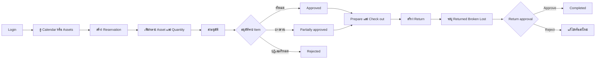

# Asset Reservation — Frontend MVP Feature Specification

เอกสารนี้เป็น source of truth สำหรับ frontend MVP ของระบบจองและคืนทรัพย์สิน โดยอ้างอิงโครงสร้างข้อมูลจาก Prisma ปัจจุบันใน `backend/prisma` เท่านั้น

เอกสารที่เกี่ยวข้อง:

- [Software architecture](../software_spec/README.md)
- [Asset reservation flow](../software_spec/asset-reservation-flow.md)
- [File and schema structure conventions](../software_spec/file-and-schema-structure.md)
- [Backend specification](../backend_spec/README.md)
- [Implemented frontend surface](implementation-status.md) — route และ feature ที่ตรวจจาก source ปัจจุบัน

หลักการสำคัญ:

- หนึ่ง Reservation แทนหนึ่งกิจกรรมและมี ReservationItem ได้หลาย asset
- Asset เป็น catalog/part-number entry แบบมีจำนวนรวม (derive จากการนับ `AssetUnit`) ไม่ใช่ตัว field ที่แก้ได้ตรงๆ ตัวเครื่องจริงแต่ละชิ้นคือ `AssetUnit` แยกตาม serial number
- ชื่อ field ใน frontend contract ใช้ camelCase ให้ตรงกับ Prisma Client
- ค่า status ในฐานข้อมูลเป็น String ดังนั้น frontend ต้องใช้ค่าที่กำหนดในเอกสารนี้เท่านั้น
- Frontend ไม่ใช่ security boundary; backend ต้องตรวจ authentication, permission, management-area scope, availability และ state transition ทุก mutation

## Documentation structure

| กลุ่ม  | เอกสาร                                                       | เนื้อหา                                        |
| ------ | ------------------------------------------------------------ | ---------------------------------------------- |
| Pages  | [Login](pages/login.md)                                      | Authentication และ session                     |
| Pages  | [Calendar](pages/calendar.md)                                | Calendar และการเริ่ม Reservation               |
| Pages  | [Assets & inventory](pages/assets-and-inventory.md)          | Asset และ inventory ledger                     |
| Pages  | [Reservations](pages/reservations.md)                        | Create, lifecycle, approval และ change request |
| Pages  | [Returns](pages/returns.md)                                  | Partial return และ return approval             |
| Pages  | [Administration](pages/admin.md)                             | Users, roles และ management areas              |
| Detail | [Access control](detail/access-control.md)                   | Role, permission และ management-area scope     |
| Detail | [Design System & UI Baseline](detail/design-system.md)       | Typography, Colors, Availability Badges, [Interactive HTML Guide](design-system.html) |
| Detail | [Application shell](detail/application-shell.md)             | Navigation, visual language และ accessibility  |
| Detail | [Status reference](detail/status-reference.md)               | Status ที่ frontend รองรับ                     |
| Detail | [Frontend data contracts](detail/frontend-data-contracts.md) | TypeScript DTO contracts                       |
| Detail | [Hybrid BFF integration](detail/hybrid-bff-integration.md)   | Page queries, commands และ query invalidation  |
| Detail | [API contract](detail/api-contract.md)                       | Operations และ error behavior                  |
| Detail | [Quality & testing](detail/quality-and-testing.md)           | UI states, acceptance criteria และ test matrix |
| Detail | [Scope & roadmap](detail/scope-and-roadmap.md)               | Out of scope และลำดับพัฒนา                     |

```text
docs/frontend_spec/
├── README.md
├── design-system.html
├── pages/
│   ├── README.md
│   ├── login.md
│   ├── calendar.md
│   ├── assets-and-inventory.md
│   ├── reservations.md
│   ├── returns.md
│   └── admin.md
└── detail/
    ├── README.md
    ├── design-system.md
    ├── access-control.md
    ├── application-shell.md
    ├── status-reference.md
    ├── frontend-data-contracts.md
    ├── hybrid-bff-integration.md
    ├── api-contract.md
    ├── quality-and-testing.md
    └── scope-and-roadmap.md
```

## Prisma models ที่เป็นขอบเขตของ MVP

| Domain           | Prisma models                                                | หน้าที่ใน frontend                                          |
| ---------------- | -------------------------------------------------------------- | ------------------------------------------------------------ |
| User             | User, UserProfile, UserAuthIdentity                            | Session, profile และช่องทางเข้าสู่ระบบ (รวม Google/Microsoft link) |
| Access control   | Role, UserRole, ManagementArea                                 | Role แบบ global หรือจำกัด management area                    |
| Asset catalog    | Asset                                                           | Catalog/part-number entry (name, partNumber, description, isActive) |
| Asset units      | AssetUnit, AssetUnitEventBatch, AssetUnitEvent                  | ตัวเครื่องจริงแยก serial number, status และ event ledger      |
| Reservation      | Reservation, ReservationItem, ReservationItemUnit, ReservationParticipant | กิจกรรมจอง หลายรายการ, unit ที่ assign ให้แต่ละ item และผู้เข้าร่วม |
| Approval/change  | ReservationItemApproval, ReservationChangeRequest               | อนุมัติราย asset และคำขอแก้ไข                                 |
| Return           | Return, ReturnItem, ReturnItemUnit, ReturnApproval               | ส่งคืนเป็นรายหน่วย (serial) พร้อม condition GOOD/BROKEN/LOST     |

Frontend ต้องไม่สร้าง field หรือ feature ที่ต้อง persist แต่ไม่มี model รองรับ เช่น asset category, location, notification workspace setting หรือไฟล์แนบระดับ asset (`Asset.partNumber` และ `AssetUnit.status`/`ownerId`/`visibility` เป็น field จริงที่มีอยู่แล้ว ไม่ใช่ตัวอย่างของสิ่งที่ห้ามสร้าง)

## MVP user flow



## Information architecture

| Route                       | หน้า                                  | Permission/เจ้าของข้อมูล                    |
| ---------------------------- | -------------------------------------- | -------------------------------------------- |
| /login                      | Sign in                                | Public                                       |
| /auth/callback              | OAuth callback (Google/Microsoft)      | Public                                       |
| /connect-account (+callback) | Mandatory account-link gate            | ผู้ใช้ที่เข้าสู่ระบบ                          |
| /account                    | Self-service profile/password/link     | ผู้ใช้ที่เข้าสู่ระบบ                          |
| /calendar                   | Reservation calendar                   | ผู้ใช้ที่เข้าสู่ระบบ                          |
| /assets                     | Asset inventory                        | asset:view                                   |
| /assets/:id                 | Asset details และ unit event ledger    | asset:view                                   |
| /assets/new                 | Create asset                           | asset:create                                 |
| /assets/:id/edit            | Edit asset                             | asset:update                                 |
| /reservations               | My reservations / approval queue       | Session user / reservation:approve           |
| /approvals                  | รวม item และ change-request approvals ที่ทำได้ | reservation approve/reject permission |
| /reservations/new           | Create reservation                     | reservation:create                           |
| /reservations/:id           | Reservation details (submit/decision/delivery-confirm/return อยู่ในหน้านี้ ไม่ใช่ route แยก) | Owner, participant หรือผู้มี scope |
| /admin/users                | Users and roles                        | user:create, user:disable หรือ role:assign   |
| /admin/areas                | Management areas                       | Global ADMIN                                 |
| /admin/access               | Permission catalog และ role editor     | Global ADMIN                                 |
| /admin/notifications        | SMTP settings และ email templates      | Global ADMIN                                 |

> ตารางนี้แสดง route ที่ register ใน `frontend/src/app.tsx` จริง — ไม่มี `/returns`, `/returns/:id` หรือ `/inventory/adjustments/new` เป็น route แยกต่างหาก สำหรับสถานะ feature รายหน้าและข้อจำกัดของ frontend ปัจจุบัน ดู [Implemented frontend surface](implementation-status.md)

หลัง login หรือเข้า / ให้ redirect ไป /calendar
