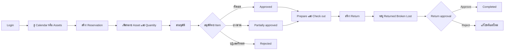

# Asset Reservation — Frontend MVP Feature Specification

เอกสารนี้เป็น source of truth สำหรับ frontend MVP ของระบบจองและคืนทรัพย์สิน โดยอ้างอิงโครงสร้างข้อมูลจาก Prisma ปัจจุบันใน `backend/prisma` เท่านั้น

เอกสารที่เกี่ยวข้อง:

- [Software architecture](../software_spec/README.md)
- [File and schema structure conventions](../software_spec/file-and-schema-structure.md)
- [Backend specification](../backend_spec/README.md)

หลักการสำคัญ:

- หนึ่ง Reservation แทนหนึ่งกิจกรรมและมี ReservationItem ได้หลาย asset
- Asset เป็นรายการทรัพย์สินแบบมีจำนวนรวม ไม่ใช่ทรัพย์สินรายชิ้นที่มี asset tag
- ชื่อ field ใน frontend contract ใช้ camelCase ให้ตรงกับ Prisma Client
- ค่า status ในฐานข้อมูลเป็น String ดังนั้น frontend ต้องใช้ค่าที่กำหนดในเอกสารนี้เท่านั้น
- Frontend ไม่ใช่ security boundary; backend ต้องตรวจ authentication, permission, management-area scope, quantity และ state transition ทุก mutation

## Documentation structure

| กลุ่ม  | เอกสาร                                                       | เนื้อหา                                        |
| ------ | ------------------------------------------------------------ | ---------------------------------------------- |
| Pages  | [Login](pages/login.md)                                      | Authentication และ session                     |
| Pages  | [Calendar](pages/calendar.md)                                | Calendar และการเริ่ม Reservation               |
| Pages  | [Assets & inventory](pages/assets-and-inventory.md)          | Asset, template และ inventory ledger           |
| Pages  | [Reservations](pages/reservations.md)                        | Create, lifecycle, approval และ change request |
| Pages  | [Returns](pages/returns.md)                                  | Partial return และ return approval             |
| Pages  | [Administration](pages/admin.md)                             | Users, roles และ management areas              |
| Detail | [Access control](detail/access-control.md)                   | Role, permission และ management-area scope     |
| Detail | [Application shell](detail/application-shell.md)             | Navigation, visual language และ accessibility  |
| Detail | [Status reference](detail/status-reference.md)               | Status ที่ frontend รองรับ                     |
| Detail | [Frontend data contracts](detail/frontend-data-contracts.md) | TypeScript DTO contracts                       |
| Detail | [Hybrid BFF integration](detail/hybrid-bff-integration.md)   | Page queries, commands และ query invalidation  |
| Detail | [API contract](detail/api-contract.md)                       | Operations และ error behavior                  |
| Detail | [Quality & testing](detail/quality-and-testing.md)           | UI states, acceptance criteria และ test matrix |
| Detail | [Scope & roadmap](detail/scope-and-roadmap.md)               | Out of scope และลำดับพัฒนา                     |

```text
docs/frontend_spec/
├── README.md
├── pages/
│   ├── README.md
│   ├── login.md
│   ├── calendar.md
│   ├── assets-and-inventory.md
│   ├── reservations.md
│   ├── returns.md
│   └── admin.md
└── detail/
    ├── README.md
    ├── access-control.md
    ├── application-shell.md
    ├── status-reference.md
    ├── frontend-data-contracts.md
    ├── hybrid-bff-integration.md
    ├── api-contract.md
    ├── quality-and-testing.md
    └── scope-and-roadmap.md
```

## Prisma models ที่เป็นขอบเขตของ MVP

| Domain           | Prisma models                                        | หน้าที่ใน frontend                              |
| ---------------- | ---------------------------------------------------- | ----------------------------------------------- |
| User             | User, UserProfile, UserAuthIdentity                  | Session, profile และช่องทางเข้าสู่ระบบ          |
| Access control   | Role, UserRole, ManagementArea                       | Role แบบ global หรือจำกัด management area       |
| Inventory        | AssetTemplate, Asset                                 | ข้อมูลต้นแบบและ asset แบบมีจำนวน                |
| Inventory ledger | AssetTransactionBatch, AssetTransaction              | ประวัติการเพิ่ม ลด สูญหาย ชำรุด ซ่อม และปรับยอด |
| Reservation      | Reservation, ReservationItem, ReservationParticipant | กิจกรรมจอง หลายรายการ และผู้เข้าร่วม            |
| Approval/change  | ReservationItemApproval, ReservationChangeRequest    | อนุมัติราย asset และคำขอแก้ไข                   |
| Return           | Return, ReturnItem, ReturnApproval                   | ส่งคืนเป็นจำนวน พร้อมจำนวนปกติ ชำรุด และสูญหาย  |

Frontend ต้องไม่สร้าง field หรือ feature ที่ต้อง persist แต่ไม่มี model รองรับ เช่น asset tag, category, location, condition, notification, workspace setting หรือไฟล์แนบ

## MVP user flow



## Information architecture

| Route แนะนำ                | หน้า                             | Permission/เจ้าของข้อมูล                   |
| -------------------------- | -------------------------------- | ------------------------------------------ |
| /login                     | Sign in                          | Public                                     |
| /calendar                  | Reservation calendar             | ผู้ใช้ที่เข้าสู่ระบบ                       |
| /assets                    | Asset inventory                  | asset:view                                 |
| /assets/:id                | Asset details และ ledger         | asset:view                                 |
| /assets/new                | Create asset                     | asset:create                               |
| /assets/:id/edit           | Edit asset                       | asset:update                               |
| /inventory/adjustments/new | Create transaction batch         | asset:update                               |
| /reservations              | My reservations / approval queue | Session user / reservation:approve         |
| /reservations/new          | Create reservation               | reservation:create                         |
| /reservations/:id          | Reservation details              | Owner, participant หรือผู้มี scope         |
| /returns                   | Return queue                     | เจ้าของรายการหรือ return:approve           |
| /returns/:id               | Return details/approval          | เจ้าของรายการหรือ return:approve           |
| /admin/users               | Users and roles                  | user:create, user:disable หรือ role:assign |
| /admin/management-areas    | Management areas                 | ADMIN                                      |
| /admin/asset-templates     | Asset templates                  | ADMIN หรือ MANAGER ตาม policy              |

หลัง login หรือเข้า / ให้ redirect ไป /calendar
