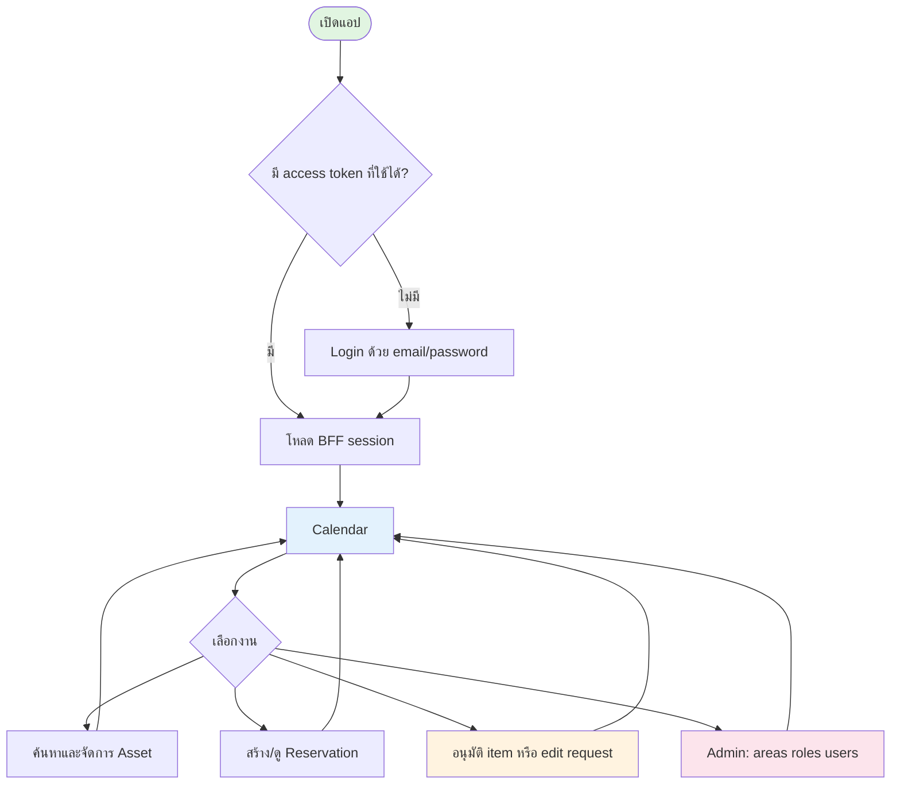
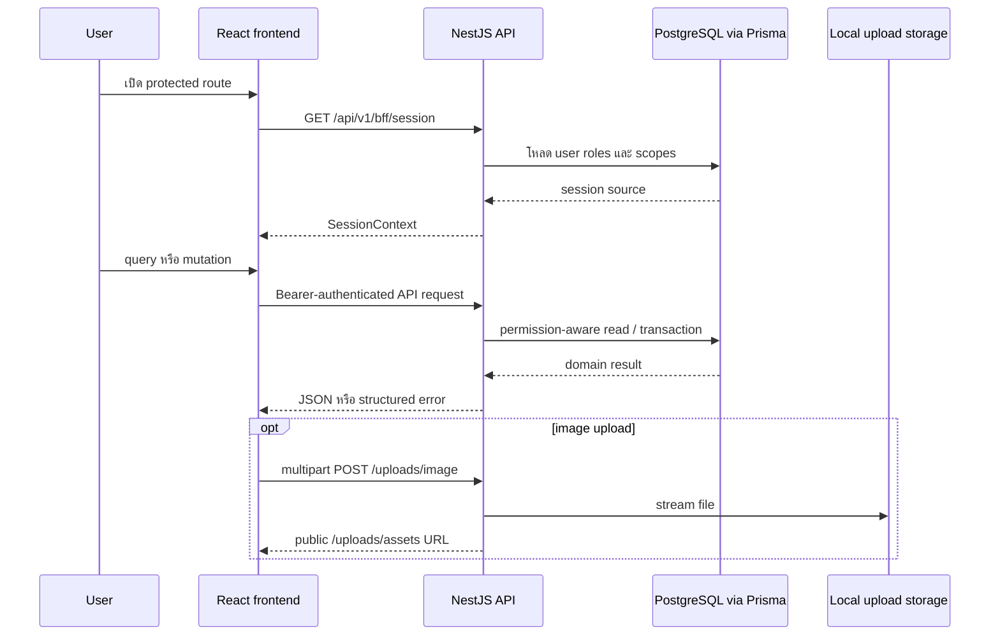

# Implemented frontend surface

[← กลับไปสารบัญ](README.md)

เอกสารนี้เป็น snapshot ของ **frontend first draft** ที่ตรวจจาก `frontend/src/app.tsx`, `frontend/src/pages`, `frontend/src/components`, `frontend/src/api.ts` และ tests ณ วันที่ 16 สิงหาคม 2026 ใช้แยกสิ่งที่ใช้งานได้จริงออกจากเอกสาร product specification ที่อาจรวม roadmap ในอนาคต

## User flow ที่ implement แล้ว

## Route และ feature inventory

ทุก route ยกเว้น `/login` ผ่าน protected shell; route ที่ไม่รู้จัก redirect ไป `/` และ `/` redirect ต่อไป `/calendar`

| Route | Page/component | Feature ที่ implement แล้ว | Access ที่ UI ใช้ |
| --- | --- | --- | --- |
| `/login` | `LoginPage` | email/password login, field/API error, callback ไป path เดิม, redirect session ที่ login แล้ว | Public |
| `/calendar` | `CalendarPage` | continuous month calendar, Today/date picker, status/workspace filters, event minibox, asset picker search/list/grid, date-range drag/keyboard selection, prefill reservation, approve/reject pending items, cancel reservation | Login; create controlsต้องมี `reservation:create`; review/cancel ใช้ capabilities จาก API |
| `/assets` | `AssetsPage` | search, workspace/template/status filters, list/card responsive views, cursor load-more, multi-select, batch stock add/remove, batch disable | `asset:view`; action ตาม `asset:create`, per-asset capabilities |
| `/assets/new` | `AssetFormPage` | single/batch create, workspace selection, quantity/description, preview, upload file, camera capture, remove/replace photo | `asset:create` ในอย่างน้อยหนึ่ง area |
| `/asset/new` | Redirect | compatibility redirect ไป `/assets/new` | Login |
| `/assets/:assetId` | `AssetDetailPage` | metadata/owner/edit policy, allocations, ledger, activate/deactivate, single stock add/remove | visibility และ capabilities จาก API |
| `/assets/:assetId/edit` | `AssetFormPage` | edit name, area, description และ picture; quantity แก้ผ่าน inventory action | `canEdit`/backend permission |
| `/reservations` | `ReservationsPage` | My reservations/Approval queue tabs, search, grouped status/workspace/date filters, cursor load-more | reservation permission อย่างน้อยหนึ่งรายการ; review tab ต้อง approve/reject |
| `/reservations/new` | `ReservationCreatePage` | event schedule, optional asset manifest, quantity, URL-prefilled dates/assets, recent reservations, reference lookup, create draft หรือ submit | `reservation:create` และ area permission ของ asset |
| `/reservations/:reservationId` | `ReservationDetailPage` | schedule/requester/participants/items, availability warnings, submit draft, item single/batch approve/reject, cancel, request edit, approve/reject edit request | capabilities จาก reservation detail |
| `/admin/areas` | `ManagementAreasPage` | search/list, create, edit, delete confirmation | navigation และ mutation UI จำกัด Global ADMIN |
| `/admin/access` | `AccessPage` | permission catalog grouped by resource, role selection, create role, edit description/permissions, dirty-state save | Global ADMIN |
| `/admin/users` | `UsersPage` | search/status/role/area filters, detail drawer, create account with optional uploaded/camera photo, enable/disable, assign/remove scoped roles | global `user:create`, `user:disable`, หรือ `role:assign` ตาม action |
| `/admin/templates` | Redirect | redirect ไป `/admin/areas`; `TemplatesPage` ยังอยู่ใน source แต่ไม่ได้ register เป็น route | Login |

## Shared application features

- Desktop sidebar และ mobile bottom navigation ถูกสร้างตาม effective permissions
- Light/dark theme เก็บใน `localStorage` key `asset-rail.theme`
- Bearer token เก็บใน `sessionStorage` key `asset-rail.access-token`; HTTP 401 ล้าง session ผ่าน event กลาง
- Loading, empty, error, notice, dialog, pagination, filter และ field primitives ใช้ร่วมกันจาก `components/ui.tsx`
- Frontend เรียก API ผ่าน `/api/v1`; dev server proxy ทั้ง `/api` และ `/uploads` ไป backend
- Upload รองรับ file picker และกล้องผ่าน `CameraCaptureModal`; backend จำกัดหนึ่งไฟล์ต่อ request และขนาด 10 MiB
- Layout มี responsive breakpoints สำหรับ navigation, tables/cards, forms, calendar และ dialogs

## สิ่งที่ยังไม่ implement ใน frontend first draft

- Return creation, partial return และ return approval ไม่มี route/page/API client แม้ Prisma/spec วาง roadmap ไว้
- Lifecycle actions PREPARED, CHECKED_OUT และ RETURNED ยังไม่มี frontend command
- External identity buttons ไม่มีใน `LoginPage`; login ปัจจุบันเป็น email/password เท่านั้น
- Asset template page เดิมไม่ reachable และ create asset form ปัจจุบันไม่ได้เปิด template picker
- ไม่มี standalone inventory-adjustment route; การปรับยอดทำจาก asset list/detail

## Data flow

## Verification map

Vitest coverage มีสำหรับ API/auth และหน้า Login, Access, Management Areas, Assets, Asset Form, Calendar, Reservation Create/List/Detail ส่วน `AssetDetailPage`, `UsersPage`, shared shell/UI และ unreachable `TemplatesPage` ยังไม่มี page-level test โดยตรง จึงต้องพึ่ง TypeScript build และ manual/runtime verification เพิ่มเติม
