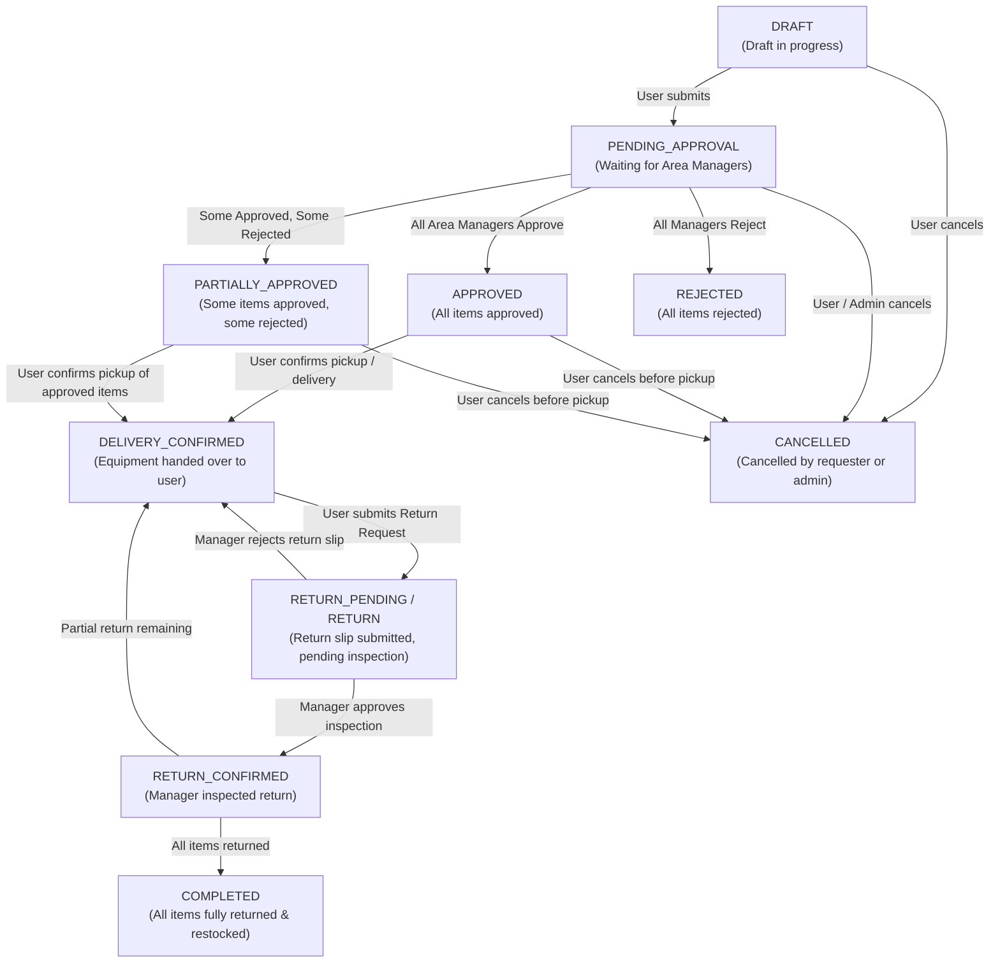
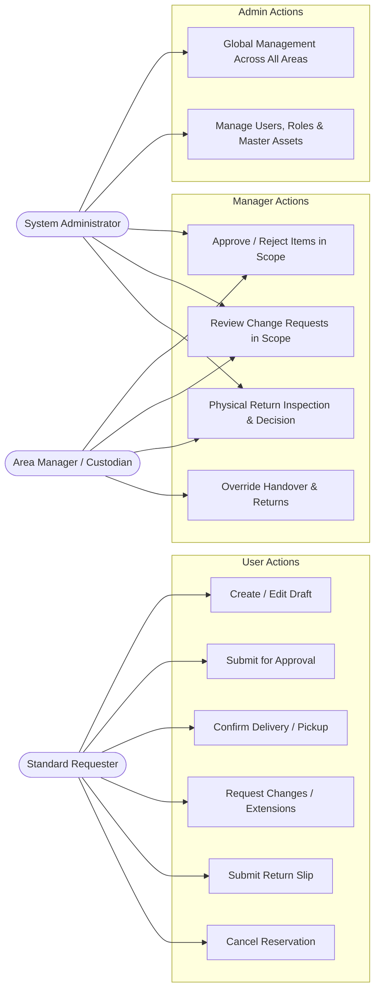

# 📋 Asset Reservation System — Complete Frontend Architecture & UI Redesign Blueprint

> **Document Version:** 2.0.0  
> **Target Audience:** Frontend Engineers, UI/UX Designers, Full-Stack Developers  
> **Scope:** Full Reservation Lifecycle, REST API Contracts, State Machines, UI Component Hierarchy, and Redesign Specifications for the Reservations System.

---

## 📑 Table of Contents
1. [System Overview & Business Principles](#1-system-overview--business-principles)
2. [Complete Reservation State Machine & Lifecycle](#2-complete-reservation-state-machine--lifecycle)
3. [Actors, Permissions & Capabilities Matrix](#3-actors-permissions--capabilities-matrix)
4. [Complete REST API Specification & Contracts](#4-complete-rest-api-specification--contracts)
5. [New Reservations Page UI/UX Redesign Specification](#5-new-reservations-page-uiux-redesign-specification)
6. [Component Hierarchy & State Management Architecture](#6-component-hierarchy--state-management-architecture)
7. [Edge Cases, Conflict Detection & Inventory Adjustment Rules](#7-edge-cases-conflict-detection--inventory-adjustment-rules)

---

## 1. System Overview & Business Principles

The Asset Reservation System manages shared organizational equipment across multiple distinct **Management Areas** (e.g. Application Engineer Lab, Marketing Production Gear, Human Resource Kits).

### Core Principles
1. **Multi-Area Independence:** A single reservation can request equipment from multiple management areas simultaneously. Approval is granular at the item level by each respective Area Manager.
2. **Deterministic State Derivation:** Parent reservation status is automatically derived from the collective statuses of its items and approval records.
3. **Strict Chain of Custody:**
   - Equipment cannot be used until **Delivery is Confirmed** (`DELIVERY_CONFIRMED`).
   - Equipment cannot be returned until it has been delivered.
   - Return is a **two-step workflow**: (1) Requester declares count returned $\rightarrow$ (2) Area Manager physically inspects condition into **Good (Intact)**, **Broken**, or **Lost**.

---

## 2. Complete Reservation State Machine & Lifecycle

### 2.1 High-Level Lifecycle Flowchart



---

### 2.2 Reservation Status Dictionary

| Status Key | UI Label | Badge Color | Meaning & Allowed Next Transitions |
78: | :--- | :--- | :--- | :--- |
79: | `DRAFT` | Draft | Gray (Neutral) | User is compiling item manifest. Next: `PENDING_APPROVAL`, `CANCELLED` |
80: | `PENDING_APPROVAL` | Pending approval | Amber (Warning) | Submitted for review. Area Managers reviewing item lines. Next: `APPROVED`, `PARTIALLY_APPROVED`, `REJECTED`, `CANCELLED` |
81: | `PARTIALLY_APPROVED` | Partially approved | Violet (Info) | Some items approved, others rejected. Usable for approved items. Next: `DELIVERY_CONFIRMED`, `CANCELLED` |
82: | `APPROVED` | Approved | Green (Success) | All requested equipment lines approved. Ready for handover. Next: `DELIVERY_CONFIRMED`, `CANCELLED` |
83: | `DELIVERY_CONFIRMED` | Delivery Confirmed | Cyan (Teal) | Equipment handed over and in requester possession. Next: `RETURN_PENDING`, `COMPLETED` |
84: | `RETURN` / `RETURN_PENDING` | Return Pending | Orange (Alert) | User submitted return slip; awaiting manager warehouse inspection. Next: `RETURN_CONFIRMED`, `COMPLETED` |
85: | `RETURN_CONFIRMED` | Partially Return | Emerald (Success) | Manager completed inspection and ledger updated. Next: `COMPLETED`, `DELIVERY_CONFIRMED` (if partial units remain) |
86: | `COMPLETED` | Completed | Slate / Green (Muted) | All items accounted for, restocked, or marked broken/lost. Final state. |
87: | `REJECTED` | Rejected | Red (Danger) | All items rejected by Area Managers. Final state. |
88: | `CANCELLED` | Cancelled | Zinc (Dimmed) | Cancelled by user before pickup. Final state. |

---

### 2.3 Reservation Item Status Dictionary

| Item Status Key | Description | Who Sets It |
| :--- | :--- | :--- |
| `PENDING` | Newly requested asset unit line | System upon submission |
| `APPROVED` | Asset line approved by Area Manager | Area Manager (`return:approve` / `reservation:approve`) |
| `REJECTED` | Asset line rejected by Area Manager | Area Manager (`reservation:reject`) |
| `PREPARED` | Asset packed & prepared in warehouse | Warehouse Staff / Area Manager |
| `CHECKED_OUT` / `DELIVERED` | Asset handed over to borrower (`checkedOutBy`, `checkedOutAt`) | Requester or Manager (via Delivery Confirm) |
| `RETURNED` | Asset returned, inspected, and restocked | Area Manager (via Return Decision) |

---

## 3. Actors, Permissions & Capabilities Matrix

The UI dynamically exposes action buttons based on the `capabilities` payload returned from API endpoints.



### Action Capability Rules Table

| Capability Flag | Enabled When (Conditions) | Primary UI Trigger |
| :--- | :--- | :--- |
| `capabilities.canSubmit` | `status === 'DRAFT'` AND actor is requester | **"Send for approval"** button |
| `capabilities.canRequestChange` | `['PENDING_APPROVAL', 'APPROVED', 'PARTIALLY_APPROVED'].includes(status)` AND no pending change request | **"Request changes"** button |
| `capabilities.canConfirmDelivery` | `['APPROVED', 'PARTIALLY_APPROVED', 'DELIVERY_CONFIRMED'].includes(status)` AND has deliverable items | **"Confirm delivery"** button |
| `capabilities.canReturn` | `['DELIVERY_CONFIRMED', 'RETURN', 'RETURN_PENDING'].includes(status) || (new Date() >= new Date(reservation.endAt))` AND remaining items > 0 | **"Return request"** button / inline form |
| `capabilities.canCancel` | `['DRAFT', 'PENDING_APPROVAL', 'APPROVED', 'PARTIALLY_APPROVED'].includes(status)` AND not yet delivered | **"Cancel reservation"** button |
| `capabilities.canReview` | `status === 'PENDING_APPROVAL'` AND actor has `reservation:approve` in item area | **"Approve / Reject selected"** batch bar |

### Cross-User Visibility (Permission-Gated)

| Permission | Scope | Effect |
| :--- | :--- | :--- |
| `reservation:view` (global) | System-wide | Actor can browse all reservations in the `ALL` view and access any reservation detail page |
| `reservation:view` (area-scoped) | Per management area | Actor can browse and view detail of reservations that include items from their permitted area(s) |
| *(none)* | — | Actor sees only their own reservations (as requester or participant) in `ALL` view; detail access denied for other users' reservations |

> **Note:** Operational permissions (`reservation:approve`, `reservation:reject`, `reservation:update`) **do not** grant cross-user view access. They grant action capability only. Assign `reservation:view` separately to any role that needs to browse reservations across the system.

---

## 4. Complete REST API Specification & Contracts

Base URL Prefix: `/api/v1`  
Authentication: HTTP Bearer Token (`Authorization: Bearer <token>`)

---

### 4.1 List Reservations
- **Endpoint:** `GET /api/v1/reservations`
- **Query Parameters:**
  - `view`: `'MINE'` | `'APPROVALS'` (default: `'MINE'`)
  - `status`: Optional status filter (e.g. `'PENDING_APPROVAL'`, `'APPROVED'`)
  - `areaId`: UUID of Management Area
  - `search`: Case-insensitive text search for event name / description
  - `from`: ISO 8601 Start Date filter
  - `to`: ISO 8601 End Date filter
  - `cursor`: Next page cursor ID
  - `limit`: Integer (default: 20, max: 100)
- **Response Structure:**
```json
{
  "data": [
    {
      "id": "00000000-0000-4000-8000-000000000602",
      "eventName": "Product Launch Video Shoot",
      "description": "Approved camera reservation for marketing content.",
      "startAt": "2026-09-10T02:00:00.000Z",
      "endAt": "2026-09-10T11:00:00.000Z",
      "status": "APPROVED",
      "requester": {
        "id": "uuid",
        "email": "user1@example.com",
        "name": "User One",
        "profilePictureUrl": null
      },
      "managementAreas": [
        { "id": "uuid", "name": "Marketing" }
      ],
      "itemCount": 1,
      "totalQuantity": 1,
      "pendingItemCount": 0,
      "approvedItemCount": 1,
      "rejectedItemCount": 0,
      "hasPendingChangeRequest": false,
      "pendingDecisionCount": 0,
      "capabilities": {
        "canSubmit": false,
        "canRequestChange": true,
        "canReview": false,
        "canConfirmDelivery": true,
        "canCancel": true
      },
      "createdAt": "2026-08-16T16:10:59.327Z",
      "updatedAt": "2026-08-16T16:10:59.327Z"
    }
  ],
  "pageInfo": {
    "nextCursor": null,
    "hasNextPage": false
  }
}
```

---

### 4.2 Get Reservation Detail
- **Endpoint:** `GET /api/v1/reservations/:id`
- **Response Structure:** Includes full item manifests, return summaries, approvals, change requests, and return records:
```json
{
  "id": "00000000-0000-4000-8000-000000000602",
  "eventName": "Product Launch Video Shoot",
  "description": "Approved camera reservation for marketing content.",
  "startAt": "2026-09-10T02:00:00.000Z",
  "endAt": "2026-09-10T11:00:00.000Z",
  "status": "APPROVED",
  "requester": {
    "id": "uuid",
    "email": "user1@example.com",
    "name": "User One",
    "profilePictureUrl": null
  },
  "participants": [],
  "items": [
    {
      "id": "00000000-0000-4000-8000-000000000613",
      "asset": {
        "id": "00000000-0000-4000-8000-000000000403",
        "name": "Sony Alpha 7 IV Kit",
        "description": "Full-frame mirrorless camera with 24-70mm lens.",
        "pictureUrl": null,
        "totalQuantity": 3,
        "managementArea": {
          "id": "00000000-0000-4000-8000-000000000203",
          "name": "Marketing"
        }
      },
      "quantity": 1,
      "status": "APPROVED",
      "returnSummary": {
        "returnedQuantity": 0,
        "brokenQuantity": 0,
        "lostQuantity": 0,
        "pendingReturnQuantity": 0,
        "remainingReturnQuantity": 1
      },
      "approval": {
        "id": "uuid",
        "status": "APPROVED",
        "comment": "Approved for event",
        "decidedAt": "2026-08-16T16:10:59.327Z",
        "approver": { "id": "uuid", "name": "Marketing Manager", "email": "mk@example.com" }
      },
      "capabilities": {
        "canApprove": false,
        "canReject": false,
        "canConfirmDelivery": true
      }
    }
  ],
  "returns": [],
  "changeRequests": [],
  "capabilities": {
    "canSubmit": false,
    "canRequestChange": true,
    "canReview": false,
    "canConfirmDelivery": true,
    "canReturn": false,
    "canCancel": true
  }
}
```

---

### 4.3 Delivery Confirmation (Handover)
- **Endpoint:** `POST /api/v1/reservations/:id/delivery-confirm`
- **Request Body (Optional Item Filter):**
```json
{
  "itemIds": ["00000000-0000-4000-8000-000000000613"]
}
```
*(If `itemIds` is omitted, all approved items on manifest are confirmed delivered).*

---

### 4.4 Submit Return Request (User Stage)
- **Endpoint:** `POST /api/v1/reservations/:id/returns`
- **Request Body:**
```json
{
  "items": [
    {
      "reservationItemId": "00000000-0000-4000-8000-000000000613",
      "quantityReturned": 1,
      "quantityBroken": 0,
      "quantityLost": 0,
      "description": "Camera returned in original protective case."
    }
  ],
  "note": "Returned to marketing gear room"
}
```

---

### 4.5 Inspect & Decide Return (Manager Stage)
- **Endpoint:** `POST /api/v1/reservations/:id/returns/:returnId/decision`
- **Request Body:**
```json
{
  "decision": "APPROVE",
  "items": [
    {
      "reservationItemId": "00000000-0000-4000-8000-000000000613",
      "quantityReturned": 1,
      "quantityBroken": 0,
      "quantityLost": 0,
      "description": "Inspected lens and sensor - perfect working order."
    }
  ],
  "description": "Restocked into available marketing pool."
}
```

---

## 5. New Reservations Page UI/UX Redesign Specification

### 5.1 Design System Tokens & Aesthetics
- **Color Scheme:** Professional Slate Neutral base (`#0f172a`), Clean Surface cards (`#ffffff` / `#1e293b`), Tailored accents (Emerald for Approved/Handover, Amber for Pending Reviews, Blue for In-Use Active, Red for Rejected/Cancelled).
- **Typography:** Display Header: `Instrument Sans`, Data & Codes: `IBM Plex Mono`.
- **Layout Rhythm:** Fluid 12-column responsive layout, 16px/24px grid spacing, rounded 12px card containers with subtle border elevations.

---

### 5.2 Top Navigation & View Switcher (Tri-View Bar)

```
[ 📑 My Reservations (5) ]  [ 📥 Approval Queue (2) ]  [ 🌐 All System Events ]
```
1. **My Reservations:** Shows reservations created by or participating the logged-in user.
2. **Approval Queue:** Shows pending items waiting for Area Manager review with badges.
3. **All System Events:** (For Admins / Managers) Overview of all reservations across the organization.

---

### 5.3 Quick KPI & Metric Health Strip
Directly above the table/card list, 4 interactive Metric Chips summarize active state:
- ⏳ **Awaiting Review (3):** Filters to `PENDING_APPROVAL`
- 🚚 **Ready for Pickup (2):** Filters to `APPROVED` / `PARTIALLY_APPROVED`
- ⚡ **Currently Active (4):** Filters to `DELIVERY_CONFIRMED` / `ACTIVE`
- 📦 **Pending Return (1):** Filters to `RETURN_PENDING`

---

### 5.4 Redesigned Reservation Card / Data Row Structure

Each reservation item in the list features a **5-Step Visual Stepper Track**:

```
[Draft] ───> [Approved] ───> [Handover / Pickup] ───> [In Use] ───> [Returned / Completed]
  ⚪              🟢                  🟢                  🔵                 ⚪
```

#### Card Layout Components:
1. **Header Row:** Event Title, Event ID Badge (`#602`), Primary Status Pill, Relative Time Badge ("Starts in 2 days").
2. **Schedule Track:** Start Date & Time $\rightarrow$ End Date & Time with duration pill ("3 hrs").
3. **Asset Manifest Avatar Stack:** Thumbnail pictures of requested assets with quantity multiplier tags (`Sony A7 IV x1`, `Logic Pro x2`).
4. **Area Scope Badges:** Colored tags showing involved Management Areas (`[Marketing]`, `[Application Engineer]`).
5. **Contextual Action Bar:**
   - For Requester in `APPROVED`: Green **"Confirm Pickup"** button.
   - For Requester in `DELIVERY_CONFIRMED`: Blue **"Return Gear"** button.
   - For Manager in `PENDING_APPROVAL`: Amber **"Review Request"** button.
   - For Manager in `RETURN_PENDING`: Violet **"Inspect Return"** button.
   - Ellipsis Menu `(...)`: View Details, Request Changes, Download Slip, Cancel.

---

### 5.5 Interactive Modal Dialogs Specification

1. **`CreateReservationModal` (Wizard Flow):**
   - Step 1: Event Schedule & Title (`eventName`, `startAt`, `endAt`, `description`).
   - Step 2: Visual Asset Browser with real-time stock availability check.
   - Step 3: Add Participants & Review Overlap Warnings.
   - Action: **"Save Draft"** or **"Submit for Approval"**.

2. **`ConfirmDeliveryDialog`:**
   - Allows full one-click receipt or granular per-item checkboxes.
   - Displays borrower name and timestamp confirmation.

3. **`ReturnRequestDialog` (User Form):**
   - Simple, frictionless numeric inputs for units being returned.
   - Optional return note for drop-off location.

4. **`PhysicalInspectionModal` (Manager Form):**
   - Detailed per-item condition breakdown:
     - 🟢 **Good (Intact)** $\rightarrow$ restocks to available pool (`+delta`).
     - 🟡 **Broken** $\rightarrow$ flags for maintenance ledger.
     - 🔴 **Lost** $\rightarrow$ permanently decrements master inventory (`-delta`).
   - Notes field for repair estimates or damage description.

5. **`ChangeRequestDialog`:**
   - Displays Before vs. After comparison side-by-side.
   - Area Managers can approve/reject time extensions or item additions without cancelling original reservation.

---

## 6. Component Hierarchy & State Management Architecture

```
src/
├── pages/
│   ├── ReservationsPage/
│   │   ├── index.tsx                         # Main Container & View Switcher
│   │   ├── components/
│   │   │   ├── ReservationMetricStrip.tsx    # 4 Quick Metric KPI Chips
│   │   │   ├── ReservationFilterBar.tsx      # Search, Status Pills, Area Dropdowns
│   │   │   ├── ReservationCardList.tsx       # Card / List View Renderers
│   │   │   ├── ReservationCard.tsx           # Individual Item Card with Stepper
│   │   │   ├── ReservationTimelineTrack.tsx  # 5-Stage Visual Progress Bar
│   │   │   └── AssetManifestStack.tsx        # Mini thumbnails with qty count
│   │   └── hooks/
│   │       ├── useReservationsQuery.ts       # React Query / SWR / Fetch Hook
│   │       └── useReservationActions.ts      # Action handlers (Approve, Deliver, Return)
│   │
│   ├── ReservationDetailPage/
│   │   ├── index.tsx                         # Full Page Detail View
│   │   ├── components/
│   │   │   ├── ReservationHeroBanner.tsx     # Large Schedule & Status Hero
│   │   │   ├── MultiAreaItemTable.tsx        # Item list grouped by Management Area
│   │   │   ├── ItemApprovalStatusCell.tsx    # Per-item approval badges & actions
│   │   │   ├── ReturnRecordsHistory.tsx      # Return slips & condition breakdown
│   │   │   └── ChangeRequestHistory.tsx      # Before/After revision audit
│   │
│   └── modals/
│       ├── ConfirmDeliveryModal.tsx          # Handover dialog
│       ├── ReturnRequestModal.tsx            # User return submission
│       ├── PhysicalInspectionModal.tsx       # Manager return decision
│       ├── ChangeRequestModal.tsx            # Modify reservation
│       └── CancelReservationModal.tsx        # Confirmation before cancel
```

---

## 7. Edge Cases, Conflict Detection & Inventory Adjustment Rules

### 7.1 Real-Time Conflict Detection Algorithm
When checking asset availability for a date range `[StartA, EndA]`:
1. Find all existing reservations with status in `['APPROVED', 'PARTIALLY_APPROVED', 'DELIVERY_CONFIRMED', 'ACTIVE', 'RETURN_PENDING']` where:
   $$\text{ExistingEnd} > \text{StartA} \quad \text{AND} \quad \text{ExistingStart} < \text{EndA}$$
2. Compute sum of booked quantities across overlapping reservations.
3. Compute $\text{AvailableStock} = \text{Asset.totalQuantity} - \text{TotalBooked}$.
4. If requested quantity $>$ AvailableStock, display inline conflict warning.

### 7.2 Damage & Lost Asset Inventory Adjustments
When an Area Manager completes inspection:
- **Intact (Good):** Returned to active pool.
- **Broken:** Tracked in `BROKEN` ledger transaction; remains in asset catalog for repair.
- **Lost:** Triggers database decrement `totalQuantity = totalQuantity - quantityLost` and records `LOST` ledger transaction.
- **Loss Recovery:** If an item previously reported lost is found and returned in a subsequent return slip, the system increments `totalQuantity` back up automatically.

---

## 8. Summary Checklist for Frontend Rebuild

- [ ] Connect to updated `/api/v1/reservations` and `/api/v1/returns` endpoints.
- [ ] Implement Tri-View Navigation (`MINE`, `APPROVALS`, `ALL`).
- [ ] Implement 5-Step Visual Stepper on Reservation Cards.
- [ ] Ensure `Confirm Delivery` modal is accessible for `APPROVED` reservations.
- [ ] Ensure `Return Request` inline form allows quantity input only.
- [ ] Ensure `Physical Inspection` modal allows Area Managers to adjust Good / Broken / Lost breakdown.
- [ ] Test with Admin (`admin@example.com`), Area Manager (`mk@example.com`, `ae@example.com`), and User (`user1@example.com`).

*(End of Blueprint)*
