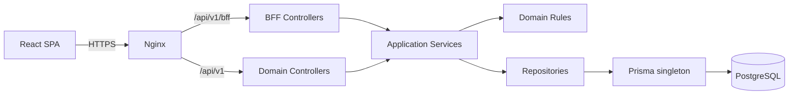
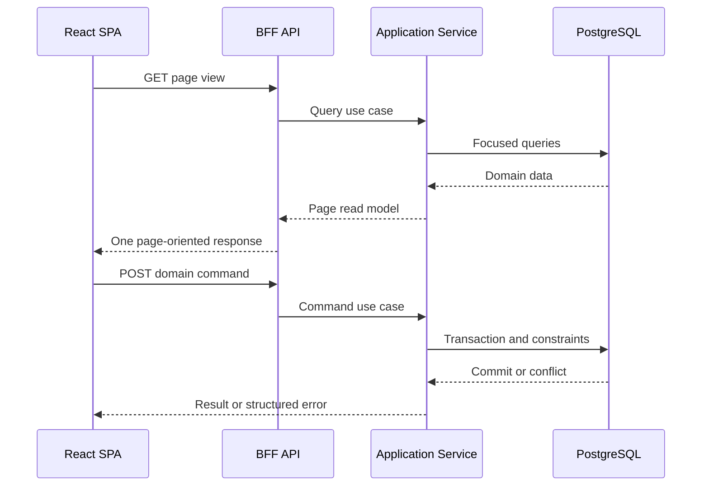

# Asset Reservation — Software Specification

เอกสารนี้อธิบายภาพรวมและการตัดสินใจระดับระบบของ Asset Reservation แบบ on-premise รายละเอียดการ implement ให้อ้างอิง frontend/backend specification แยกกัน

## เอกสารหลัก

| เอกสาร                                                    | Source of truth                                                        |
| --------------------------------------------------------- | ---------------------------------------------------------------------- |
| [Frontend specification](../frontend_spec/README.md)      | หน้าจอ, interaction, frontend contracts และ frontend testing           |
| [Backend specification](../backend_spec/README.md)        | Backend modules, Hybrid BFF, API, database, concurrency และ deployment |
| [Database specification](../database.txt)                 | ตาราง, field, constraint และ relation ต้นฉบับ                          |
| [Prisma schema](../../backend/prisma/schema.prisma)       | Data model ที่ backend ใช้งาน                                          |
| [File and schema structure](file-and-schema-structure.md) | มาตรฐานโครงสร้าง frontend, backend, Prisma และ dependency boundary     |

## เป้าหมายการออกแบบ

- แยก frontend และ backend ให้ build/deploy ได้อิสระ
- รองรับผู้ใช้หลายคนพร้อมกันโดยให้ PostgreSQL เป็น source of truth
- ลดจำนวน request และภาระ backend โดยไม่ใช้ Redis, shared cache หรือ load balancer
- ติดตั้งบนเครื่องหรือ VM เดียวภายในองค์กรด้วย Docker Compose
- เริ่มจาก modular monolith ที่ดูแลง่ายและขยายภายหลังได้

## Architecture: Hybrid BFF Pattern

ระบบใช้ Hybrid Backend for Frontend ภายใน backend deployable เดียว

- BFF API ทำหน้าที่ประกอบ read model ตามความต้องการของแต่ละหน้าจอ
- Domain API รับ command/mutation และบังคับ business rules
- Application/domain services เป็นแกนกลางที่ทั้ง BFF และ Domain API เรียกใช้
- Infrastructure layer จัดการ Prisma, PostgreSQL และ external adapters
- BFF ห้ามมี business rule หรือเขียนฐานข้อมูลโดยตรง
- Frontend ห้าม import Prisma หรือผูกกับ database model

### เหตุผลที่เป็น Hybrid

BFF อย่างเดียวเหมาะกับ UI แต่ทำให้ command contract ผูกกับหน้าจอมากเกินไป ส่วน resource/domain API อย่างเดียวอาจทำให้หน้า Calendar, Reservation details หรือ Approval queue ต้องเรียกหลาย endpoint

Hybrid BFF จึงแบ่งหน้าที่ดังนี้:

| API surface        | ใช้สำหรับ                                 | ตัวอย่าง                                                                       |
| ------------------ | ----------------------------------------- | ------------------------------------------------------------------------------ |
| BFF read API       | Page-oriented query และข้อมูลประกอบหน้าจอ | Session bootstrap, Calendar view, Reservation detail view, Approval queue      |
| Domain command API | Business mutation และ reusable operations | Create/submit reservation, approve item, inventory adjustment, return approval |

ทั้งสอง surface อยู่ใน NestJS process เดียว จึงไม่มี network hop ภายในและยังไม่ถือเป็น microservices

## Request flow

## Component boundaries

### Frontend

- React/TypeScript SPA build ด้วย Vite
- เรียก backend ผ่าน generated OpenAPI client
- ใช้ BFF สำหรับ page data และใช้ command endpoints สำหรับ mutation
- จัดการ rendering, form state และ local interaction เท่านั้น
- รายละเอียดอยู่ใน [Frontend specification](../frontend_spec/README.md)

### Backend

- NestJS + Fastify modular monolith
- แยก presentation/BFF, application, domain และ infrastructure
- ใช้ PrismaClient singleton กับ PostgreSQL connection pool
- Critical mutation ใช้ transaction, constraint และ conflict retry
- รายละเอียดอยู่ใน [Backend specification](../backend_spec/README.md)

### Infrastructure

- Nginx serve static frontend และ reverse proxy API
- Backend process เดียว
- PostgreSQL บน persistent SSD volume
- Docker Compose เป็น deployment unit
- ไม่มี Redis, shared application cache, message broker หรือ load balancer ใน concept phase

## Technology summary

| Layer      | Technology                              |
| ---------- | --------------------------------------- |
| Frontend   | React, TypeScript, Vite, TanStack Query |
| Backend    | NestJS, Fastify, OpenAPI                |
| Data       | Prisma ORM 7, pg adapter, PostgreSQL    |
| Edge       | Nginx                                   |
| Deployment | Docker Compose                          |
| Tests      | Vitest/Jest, Supertest, Playwright, k6  |

## Key design rules

1. Backend เป็น security และ consistency boundary
2. BFF aggregate ข้อมูลได้ แต่ห้ามข้าม application service ไปเรียก Prisma โดยตรง
3. Domain command ต้องไม่ขึ้นกับ shape ของหน้าใดหน้าหนึ่ง
4. DTO/API contract แยกจาก Prisma-generated types
5. Availability ที่ frontend แสดงเป็นข้อมูลชั่วคราว Backend ต้องตรวจซ้ำตอน mutation
6. Frontend/backend มี dependencies, environment และ build output แยกกัน
7. Database migration เป็น deployment step เดียวก่อน backend version ใหม่
8. Performance ให้แก้ query, index, payload และ round trip ก่อนเพิ่ม infrastructure

## Architecture acceptance criteria

- Frontend build และ deploy แยกจาก backend ได้
- Frontend ไม่มี Prisma dependency หรือ direct database access
- Page หลักใช้ BFF response โดยไม่ต้องประกอบข้อมูลจากหลาย domain endpoint เกินจำเป็น
- Command endpoint ใช้ application service เดียวกับ BFF และไม่ duplicate business logic
- BFF controller ไม่มี direct Prisma call
- Backend ใช้ PrismaClient singleton
- Concurrent critical mutations ไม่ทำให้ quantity ติดลบหรือจองเกินจำนวน
- ระบบเริ่มได้ด้วย Nginx, backend และ PostgreSQL โดยไม่ต้องมี distributed component

## Scope boundary

ระบบยังไม่ครอบคลุม horizontal scaling, Redis, distributed cache/lock, microservices, message broker, automatic failover และ multi-site replication การเพิ่มสิ่งเหล่านี้ต้องมี architecture decision record ใหม่

เอกสารนี้ควรสั้นและใช้ตอบว่า “ระบบออกแบบอย่างไร” ส่วนรายละเอียดว่า “แต่ละฝั่งต้อง implement อย่างไร” อยู่ใน frontend/backend specification
