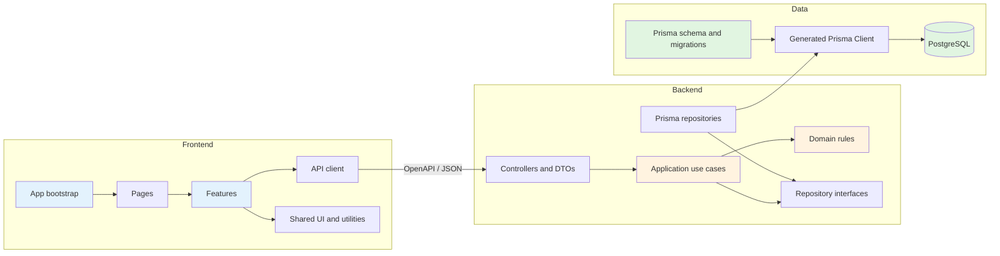

# File and schema structure conventions

[← Software specification](README.md)

เอกสารนี้เป็นมาตรฐานพื้นฐานสำหรับจัดโครงสร้างไฟล์ของ frontend, backend และ Prisma ในโปรเจกต์ Asset Reservation เป้าหมายคือให้ผู้พัฒนาตัดสินใจได้ว่าไฟล์ใหม่ควรอยู่ที่ใด dependency ควรชี้ไปทางไหน และ schema ต้องเปลี่ยนอย่างไรโดยไม่ทำให้แต่ละส่วนผูกกันเกินจำเป็น

โครงสร้างในเอกสารนี้เป็น **target structure** ไม่จำเป็นต้องสร้างทุกโฟลเดอร์ล่วงหน้า ให้สร้างเมื่อมี implementation จริงอย่างน้อยหนึ่งรายการ และปรับโครงสร้างเดิมแบบค่อยเป็นค่อยไปเมื่อแก้ feature นั้น

## หลักการร่วม

1. **จัดตาม business feature ก่อนชนิดไฟล์** — ไฟล์ที่เปลี่ยนพร้อมกันควรอยู่ใกล้กัน เช่น reservation controller, service และ policy อยู่ใต้ domain เดียวกัน
2. **Dependency ชี้เข้าหา business rule** — UI และ controller เรียก application/domain ได้ แต่ domain ห้าม import React, NestJS, Prisma หรือ HTTP DTO
3. **Contract ต้องแยกจาก persistence** — API DTO และ frontend type ห้ามใช้ Prisma-generated type เป็น public contract โดยตรง
4. **Shared ต้อง shared จริง** — ย้ายเข้า `common/`, `shared/` หรือ `components/` เมื่อถูกใช้อย่างมีความหมายมากกว่าหนึ่ง feature ไม่ใช่เพียงคาดว่าอาจได้ใช้
5. **ชื่อไฟล์บอกหน้าที่** — ใช้ suffix เช่น `.controller.ts`, `.service.ts`, `.dto.ts`, `.repository.ts`, `.spec.ts` เพื่อให้ค้นหาได้ง่าย
6. **Test อยู่ใกล้สิ่งที่พิสูจน์** — unit test ควรอยู่ข้างไฟล์หรือ feature; integration/E2E ที่ครอบคลุมหลาย module อยู่ในโฟลเดอร์ test ระดับแอป
7. **Generated และ build output ไม่ใช่ source** — `dist/`, generated Prisma client, coverage และ frontend build output ต้องไม่แก้ด้วยมือและไม่ commit
8. **หลีกเลี่ยงไฟล์รวมขนาดใหญ่** — เมื่อไฟล์เริ่มมีหลาย responsibility ให้แยกตาม use case หรือ component ไม่แยกเพียงเพื่อให้ไฟล์สั้น
9. **ไม่มี circular dependency** — feature ระดับเดียวกันไม่ import วนกัน ให้ย้าย orchestration ขึ้นไปที่ page/application service หรือแยก contract กลางที่เล็กและชัดเจน
10. **Secret ไม่อยู่ใน Git** — commit เฉพาะ `.env.example`; ค่าใช้งานจริงใน `.env`, secret manager หรือ deployment environment เท่านั้น

## ภาพรวม dependency



กฎสำคัญคือ frontend รู้จัก backend ผ่าน API contract เท่านั้น และ backend รู้จัก PostgreSQL ผ่าน repository/Prisma เท่านั้น ห้าม frontend import schema หรือเชื่อมฐานข้อมูลโดยตรง

## โครงสร้างระดับ repository

```text
asset-reservation/
├── frontend/                 # React SPA; build และ deploy แยกได้
├── backend/                  # NestJS modular monolith
│   ├── src/
│   ├── prisma/
│   ├── scripts/
│   └── test/
├── recognition-service/      # แยก deployable ต่างหาก (own Dockerfile, docker-compose.yml)
├── scripts/                  # Repo-level operational script (นอกเหนือจาก backend/scripts/)
├── database/                 # PostgreSQL deployment configuration
├── docs/                     # Specification และ decision records
└── .dockerignore
```

- แต่ละ deployable มี `package.json`, environment, Dockerfile และ build output ของตัวเอง
- `docs/` อธิบาย contract และ decision; source code ต้องไม่พึ่งการ parse เอกสาร Markdown ตอน runtime
- `database/` ดูแลการรัน PostgreSQL ส่วน schema ของ application อยู่ที่ `backend/prisma/`

## Frontend structure

### โครงสร้างเป้าหมาย

```text
frontend/
├── public/                         # Static files ที่ไม่ผ่าน bundler
├── src/
│   ├── app/
│   │   ├── App.tsx                 # Root application shell
│   │   ├── router.tsx              # Route definitions
│   │   └── providers.tsx           # Global providers
│   ├── pages/
│   │   ├── calendar/
│   │   │   └── CalendarPage.tsx
│   │   └── reservation-detail/
│   │       └── ReservationDetailPage.tsx
│   ├── features/
│   │   └── reservations/
│   │       ├── api/                # Feature query/mutation functions
│   │       ├── components/         # UI ที่ใช้เฉพาะ feature
│   │       ├── hooks/              # Feature orchestration hooks
│   │       ├── model/              # UI state และ pure domain helpers
│   │       ├── schemas/            # Form/runtime validation
│   │       └── index.ts            # Public exports ของ feature
│   ├── components/
│   │   └── ui/                     # Reusable presentation components
│   ├── api/
│   │   ├── client.ts               # HTTP client, auth header, error mapping
│   │   └── generated/              # Generated OpenAPI client; ห้ามแก้มือ
│   ├── shared/
│   │   ├── hooks/
│   │   ├── lib/
│   │   └── types/
│   ├── styles/                     # Tokens และ global styles
│   ├── test/                       # Shared test setup/factories
│   └── main.tsx                    # Browser entrypoint
├── Dockerfile
├── nginx.conf
├── vite.config.ts
└── package.json
```

ไม่ต้องสร้างทุก directory ตั้งแต่วันแรก Feature ขนาดเล็กเริ่มจาก component, API function และ test ในโฟลเดอร์เดียวได้ แล้วค่อยแยก `api/`, `hooks/` หรือ `model/` เมื่อมีไฟล์มากกว่าหนึ่งชนิดหรือ responsibility เริ่มปะปนกัน

### หน้าที่ของแต่ละ layer

| Layer            | ทำอะไรได้                                                    | ห้ามทำ                                   |
| ---------------- | ------------------------------------------------------------ | ---------------------------------------- |
| `app/`           | Bootstrap, router, global provider, error boundary           | Business rule ราย feature                |
| `pages/`         | ประกอบหลาย feature ให้เป็น route/page                        | เรียก database หรือเขียน HTTP client ซ้ำ |
| `features/`      | Use case ของผู้ใช้, feature UI, query/mutation orchestration | Import page หรือ app layer               |
| `components/ui/` | Component ทั่วไปที่ไม่รู้ business domain                    | Fetch API หรือรู้ reservation state      |
| `api/`           | Transport, generated client, auth/error mapping              | UI state และ visual behavior             |
| `shared/`        | Utility/type/hook ที่ใช้ข้าม feature จริง                    | เป็นที่ทิ้งไฟล์ที่จัดหมวดไม่ได้          |

### Dependency rules

```text
main → app → pages → features → api/shared
                         └────→ components/ui
```

- `pages` import feature ได้หลายตัวเพื่อประกอบหน้าจอ
- feature ห้าม import `pages` หรือ `app`
- feature หนึ่งไม่ควร import internal file ของอีก feature ให้ใช้ public export จาก `index.ts` หรือย้าย orchestration ไป page
- component ใน `components/ui` รับข้อมูลผ่าน props และส่ง event ผ่าน callback; ห้ามรู้ endpoint หรือ permission policy เฉพาะ domain
- frontend DTO มาจาก OpenAPI contract ส่วน UI model/computed state แยกจาก DTO เมื่อ shape ไม่เหมือนกัน

### State placement

| State                                                   | ตำแหน่งแนะนำ              |
| ------------------------------------------------------- | ------------------------- |
| Input ที่ใช้ใน component เดียว                          | Local component state     |
| Form หลาย field                                         | Feature form hook/schema  |
| Server data                                             | Query layer ภายใน feature |
| Session และ app-wide provider                           | `app/providers.tsx`       |
| URL filter, pagination, selected tab ที่ share link ได้ | Router/search params      |

อย่าคัดลอก server data ลง global state โดยไม่มีเหตุผล เพราะจะสร้าง source of truth ซ้ำ Frontend cache เป็นข้อมูลชั่วคราวและ backend ต้องตรวจ business rule ซ้ำทุก mutation

### Naming conventions

- React component และไฟล์ component ใช้ `PascalCase.tsx` เช่น `ReservationCard.tsx`
- Hook ใช้ `useXxx.ts` เช่น `useReservationForm.ts`
- Utility และ API module ใช้ `kebab-case.ts` หรือชื่อ domain ที่สม่ำเสมอ เช่น `reservation-api.ts`
- Test ใช้ชื่อเดียวกับไฟล์หลักตามด้วย `.test.ts` หรือ `.test.tsx`
- Route component ลงท้าย `Page`; reusable visual component ไม่ใช้คำว่า `Page`
- หลีกเลี่ยงไฟล์ชื่อกว้างเกินไป เช่น `helpers.ts`, `utils.ts`, `types.ts` ภายใน feature หากสามารถตั้งชื่อตามหน้าที่ได้ชัดกว่า

## Backend structure

### โครงสร้างเป้าหมาย

Backend เป็น NestJS modular monolith แยก module ตาม bounded business domain:

```text
backend/src/
├── main.ts
├── app.module.ts
├── config.ts
├── auth/
├── google-auth/
├── microsoft-auth/
├── access-control/
├── users/
├── management-areas/
├── assets/
├── reservations/
├── returns/
├── recognition/
├── email/
├── email-templates/
├── notification-settings/
├── uploads/
├── database/
└── common/
```

Module ขนาดเล็กใช้โครงสร้างแบนได้:

```text
management-areas/
├── management-areas.module.ts
├── management-areas.controller.ts
├── management-areas.service.ts
└── management-areas.dto.ts
```

เมื่อ module มีหลาย use case, business rule ซับซ้อน หรือ infrastructure มากกว่าหนึ่ง implementation ให้ขยายเป็น layer ภายใน feature:

```text
reservations/
├── reservations.module.ts
├── presentation/
│   ├── reservations.controller.ts
│   ├── reservation-bff.controller.ts
│   └── reservations.dto.ts
├── application/
│   ├── create-reservation.use-case.ts
│   ├── submit-reservation.use-case.ts
│   └── get-calendar.query.ts
├── domain/
│   ├── reservation.policy.ts
│   ├── reservation-status.ts
│   └── reservation.errors.ts
└── infrastructure/
    └── prisma-reservation.repository.ts
```

อย่าเพิ่ม layer เพียงเพราะเป็น pattern ที่นิยม ให้แยกเมื่อ module แบบแบนทำให้ controller/service มีหลาย responsibility หรือทดสอบ business rule โดยไม่ต่อ database ได้ยาก

### Responsibility rules

| ส่วน                         | Responsibility                                                |
| ---------------------------- | ------------------------------------------------------------- |
| Controller                   | HTTP mapping, DTO validation, status/header และเรียก use case |
| DTO                          | Public API shape และ input validation                         |
| Application service/use case | Authorization, orchestration และ transaction boundary         |
| Domain policy                | Pure business rule, state transition และ invariant            |
| Repository interface         | Contract ที่ application ต้องการจาก persistence               |
| Prisma repository            | Prisma query และ mapping persistence ↔ domain/API model       |
| Module                       | Wiring dependency เท่านั้น ไม่ใส่ business logic              |

Controller ต้องบางและไม่เรียก Prisma โดยตรง Application/domain ห้ามรับ NestJS `Request`, `Reply` หรือ HTTP DTO เป็น dependency ภายใน

### Backend dependency direction

```text
Controller/BFF
      ↓
Application use case
      ↓
Domain policy ← Repository interface
                      ↑
              Prisma repository
```

- BFF controller รวม read model ผ่าน application query service ได้ แต่ห้ามมี business rule หรือเขียนฐานข้อมูล
- Domain controller และ BFF ต้อง reuse application service เดียวกันสำหรับ command เดียวกัน
- Critical mutation กำหนด transaction ที่ application layer และให้ database constraint เป็นแนวป้องกันชั้นสุดท้าย
- Cross-module call ใช้ exported service/use case ที่ตั้งใจเปิดเผย ห้าม import internal repository ของ module อื่น

### Infrastructure และ common

- `database/` เก็บ Prisma singleton, transaction utilities และ database health เท่านั้น
- `common/` เก็บ error envelope, pagination, guard/decorator หรือ utility เชิงเทคนิคที่ใช้หลาย module
- Business type เช่น `ReservationStatus` ต้องอยู่ใน domain ของมัน ไม่อยู่ใน `common/`
- `config.ts` อ่านและ validate environment ตอน startup; feature ไม่ควรอ่าน `process.env` โดยตรง
- Adapter ภายนอก เช่น email, object storage หรือ identity provider อยู่ใต้ infrastructure ของ feature หรือ module adapter ที่มี ownership ชัดเจน

### Backend naming conventions

- Module: `reservations.module.ts`
- Controller: `reservations.controller.ts`; BFF ใช้ `reservation-bff.controller.ts`
- DTO: `create-reservation.dto.ts` หรือ `reservations.dto.ts` เมื่อยังมีจำนวนน้อย
- Use case: `create-reservation.use-case.ts`
- Query: `get-calendar.query.ts`
- Domain policy: `reservation-availability.policy.ts`
- Repository contract: `reservation.repository.ts`
- Prisma implementation: `prisma-reservation.repository.ts`
- Unit test: ชื่อไฟล์หลักตามด้วย `.spec.ts`

## Prisma schema structure

### Ownership

Prisma เป็นส่วนของ backend เพราะ schema และ generated client ต้องเปลี่ยนพร้อม application code ส่วน `database/docker-compose.yml` มีหน้าที่รัน PostgreSQL เท่านั้นและห้ามมี schema SQL อีกชุดที่ซ้ำกับ Prisma migrations

```text
backend/prisma/
├── schema.prisma              # Generator และ datasource เท่านั้น
├── models/
│   ├── users.prisma
│   ├── rbac.prisma
│   ├── management-areas.prisma
│   ├── assets.prisma
│   ├── reservations.prisma
│   ├── returns.prisma
│   ├── activity-logs.prisma
│   ├── email-templates.prisma
│   └── notification-settings.prisma
└── migrations/
    ├── migration_lock.toml
    └── YYYYMMDDHHMMSS_name/
        └── migration.sql
```

Model file แบ่งตาม business domain ไม่แบ่งเป็นหนึ่งไฟล์ต่อหนึ่ง model เสมอไป Model ที่สัมพันธ์และเปลี่ยนพร้อมกันควรอยู่ไฟล์เดียวกัน เช่น `Reservation`, `ReservationItem`, `ReservationParticipant` และ approval ที่เกี่ยวข้อง

### Schema conventions

- Prisma model ใช้ singular `PascalCase`: `ReservationItem`
- Prisma field ใช้ `camelCase`: `managementAreaId`
- PostgreSQL table/column ใช้ plural `snake_case` ผ่าน `@@map` และ `@map`
- Primary key ใช้ UUID ตามมาตรฐานปัจจุบันของระบบ
- Timestamp ใช้ `timestamptz` และตั้งชื่อ `createdAt`, `updatedAt`
- Relation ระบุ `fields` และ `references` ชัดเจน; relation ที่มีหลายเส้นทางไป model เดียวกันต้องตั้งชื่อ
- Foreign-key column ที่ใช้ join/filter ต้องมี index โดยพิจารณา index เดิมและลำดับ column ก่อนเพิ่ม
- Unique constraint ต้องสะท้อน business invariant ไม่ใช้เพียงเพื่อแก้ duplicate จาก application bug
- String status ต้องกำหนดค่าที่รองรับใน comment/contract และมี database CHECK เมื่อ Prisma schema แสดงข้อจำกัดนั้นไม่ได้
- จำนวนและช่วงเวลาที่มี invariant เช่น `quantity > 0` หรือ `end_at > start_at` ต้องมี database CHECK ใน migration
- `Json` ใช้เฉพาะข้อมูลที่ shape ยืดหยุ่นจริง ไม่ใช้แทน relation หรือ column ที่ต้อง query/index เป็นประจำ

### Migration rules

1. แก้ model ใน `backend/prisma/models/`
2. รัน format และ validation:

   ```bash
   cd backend
   npx prisma format
   npm run prisma:validate
   ```

   ผลที่คาดหวังคือ schema valid และทุกไฟล์ถูก format

3. สร้าง migration ใน development database:

   ```bash
   npx prisma migrate dev --name describe_the_change
   ```

4. Review `migration.sql` โดยเฉพาะ data loss, lock, constraint, index และ default
5. เพิ่ม SQL ที่ Prisma แสดงไม่ได้ เช่น CHECK constraint ก่อน migration ถูกใช้ร่วมกับผู้อื่น
6. รัน integration test กับ PostgreSQL จริง
7. Production ใช้คำสั่งเดียวจาก deployment step:

   ```bash
   npm run db:deploy
   ```

ห้ามแก้ migration ที่ถูก apply ใน shared/production database แล้ว ให้สร้าง migration ใหม่เพื่อแก้ไข และห้ามใช้ `prisma db push` เป็น production deployment เพราะไม่มี migration history ที่ review ได้

### Seed rules

- Seed ต้อง idempotent รันซ้ำแล้วไม่เพิ่มข้อมูลซ้ำ
- ใช้ `upsert`, unique key หรือ deterministic ID กับ mock/reference data
- สร้างข้อมูลตามลำดับ dependency: role/user → area → asset → reservation → return
- Password ต้อง hash ด้วย algorithm เดียวกับ runtime และรับค่าจาก environment
- Production reference data กับ demonstration data ต้องเปิด/ปิดแยกกัน เช่น `LOAD_MOCK_DATA`
- Seed ห้ามลบหรือ reset ข้อมูลที่มีอยู่โดยอัตโนมัติ

### Generated client

`backend/generated/prisma/` สร้างด้วย `prisma generate` และอยู่ใน `.gitignore`:

- ห้ามแก้ generated file ด้วยมือ
- Backend repository/infrastructure import client ได้
- Controller/API DTO และ frontend ห้าม expose/import generated model โดยตรง
- หลัง schema เปลี่ยน ต้อง generate ใหม่ก่อน type-check และ test

## การเพิ่ม feature แบบ end-to-end

ตัวอย่างเมื่อเพิ่มความสามารถ “ยกเลิก reservation”:

1. ยืนยัน state transition และ permission ใน specification
2. ถ้ามีการเปลี่ยนข้อมูล ให้แก้ `models/reservations.prisma` และสร้าง migration
3. เพิ่ม domain policy สำหรับกฎว่า status ใดยกเลิกได้
4. เพิ่ม application use case ที่ตรวจ actor/scope และเปิด transaction
5. เพิ่ม controller DTO และ OpenAPI contract
6. เพิ่ม frontend API mutation ใน `features/reservations/api/`
7. เพิ่ม UI/hook ใน feature แล้วให้ page ประกอบใช้งาน
8. เพิ่ม unit test ของ policy, backend integration test และ frontend interaction test

ลำดับนี้ช่วยให้ UI ไม่กลายเป็นที่เก็บ business rule และทำให้ database invariant, backend behavior และ API contract เปลี่ยนไปด้วยกัน

## วิธีตัดสินใจว่าไฟล์ควรอยู่ที่ใด

| คำถาม                                               | ตำแหน่ง                                 |
| --------------------------------------------------- | --------------------------------------- |
| เป็น route หรือประกอบหลาย frontend feature หรือไม่  | `frontend/src/pages/`                   |
| เป็น use case/UI เฉพาะ business capability หรือไม่  | `frontend/src/features/<feature>/`      |
| เป็น visual component ที่ไม่รู้ domain หรือไม่      | `frontend/src/components/ui/`           |
| เป็น HTTP transport/generated contract หรือไม่      | `frontend/src/api/`                     |
| เป็น HTTP input/output ของ backend หรือไม่          | feature `presentation/` หรือ `.dto.ts`  |
| เป็น orchestration/transaction ของ use case หรือไม่ | feature `application/`                  |
| เป็น pure business invariant หรือไม่                | feature `domain/`                       |
| เป็น Prisma query หรือ mapping หรือไม่              | feature `infrastructure/`               |
| เป็น persistent data model หรือไม่                  | `backend/prisma/models/<domain>.prisma` |
| เป็นกฎที่ใช้ข้ามหลาย domain จริงหรือไม่             | พิจารณา `common/` หลังยืนยัน ownership  |

## Anti-patterns

- `App.tsx` หรือ controller ไฟล์เดียวทำทุก feature
- `utils.ts` ขนาดใหญ่ที่รวม business logic หลาย domain
- frontend คำนวณ permission หรือ availability แล้วถือเป็นผลสุดท้าย
- controller เรียก Prisma โดยตรง
- service คืน Prisma model เป็น API response โดยไม่มี DTO boundary
- duplicate schema เป็น SQL init script อีกชุดหนึ่ง
- แก้ generated client หรือ migration ที่ deploy แล้ว
- สร้าง `shared` abstraction ก่อนมี consumer มากกว่าหนึ่งตัว
- import ข้าม feature ผ่าน path ภายในหลายชั้น
- commit `.env`, password, token หรือ database URL ที่มี credential จริง

## Definition of done สำหรับการเปลี่ยนโครงสร้าง

- ไฟล์มี owner และ layer ชัดเจน
- Dependency direction ไม่ย้อนกลับและไม่มี circular import
- Public API/OpenAPI ไม่ผูกกับ Prisma-generated type
- Schema ผ่าน `prisma format` และ `prisma validate`
- Migration ถูก review และทดสอบกับ PostgreSQL จริง
- Unit/integration/UI test อยู่ในระดับที่ตรงกับ behavior
- ไม่มี secret, generated output หรือ build artifact ถูกเพิ่มเข้า Git
- สารบัญและเอกสาร architecture ถูกอัปเดตเมื่อเพิ่ม layer หรือ convention ใหม่
