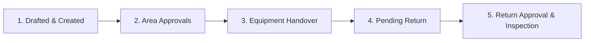
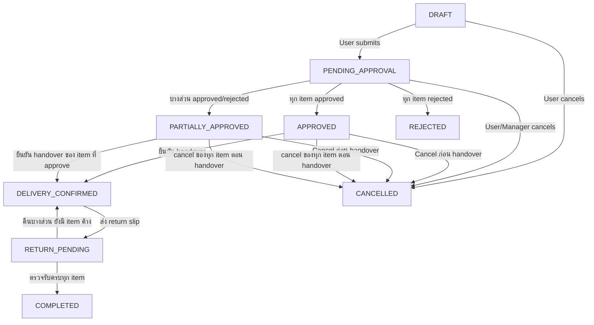
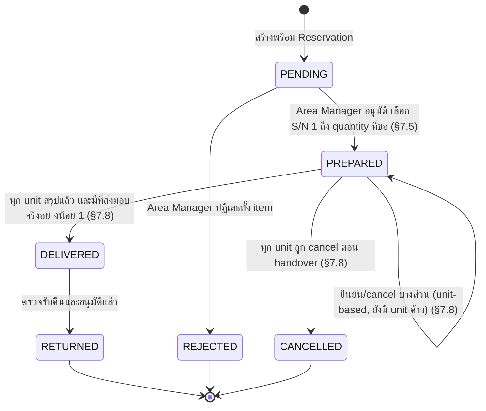
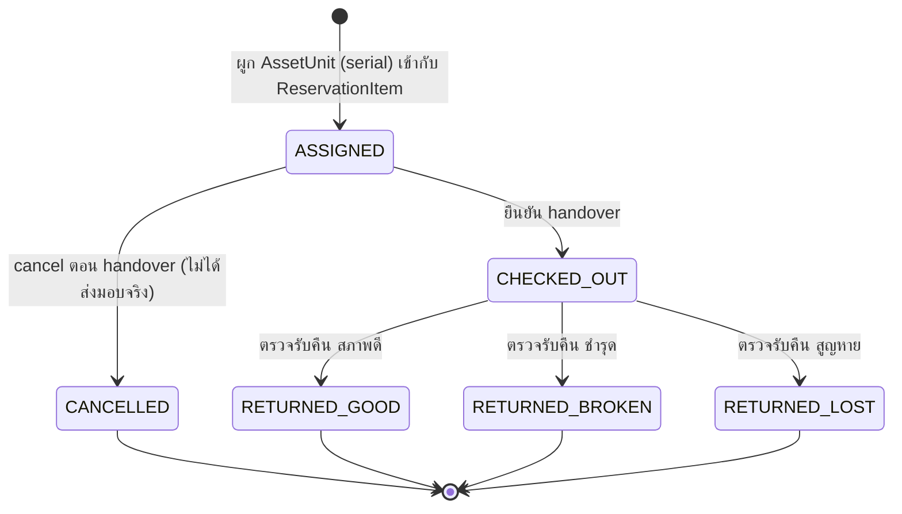
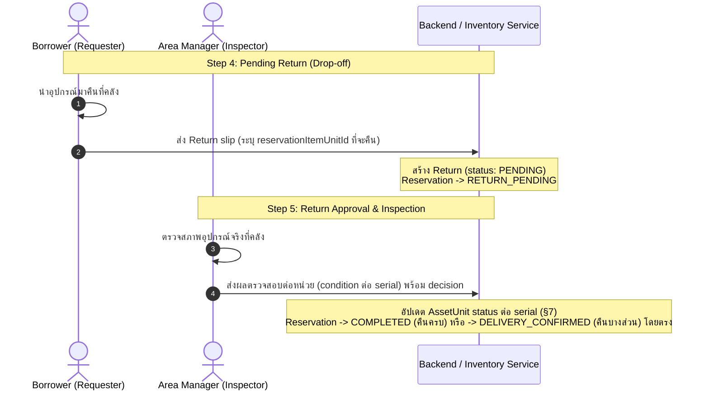

# Lifecycle & state machines

[← กลับไปสารบัญ](README.md)

เอกสารนี้เป็นแหล่งเดียว (single source) สำหรับ status enum และ state transition ของทุก entity ในระบบ ห้ามเอกสารอื่นเขียน status list หรือ transition table ซ้ำ — ให้ลิงก์มาที่หัวข้อในหน้านี้แทน

## 1. ภาพรวม 5-step lifecycle

| Step | Phase                        | Primary actor               | สรุป                                                                                                                                        |
| :--: | ---------------------------- | --------------------------- | ------------------------------------------------------------------------------------------------------------------------------------------- |
|  1   | Drafted & Created            | Requester                   | เลือกวันที่และอุปกรณ์ เพิ่มผู้ร่วมกิจกรรม แล้ว submit                                                                                       |
|  2   | Area Approvals               | Area Manager                | ตรวจรายการที่ขอในแต่ละ management area ปรับจำนวนอนุมัติ **เลือก serial-numbered unit ที่จะจ่ายให้** แล้ว approve/reject ในขั้นตอนเดียว (§3) |
|  3   | Equipment Handover           | Warehouse Staff / Requester | รับมอบอุปกรณ์จริงที่คลัง และยืนยัน handover                                                                                                 |
|  4   | Pending Return               | Requester / Borrower        | ใช้งานอุปกรณ์ เมื่อจบกิจกรรมนำมาคืนที่คลังพร้อม return slip                                                                                 |
|  5   | Return Approval & Inspection | Area Manager (Inspector)    | ตรวจสภาพอุปกรณ์ที่คืน (Good/Broken/Lost) แล้วอนุมัติ                                                                                        |

## 2. Reservation status {#reservation-status}

Status เก็บเป็น `String` ใน database (ไม่ใช่ Prisma enum) ค่าที่ระบบยอมรับมีเท่านี้ — ห้าม frontend/backend ใช้ค่าอื่นนอกตารางนี้ (เช่น `ACTIVE`, `PENDING`, `RETURN` แบบเดี่ยวๆ ที่เคยมีในเอกสารรุ่นเก่า **ไม่ใช่ค่าที่ระบบรองรับอีกต่อไป**)

| Status               | ความหมาย                                                                | Transition ถัดไปที่เป็นไปได้                                      |
| -------------------- | ----------------------------------------------------------------------- | ----------------------------------------------------------------- |
| `DRAFT`              | กำลังร่าง ยังไม่ submit                                                 | `PENDING_APPROVAL`, `CANCELLED`                                   |
| `PENDING_APPROVAL`   | รอ area manager อนุมัติ                                                 | `APPROVED`, `PARTIALLY_APPROVED`, `REJECTED`, `CANCELLED`         |
| `PARTIALLY_APPROVED` | บาง item อนุมัติ (พร้อมผูก serial unit แล้ว — ดู §3) บาง item ถูกปฏิเสธ | `DELIVERY_CONFIRMED`, `CANCELLED`                                 |
| `APPROVED`           | ทุก item อนุมัติและผูก serial unit แล้ว รอส่งมอบ                        | `DELIVERY_CONFIRMED`, `CANCELLED`                                 |
| `DELIVERY_CONFIRMED` | ส่งมอบอุปกรณ์ให้ผู้ขอแล้ว                                               | `RETURN_PENDING`, `COMPLETED`                                     |
| `RETURN_PENDING`     | ส่ง return slip แล้ว รอตรวจรับ                                          | `COMPLETED`, `DELIVERY_CONFIRMED` (ถ้าคืนบางส่วน ยังมี item ค้าง) |
| `COMPLETED`          | คืนครบทุก item ที่ checkout แล้ว (final)                                | –                                                                 |
| `REJECTED`           | ทุก item ถูกปฏิเสธ (final)                                              | –                                                                 |
| `CANCELLED`          | ยกเลิกก่อนรับมอบ (final) — รวมกรณีที่ทุก item ถูก cancel ตอน handover                                                | –                                                                 |

### Return eligibility rule

Asset สามารถถูกคืนได้ **ทุกเมื่อหลังจากถูก handover ออกไปแล้ว** ไม่มีเงื่อนไขเรื่องเวลา — กิจกรรมที่จบก่อนกำหนดคืนของก่อน `endAt` ได้ (เดิมมี `now() >= reservation.endAt` บังคับไว้ ตอบ `409 RETURN_TOO_EARLY` ซึ่งถูกตัดออกแล้ว) เงื่อนไขที่เหลือคือ:

- reservation อยู่สถานะ `DELIVERY_CONFIRMED` หรือ `RETURN_PENDING`
- unit ที่จะคืนอยู่สถานะ `CHECKED_OUT` และยังไม่ถูก claim ในสลิปอื่น

เดิมมีการใช้ status `ACTIVE` เพื่อสื่อความหมาย "กำลังยืมอยู่" แต่ถูกตัดออกแล้ว

## 3. ReservationItem status {#reservation-item-status}

> **Breaking change จากรุ่นก่อนหน้า**: เดิม `PENDING` อนุมัติเป็น `APPROVED` ก่อน แล้วค่อยผูก serial unit เป็นอีกขั้นตอนแยก (`PREPARED`, คนละ endpoint/actor ได้) ตอนนี้ **รวมเป็นการตัดสินใจเดียว** — Area Manager ที่อนุมัติต้องเลือก serial-numbered unit (`assetUnitIds[]`) มาพร้อมกันในคำขอเดียว item จึงข้ามจาก `PENDING` ไป `PREPARED` ตรงๆ ไม่มีสถานะ `APPROVED` เป็นจุดพักอีกต่อไป **Approve เป็น unit-based**: เลือก S/N น้อยกว่าจำนวนที่ขอได้ (`quantity` จะถูกตัดลงให้ตรงกับจำนวนที่ approve จริงทันที ไม่มีส่วนที่เหลือค้าง `PENDING` รออนุมัติรอบถัดไป) — ส่วน **reject ยังเป็น all-or-nothing ทั้ง item เหมือนเดิม** ไม่มี unit-level reject รายละเอียด transaction: [backend_spec/algorithms-and-validation.md §7.5](../backend_spec/algorithms-and-validation.md#75-post-reservationsreservationiditemsitemiddecision)

> **Handover เป็น unit-based เช่นกัน**: ยืนยัน handover เลือกเฉพาะบาง `ReservationItemUnit` (`reservationItemUnitIds[]`) ของ item ได้ ไม่ต้องส่งมอบทั้ง item พร้อมกัน — item ยังอยู่ status `PREPARED` ต่อไปตราบใดที่ยังมี unit ที่ผูกไว้ (`ASSIGNED`) เหลืออยู่ (ยืนยันได้หลายรอบ) รายละเอียด transaction: [backend_spec/algorithms-and-validation.md §7.8](../backend_spec/algorithms-and-validation.md#78-post-reservationsreservationiddelivery-confirm)

> **ทุก unit ต้องมีข้อสรุปตอน handover**: unit ที่ผูกไว้แล้วแต่ไม่ได้ส่งมอบจริง (ของไม่พร้อม ผู้ยืมไม่เอาแล้ว ฯลฯ) ต้องถูก **cancel** ในคำขอเดียวกัน (`cancelledReservationItemUnitIds[]`) ไม่ปล่อยค้าง `ASSIGNED` — unit นั้นไปเป็น `CANCELLED` (§3a) และคืนช่วงเวลาให้ serial ทันที item จึงพ้น `PREPARED` ก็ต่อเมื่อ unit ที่ผูกไว้**ทุกตัว**ถูก handover หรือ cancel แล้ว โดยไป `DELIVERED` ถ้ามี unit ที่ส่งมอบจริงอย่างน้อยหนึ่งตัว (พร้อมตัด `quantity` ให้เท่ากับจำนวนที่ส่งมอบจริง) และไป `CANCELLED` ถ้าถูก cancel ทั้งหมด (`quantity` คงเดิม — status บอกอยู่แล้วว่าไม่มีของออกไป) — **การคืน (§6) จึงอ้างอิงเฉพาะของที่ handover ไปแล้วเท่านั้น**

| Status        | ความหมาย                                                                                                                                                                                                                                                                                     |
| ------------- | -------------------------------------------------------------------------------------------------------------------------------------------------------------------------------------------------------------------------------------------------------------------------------------------- |
| `PENDING`     | รอ area manager ตัดสินใจ                                                                                                                                                                                                                                                                     |
| `REJECTED`    | ถูกปฏิเสธทั้ง item (reject ไม่ใช่ unit-based)                                                                                                                                                                                                                                                |
| `PREPARED`    | อนุมัติแล้ว และผูก `AssetUnit`/`ReservationItemUnit` (serial) แล้วในคำขอเดียวกัน รอส่งมอบ — `quantity` คือจำนวนที่ approve จริง (อาจน้อยกว่าที่ขอตอน submit ถ้า approve บางส่วน) item จะค้างอยู่ status นี้ตราบใดที่ยังมี unit สถานะ `ASSIGNED` เหลืออยู่ แม้จะยืนยัน handover ไปแล้วบางส่วน |
| `CHECKED_OUT` | เป็น status ของ `AssetUnit`/`ReservationItemUnit` (หน่วยจริงที่ถูกส่งมอบ) **ไม่ใช่** status ของ `ReservationItem` เอง — item ข้ามจาก `PREPARED` ไป `DELIVERED` ก็ต่อเมื่อ unit ที่ผูกไว้ทั้งหมดของ item นั้นเป็น `CHECKED_OUT` ครบแล้ว (handover เป็น unit-based, ยืนยันบางส่วนได้หลายรอบ)   |
| `DELIVERED`   | ส่งมอบให้ผู้ขอแล้ว (ครบทุก unit ของ item)                                                                                                                                                                                                                                                    |
| `RETURNED`    | คืนครบสำหรับ item นี้แล้ว                                                                                                                                                                                                                                                                    |
| `CANCELLED`   | อนุมัติและผูก serial ไว้แล้ว แต่ตอน handover ถูก cancel ทั้งหมด ไม่มีของออกจากคลัง (final) — ไม่มีอะไรให้คืน                                                                                                                                                                                 |

## 3a. ReservationItemUnit status {#reservation-item-unit-status}

สถานะต่อ serial-numbered unit ที่ถูกผูกไว้กับ `ReservationItem` หนึ่งรายการ (ผูกตอน `ReservationItem` เข้าสถานะ `PREPARED` — ดู §3)

| Status            | ความหมาย                                                                |
| ----------------- | ----------------------------------------------------------------------- |
| `ASSIGNED`        | ผูกกับ `AssetUnit` (serial) แล้ว ยังไม่ส่งมอบ                           |
| `CHECKED_OUT`     | ส่งมอบให้ผู้ขอแล้ว (`ReservationItem` ข้ามไป `DELIVERED` พร้อมกัน — §3) |
| `RETURNED_GOOD`   | คืนแล้ว ตรวจสภาพดี → `AssetUnit.status` เป็น `ACTIVE` (§7)              |
| `RETURNED_BROKEN` | คืนแล้ว ชำรุด → `AssetUnit.status` เป็น `BROKEN` (§7)                   |
| `RETURNED_LOST`   | คืนแล้ว สูญหาย → `AssetUnit.status` เป็น `LOST` (§7)                    |
| `CANCELLED`       | ถูก cancel ตอน handover ไม่เคยออกจากคลัง — คืนช่วงเวลาให้ serial ทันที ไม่แตะ `AssetUnit.status` |

Assignment ทุกแถวเก็บช่วง `[assignmentStartAt, assignmentEndAt)` ตามกำหนดการของ reservation หน่วยเดียวกัน (`asset_unit_id`) จึงมี future assignment ได้หลายแถว ตราบใดที่ช่วงของ assignment สถานะ `ASSIGNED`/`CHECKED_OUT` ไม่ทับกัน (แถวสถานะ `CANCELLED` และ `RETURNED_*` ไม่นับ จึงไม่กันช่วงเวลาอีกต่อไป) ฐานข้อมูลบังคับกติกานี้ด้วย time-range exclusion constraint; ช่วงที่ปลายของรายการแรกเท่ากับต้นของรายการถัดไปไม่ถือว่าทับกัน

## 4. Approval / ReturnApproval status {#approval-status}

`ReservationItemApproval` และ `ReturnApproval` ใช้ status ชุดเดียวกัน: `PENDING`, `APPROVED`, `REJECTED`

## 5. Return status {#return-status}

| Status      | ความหมาย                                      |
| ----------- | --------------------------------------------- |
| `PENDING`   | รอตรวจรับ                                     |
| `REJECTED`  | ปฏิเสธหรือให้แก้ไข                            |
| `COMPLETED` | backend ประมวลผล item/ledger และปิดการคืนแล้ว |

ผลอนุมัติ `APPROVED` ถูกเก็บที่ `ReturnApproval.status`; ตัว `Return.status` เปลี่ยนจาก `PENDING` ไป `COMPLETED` โดยตรงใน transaction เดียว จึงไม่มี `APPROVED` เป็นสถานะพัก

เมื่อคืนครบสำหรับ item หนึ่ง ให้ `ReservationItem` เป็น `RETURNED` (§3) และเมื่อทุก item ที่ checkout คืนครบ ให้ `Reservation` เป็น `COMPLETED` (§2)

## 6. Return & inspection flow

Return workflow แยก **การส่งคืนโดยผู้ยืม (drop-off)** ออกจาก **การตรวจรับโดยผู้ดูแล (inspection)** อย่างชัดเจน:

Condition ถูกบันทึก**ต่อ serial-numbered unit** (`ReturnItemUnit.condition`) ไม่ใช่ตัวเลข quantity รวม

## 7. Condition classification → AssetUnit status {#condition-classification}

| Condition | `AssetUnit.status` หลังตัดสินใจ | สี (badge) | ผล                                                          |
| --------- | ------------------------------- | :--------: | ----------------------------------------------------------- |
| Good      | `ACTIVE`                        |   เขียว    | กลับเข้า shared pool พร้อมให้จองใหม่                        |
| Broken    | `BROKEN`                        |   เหลือง   | ถูกตัดออกจาก availability รอซ่อม                            |
| Lost      | `LOST`                          |    แดง     | ถูกตัดออกจาก availability ถาวร ไม่มี stock counter แยกให้ลด |

`AssetUnit.status` บอก **สภาพทางกายภาพ ณ ตอนนี้** ไม่ใช่ตารางจองในอนาคต: การ approve จึงไม่เปลี่ยน `ACTIVE` เป็น `RESERVED`; การ handover ภายในช่วงจองจึงเปลี่ยนเป็น `CHECKED_OUT` และผลตรวจคืนเปลี่ยนเป็น `ACTIVE`/`BROKEN`/`LOST` ตามจริง ค่า `IN_REPAIR` และ `INACTIVE` ใช้กับงานซ่อม/ปลดระวาง ส่วน `RESERVED` คงอยู่ใน contract ชั่วคราวเพื่อรองรับข้อมูลหรือ backend รุ่นก่อน migration เท่านั้น และจะไม่ถูกสร้างใหม่โดย reservation flow

## เอกสารที่เกี่ยวข้อง

- Business rule และ validation อื่น (เช่น conflict detection, past-date protection): [business-rules-and-validation.md](business-rules-and-validation.md)
- Permission ที่ต้องมีในแต่ละ transition: [permissions-and-rbac.md](permissions-and-rbac.md)
- Algorithm การคำนวณ availability/conflict และ implementation ของ transition เหล่านี้: [backend_spec/algorithms-and-validation.md](../backend_spec/algorithms-and-validation.md)
- การแสดง status เป็นสีใน UI: [frontend_spec/status-color-mapping.md](../frontend_spec/status-color-mapping.md)
