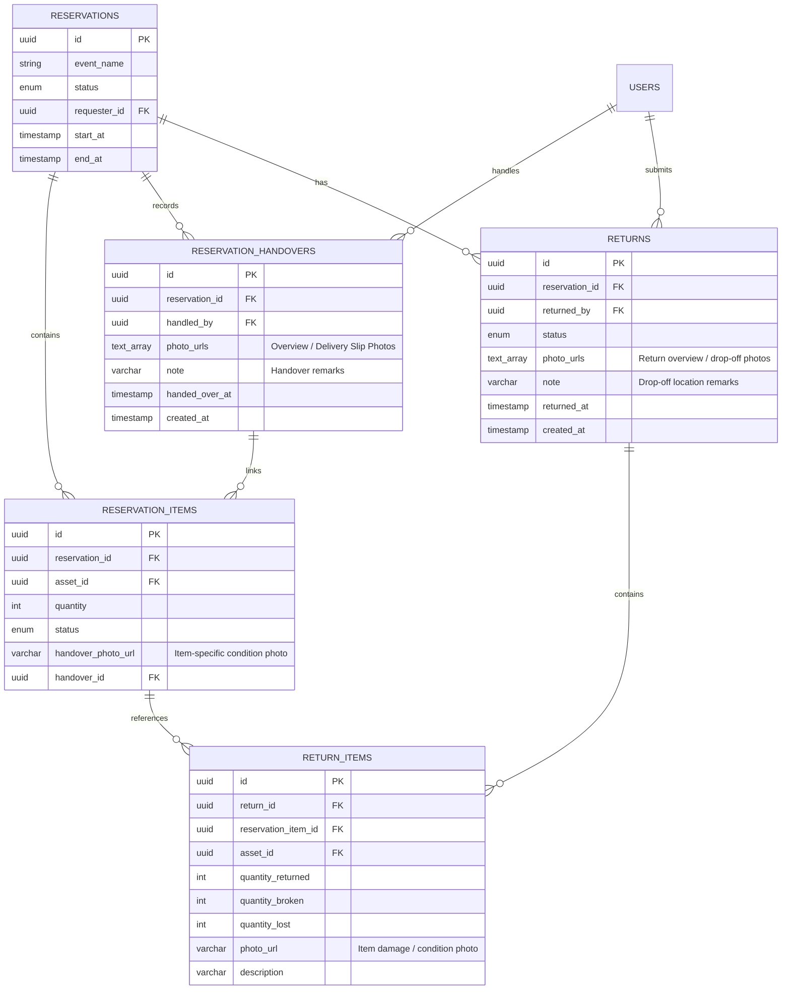
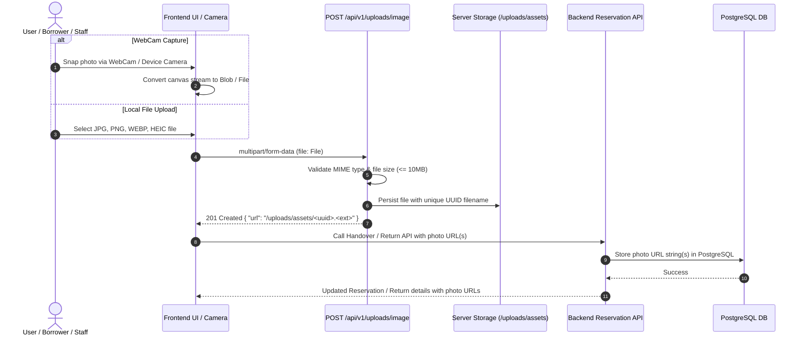
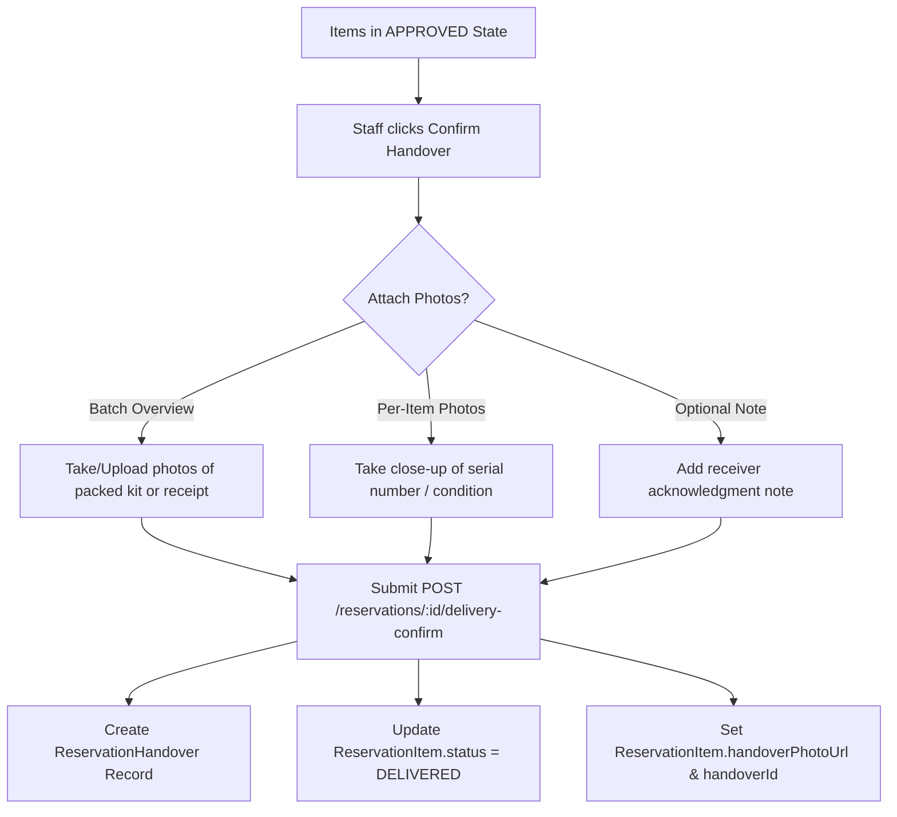
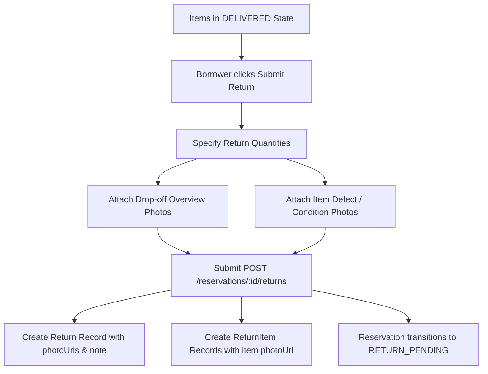

# Reservation Proof Photos & Image System Architecture

This document provides the technical specification and architectural blueprint for the **Proof Photos & Image System** integrated into the Asset Reservation lifecycle. It covers database schemas, upload pipelines, API contracts, sequence diagrams, and frontend integration guidelines.

---

## 1. Objectives & Overview

In an enterprise asset reservation system, physical verification is critical to avoid disputes regarding item condition, missing accessories, or unauthorized dispatch. The image system introduces verifiable photographic evidence at two critical lifecycle transition points:

1. **Equipment Handover (Dispatch)**: Warehouse staff or custodians photograph dispatched equipment (overview batch and/or serial/condition close-ups) to verify what was handed over, to whom, and in what condition.
2. **Equipment Return (Drop-off & Inspection)**: Borrowers attach condition photos upon return drop-off so Area Managers can visually inspect the equipment's condition before approving clearance or recording damage/loss.

### Dual-Tier Photo Architecture (Option 3)
The system employs a **dual-tier image model**:
- **Batch / Session Photos (`photoUrls: String[]`)**: Broad overview photos, group shots of packed kits, physical paper delivery slips, or warehouse shelf drop-off location.
- **Item-Specific Photos (`photoUrl: String?`)**: High-resolution close-ups of specific high-value assets, serial numbers, pre-existing scratches, or return damage.

---

## 2. Entity-Relationship Model (ERD)



---

## 3. Image Upload & Ingestion Pipeline

All image assets (whether captured via webcams or uploaded as local image files) pass through the centralized uploads pipeline.



### Static Asset Serving
- Uploaded images are stored on disk under `uploads/assets/`.
- Fastify statically serves images directly from `/uploads/*`.
- External image URLs (e.g. `https://s3.amazonaws.com/...` or CDN URLs) are also supported transparently.

---

## 4. Lifecycle Photo Touchpoints

### Touchpoint 1: Equipment Handover (Dispatch)

When equipment is physically handed over to the requester:
1. Staff opens the Handover modal for approved items.
2. Staff can take/upload batch overview photos (`photoUrls`) and/or item-specific close-up photos (`itemPhotos`).
3. Staff submits the handover confirmation.



#### API Contract: Handover Confirmation
- **Endpoint**: `POST /api/v1/reservations/:id/delivery-confirm`
- **Headers**: `Authorization: Bearer <token>`, `Content-Type: application/json`
- **Request Body**:
```json
{
  "itemIds": [
    "c8a51d9e-1111-4000-8000-000000000001",
    "c8a51d9e-2222-4000-8000-000000000002"
  ],
  "photoUrls": [
    "/uploads/assets/delivery-batch-overview-01.webp",
    "/uploads/assets/signed-dispatch-slip.jpg"
  ],
  "itemPhotos": [
    {
      "itemId": "c8a51d9e-1111-4000-8000-000000000001",
      "photoUrl": "/uploads/assets/sony-a7-serial-condition.webp"
    }
  ],
  "note": "Handed over to John in room 302 with 2 additional battery packs."
}
```
- **Response**: `200 OK` (Serialized `ReservationDetail` with `handovers` array and item `handoverPhotoUrl`).

---

### Touchpoint 2: Equipment Return Request (Drop-off)

When returning equipment at event conclusion:
1. Borrower selects equipment lines and quantities to return.
2. Borrower attaches proof photos of the drop-off location or equipment condition.
3. Borrower submits the return slip.



#### API Contract: Return Request
- **Endpoint**: `POST /api/v1/reservations/:id/returns`
- **Headers**: `Authorization: Bearer <token>`, `Content-Type: application/json`
- **Request Body**:
```json
{
  "items": [
    {
      "reservationItemId": "c8a51d9e-1111-4000-8000-000000000001",
      "quantityReturned": 1,
      "quantityBroken": 0,
      "quantityLost": 0,
      "photoUrl": "/uploads/assets/returned-camera-lens-clean.webp",
      "description": "Clean and working properly"
    }
  ],
  "photoUrls": [
    "/uploads/assets/dropoff-cabinet-a3.webp"
  ],
  "note": "Returned to Warehouse Cabinet A3. All cables packed in original pouch."
}
```
- **Response**: `201 Created` (Serialized `ReturnDetail` with `photoUrls`, `note`, and item `photoUrl`).

---

### Touchpoint 3: Manager Return Inspection Review

Area Managers inspect the returned items before approving restocking:
1. Area Manager views the pending return slip on the reservation page.
2. Manager clicks **"View Return Photos"** to inspect borrower-submitted drop-off and condition photos.
3. Manager performs physical verification and records condition (**Good**, **Broken**, **Lost**).
4. Manager approves or rejects the return slip (`POST /reservations/:id/returns/:returnId/decision`), which automatically updates warehouse inventory totals.

---

## 5. Database Schema Reference

### 5.1 `reservation_handovers` Table

| Column | Type | Constraints | Description |
| :--- | :--- | :--- | :--- |
| `id` | `UUID` | `PRIMARY KEY, DEFAULT gen_random_uuid()` | Handover session ID |
| `reservation_id` | `UUID` | `NOT NULL, FK -> reservations(id) ON DELETE CASCADE` | Linked reservation |
| `handled_by` | `UUID` | `NOT NULL, FK -> users(id)` | User who dispatched the equipment |
| `photo_urls` | `TEXT[]` | `NOT NULL, DEFAULT '{}'` | Overview and receipt photos |
| `note` | `VARCHAR(2000)` | `NULLABLE` | Dispatch remarks / receiver note |
| `handed_over_at` | `TIMESTAMPTZ` | `NOT NULL, DEFAULT NOW()` | Physical handover timestamp |
| `created_at` | `TIMESTAMPTZ` | `NOT NULL, DEFAULT NOW()` | Creation timestamp |

### 5.2 `reservation_items` Photo Extensions

| Column | Type | Constraints | Description |
| :--- | :--- | :--- | :--- |
| `handover_photo_url` | `VARCHAR(1000)` | `NULLABLE` | Condition photo of this specific item at handover |
| `handover_id` | `UUID` | `NULLABLE, FK -> reservation_handovers(id) ON DELETE SET NULL` | Linked handover session |

### 5.3 `returns` & `return_items` Photo Extensions

| Table | Column | Type | Constraints | Description |
| :--- | :--- | :--- | :--- | :--- |
| `returns` | `photo_urls` | `TEXT[]` | `NOT NULL, DEFAULT '{}'` | Batch drop-off proof photos |
| `returns` | `note` | `VARCHAR(2000)` | `NULLABLE` | Drop-off location remarks |
| `return_items` | `photo_url` | `VARCHAR(1000)` | `NULLABLE` | Item condition photo taken during return |

---

## 6. Frontend Integration Guidelines

When implementing the frontend UI for this feature in subsequent sessions, adhere to these recommendations:

### Recommended Component Architecture

1. **`CameraCaptureModal`**:
   - Reusable modal providing camera switching (Front/Rear environment), snapshot capture to Canvas, and direct conversion to `File` for upload via `api.uploadImage()`.
2. **`HandoverConfirmModal`**:
   - Manifest preview of selected equipment lines to dispatch.
   - Dual upload controls: General batch photo drop-zone / webcam trigger + Per-item photo action buttons.
   - Handover notes input field.
3. **`ReturnRequestModal`**:
   - Item return quantity counters with remaining limits.
   - Condition photo attachment per item line + general drop-off photos.
   - Notes field for drop-off desk / cabinet location.
4. **`ImageLightboxModal`**:
   - High-resolution image modal with thumbnail navigation, zoom capabilities, image counter (`Photo 1 of 4`), metadata subtitles (who uploaded and when), and keyboard navigation (`ArrowLeft` / `ArrowRight` / `Escape`).
5. **Equipment Manifest Integration**:
   - Render camera icon badges on items with attached handover photos (`item.handoverPhotoUrl`).
   - In the Manager Return Inspection review bar, display a prominent **"📷 View Return Photos (N)"** button to view borrower proof photos before deciding on approval.

---

## 7. Quality & Verification Checklist

- [x] Prisma schema compiled and database migration deployed.
- [x] DTOs with validation rules for `photoUrls`, `note`, and item `photoUrl` in place.
- [x] Handover entity creation and item photo linkage verified in unit tests.
- [x] Return creation and return item photo storage verified in unit tests.
- [x] Backend test suite passing 100% (46/46 tests).
- [x] Fastify static uploads handler operational.
