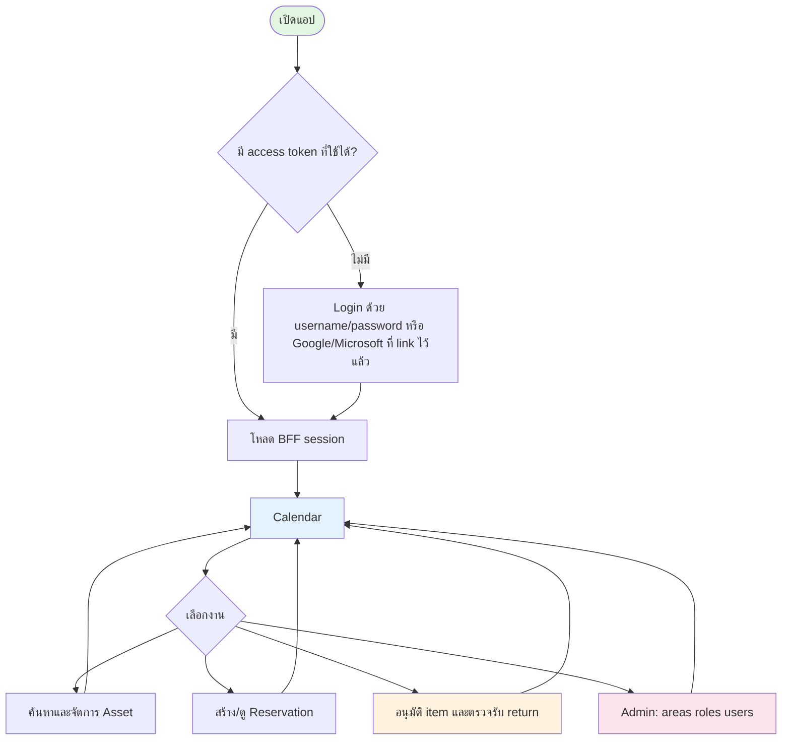
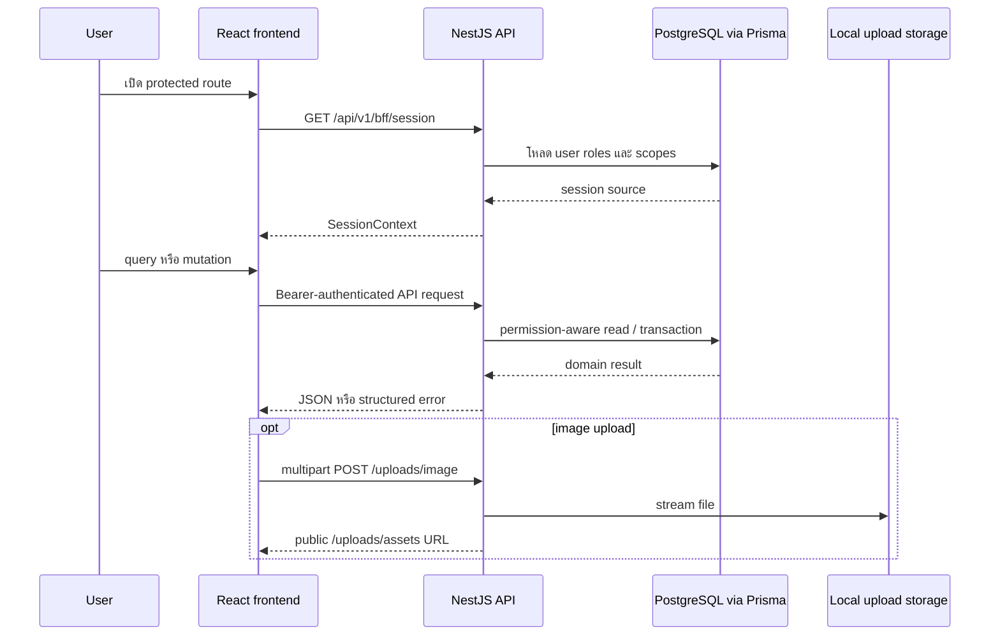

# Implementation status

[← กลับไปสารบัญ](../README.md)

> **นี่คือ dated build/QA snapshot ไม่ใช่ spec** — ห้ามอ้างอิงเอกสารนี้เป็นแหล่งของ requirement หรือ business rule ใดๆ สำหรับ requirement ให้ดู [`../software_spec/`](../software_spec/README.md), สำหรับ API contract ดู [`../backend_spec/contracts/`](../backend_spec/contracts/README.md), สำหรับ UI design ดู [`../frontend_spec/`](../frontend_spec/README.md)

เอกสารนี้เป็น snapshot ของ frontend ที่ตรวจจาก `frontend/src/app.tsx`, `frontend/src/pages`, `frontend/src/components`, `frontend/src/api.ts` และ tests ณ วันที่ 23 สิงหาคม 2026 ใช้แยกสิ่งที่ใช้งานได้จริงออกจากเอกสาร product specification ที่อาจรวม roadmap ในอนาคต

## User flow ที่ implement แล้ว

## Route และ feature inventory

ทุก route ยกเว้น `/login` ผ่าน protected shell; route ที่ไม่รู้จัก redirect ไป `/` และ `/` redirect ต่อไป `/calendar`

| Route | Page/component | Feature ที่ implement แล้ว | Access ที่ UI ใช้ |
| --- | --- | --- | --- |
| `/login` | `LoginPage` | username/password login, Google/Microsoft OAuth login สำหรับบัญชีที่ link ไว้แล้ว, field/API error, callback ไป path เดิม, redirect session ที่ login แล้ว | Public |
| `/auth/callback` | `OAuthCallbackPage` | รับ OAuth callback (Google/Microsoft) หลัง provider consent, จัดการ error state | Public |
| `/connect-account` | `ConnectAccountPage` | mandatory account-link gate เมื่อ `REQUIRE_ACCOUNT_LINK` เปิด บังคับ link Google/Microsoft ก่อนใช้แอปต่อ | Login |
| `/connect-account/callback` | `ConnectAccountCallbackPage` | callback ของ mandatory-link flow | Login |
| `/account` | `AccountPage` | self-service แก้ name/email, เปลี่ยน password, link/unlink Google/Microsoft แบบ optional | Login |
| `/calendar` | `CalendarPage` | continuous month calendar, Today/date picker, status/management-area filters, event minibox, asset picker search/list/grid, date-range drag/keyboard selection, prefill reservation, approve/reject pending items, cancel reservation | Login; permission-gated ตาม capability ที่ API ส่งมา |
| `/assets` | `AssetsPage` | search, management-area/status filters, list/card responsive views, cursor load-more, multi-select, register units (serial number ทีละบรรทัด), batch disable | permission-gated |
| `/assets/new` | `AssetFormPage` | single/batch create, management-area selection, serial number/description, preview, upload file, camera capture, remove/replace photo | permission-gated |
| `/asset/new` | Redirect | compatibility redirect ไป `/assets/new` | Login |
| `/assets/:assetId` | `AssetDetailPage` | metadata/owner/edit policy, allocations, ledger, activate/deactivate, register/retire units, เปลี่ยนสถานะ unit รายหน่วย | visibility และ capabilities จาก API |
| `/assets/:assetId/edit` | `AssetFormPage` | edit name, area, description และ picture; จำนวนแก้ผ่าน register/retire unit เท่านั้น | permission-gated |
| `/reservations` | `ReservationsPage` | My reservations/Approval queue tabs, search, grouped status/management-area/date filters, cursor load-more | permission-gated |
| `/reservations/new` | `ReservationCreatePage` | event schedule, asset manifest (อย่างน้อย 1 รายการ), quantity, participant picker (`GET /users/directory`), URL-prefilled dates/assets, reference lookup, create draft หรือ submit | permission-gated |
| `/reservations/:reservationId` | `ReservationDetailPage` | schedule/requester/participants/items, availability warnings, item batch **approve (with inline serial-unit assignment)**/reject, cancel, delivery confirm (**hand over / cancel ต่อ serial**), submit/decide return (per-item return slip, Good/Broken/Lost decision) | capabilities จาก reservation detail |
| `/approvals` | `ApprovalRequestsPage` | รวม pending item approvals ที่ actor ตัดสินใจได้ ข้ามหลาย reservation ในหน้าเดียว | permission-gated |
| `/admin/areas` | `ManagementAreasPage` | search/list, create, edit, delete confirmation | Global ADMIN |
| `/admin/access` | `AccessPage` | permission catalog grouped by resource, role selection, create role, edit description/permissions, dirty-state save | Global ADMIN |
| `/admin/users` | `UsersPage` | search/status/role/area filters, detail drawer, create account (username + password เท่านั้น — ชื่อ/อีเมล/รูปมาตอน link Google/Microsoft), enable/disable, assign/remove scoped roles | permission-gated |
| `/admin/notifications` | `NotificationsPage` | SMTP delivery settings tab และ email-template editor tab (per-situation subject/body) | Global ADMIN |
| `/admin/templates` | Redirect | compatibility redirect ไป `/admin/areas` | Global ADMIN |

Permission key ที่ควบคุมแต่ละ action ดู [software_spec/permissions-and-rbac.md](../software_spec/permissions-and-rbac.md) — ตารางนี้ไม่ restate permission key ซ้ำ

## Shared application features

- Desktop sidebar และ mobile bottom navigation ถูกสร้างตาม effective permissions
- Light/dark theme เก็บใน `localStorage` key `asset-rail.theme`
- Bearer token เก็บใน `sessionStorage` key `asset-rail.access-token`; HTTP 401 ล้าง session ผ่าน event กลาง
- Loading, empty, error, notice, dialog, pagination, filter และ field primitives ใช้ร่วมกันจาก `components/ui.tsx`
- Frontend เรียก API ผ่าน `/api/v1`; dev server proxy ทั้ง `/api` และ `/uploads` ไป backend
- Input limit ที่ UI บังคับอยู่รวมที่ `frontend/src/constants/contract-limits.ts` ที่เดียว และ `npm run check:contract` เทียบกับ OpenAPI contract ทุกครั้งที่รัน `test:all`
- Client-side storage มีแค่ 2 key: `asset-rail.theme` (`localStorage`) และ `asset-rail.access-token` (`sessionStorage`) — ไม่มีข้อมูลจาก API ค้างใน `localStorage`
- Upload รองรับ file picker และกล้องผ่าน `CameraCaptureModal`; backend จำกัดหนึ่งไฟล์ต่อ request และขนาด 10 MiB
- Layout มี responsive breakpoints สำหรับ navigation, tables/cards, forms, calendar และ dialogs

## Known gaps และ open bugs

- Approve + prepare (serial-unit assignment) merged into one request, matching [software_spec/lifecycle-and-state-machines.md §3](../software_spec/lifecycle-and-state-machines.md#reservation-item-status) และ [backend_spec/algorithms-and-validation.md §7.5](../backend_spec/algorithms-and-validation.md#75-post-reservationsreservationiditemsitemiddecision): `POST .../items/:itemId/decision` (และ batch `.../items/decision`) รับ `assetUnitIds` ตอน `APPROVE`, item ข้าม `APPROVED` ไป `PREPARED` ตรง, endpoint `/prepare` แยกถูกตัดออกแล้วทั้ง backend และ frontend — ไม่ใช่ gap อีกต่อไป (เดิมเคยมีทั้งสองขั้นตอนแยก ตามด้วยการรวมเป็นขั้นตอนเดียวในรอบนี้)
- `CHECKED_OUT`/`RETURNED` มี frontend command แล้ว (`confirmDelivery`, `createReturn`, `decideReturn` ใน `ReservationDetailPage`) — ไม่ใช่ gap อีกต่อไป
- Handover เป็น unit-based แล้ว ตรงกับ [software_spec/lifecycle-and-state-machines.md §3](../software_spec/lifecycle-and-state-machines.md#reservation-item-status) และ [backend_spec/algorithms-and-validation.md §7.8](../backend_spec/algorithms-and-validation.md#78-post-reservationsreservationiddelivery-confirm): `POST .../delivery-confirm` รับ `items[].reservationItemUnitIds` (ส่งมอบ) คู่กับ `items[].cancelledReservationItemUnitIds` (ไม่ส่งมอบ) — ทุก unit ที่ผูกไว้ต้องมีข้อสรุปก่อน item จะพ้น `PREPARED` แล้วไป `DELIVERED` หรือ `CANCELLED` ตามที่มีของออกไปจริงหรือไม่
- ไม่มี standalone inventory-adjustment route; การปรับยอดทำจาก asset list/detail
- `POST /reservations/:id/submit` มี frontend action แล้ว (`api.submitReservation` + ปุ่ม "Send for approval" ใน `ReservationDetailPage` gate ด้วย `capabilities.canSubmit`) — ไม่ใช่ gap อีกต่อไป
- Return payload shape (`reservationItemUnitIds` ตอน drop-off, per-unit `{reservationItemUnitId, condition}` จัดกลุ่มตาม `reservationItemId` ตอน decision) — frontend (`ReservationDetailPage`) แก้ให้ตรง backend DTO แล้ว ไม่ใช่ gap อีกต่อไป
- `POST /assets/units/batch-retire` มี frontend UI แล้ว (Retire Units dialog ใน `AssetDetailPage` เรียก `api.retireAssetUnits`) และ `PATCH /assets/units/:assetUnitId/status` มี UI แล้วเช่นกัน (ปุ่ม "Change status" ต่อแถว unit เรียก `api.updateAssetUnitStatus`) — ไม่ใช่ gap อีกต่อไปทั้งคู่ ปุ่มถูก disable สำหรับ unit สถานะ `RESERVED`/`CHECKED_OUT` ซึ่ง backend ปฏิเสธอยู่แล้ว (`409 ASSET_UNIT_IN_USE`)
- Frontend เป็น serial-numbered `AssetUnit` เต็มรูปแบบแล้ว ตรงกับ backend: `AssetsPage` ("Register units" dialog รับ serial number ทีละบรรทัด) และ `AssetDetailPage` เรียก `api.registerAssetUnits`/`api.retireAssetUnits` โดยตรง ไม่มี quantity-based batch add/remove เหลืออยู่ในโค้ด — `asset.totalQuantity` ที่เหลืออยู่เป็นแค่ read-only display label ไม่ใช่ gap อีกต่อไป

## Endpoint status: BFF vs domain call (as-built)

**สถานะปัจจุบัน:** มีแค่ `GET /api/v1/bff/session` เท่านั้นที่เป็น BFF endpoint จริง ทุก UI operation อื่น — Calendar, Asset list/detail, Reservation list/detail, approval queue, return, admin — เรียก domain endpoint ตรงๆ ผ่าน `/api/v1/...` ไม่ผ่าน BFF เลย (`frontend/src/api.ts` เรียก `/reservations`, `/assets`, `/users` ฯลฯ โดยตรง)

| UI operation                              | API surface (เป้าหมายตาม architecture) | สถานะจริง |
| ----------------------------------------- | ----------------------------------------- | ---------- |
| โหลด session/navigation                   | BFF read API                              | ✅ Implemented (`/bff/session`) |
| โหลด Calendar view                        | BFF read API                              | ❌ เรียก `/reservations` ตรง |
| โหลด Asset/Reservation/Return detail view | BFF read API                              | ❌ เรียก domain endpoint ตรง |
| โหลด approval queue                       | BFF read API                              | ❌ เรียก domain endpoint ตรง |
| Create/cancel Reservation                 | Domain command API                        | ✅ Implemented |
| Submit existing draft Reservation         | Domain command API                        | ✅ Implemented (`api.submitReservation` + ปุ่มใน `ReservationDetailPage`) |
| Approve/reject item                       | Domain command API                        | ✅ Implemented |
| Register/retire asset unit                | Domain command API                        | ✅ Implemented ทั้ง register และ retire |
| Prepare (serial-unit assignment) / check out | Domain command API                     | ✅ Implemented — รวมเข้ากับ approve เป็นคำขอเดียวแล้ว (`items/:itemId/decision` รับ `assetUnitIds`), check out แยกเป็น `delivery-confirm` ตามเดิม และเป็น unit-based (`items[].reservationItemUnitIds` + `cancelledReservationItemUnitIds`) |
| Create/decide Return                      | Domain command API                        | ✅ Implemented — payload shape ตรงกับ backend DTO แล้ว (ดู gap ด้านบน) |
| โหลด Return list/detail แยกหน้า            | Domain read API (`/returns`, `/returns/:id`) | ⚠️ Backend และ contract มีครบ (view `MINE`/`APPROVALS`/`ALL`) แต่ frontend ไม่เรียก — อ่าน return จาก `reservations/:id` → `returns[]` แทน |
| ปรับสถานะ asset unit รายหน่วยด้วยมือ        | Domain command API (`PATCH /assets/units/:id/status`) | ✅ Implemented — ปุ่ม "Change status" ต่อแถว unit ใน `AssetDetailPage` (`ACTIVE`/`IN_REPAIR`/`BROKEN`/`LOST`/`INACTIVE`) |
| จำแนก asset จากภาพ (recognize)             | Domain command API (`/recognition/recognize*`) | ⏸️ Deferred by design — backend proxy และ contract มีครบ ยังไม่ทำ UI ในรอบนี้ ([scope-and-roadmap.md](../software_spec/scope-and-roadmap.md#asset-recognition--การจำแนก-asset-จากภาพ)) |

Recommended BFF read endpoint (ยังไม่ implement — เป้าหมายสถาปัตยกรรม ไม่ blocked การใช้งานปัจจุบันเพราะ frontend เรียก domain endpoint ตรงได้เต็มรูปแบบอยู่แล้ว):

| Route                            | Response purpose                                                | สถานะ |
| --------------------------------- | ------------------------------------------------------------------ | ------ |
| GET /api/v1/bff/session           | User, profile, permissions, scopes และ navigation                  | ✅ Implemented |
| GET /api/v1/bff/calendar          | Reservation bars และ filters สำหรับ visible range                  | ❌ ไม่มี |
| GET /api/v1/bff/assets            | Asset summaries, computed availability และ lookups                 | ❌ ไม่มี |
| GET /api/v1/bff/reservations/:id  | Reservation detail, items, approvals, returns และ capabilities     | ❌ ไม่มี |
| GET /api/v1/bff/approval-queue    | Waiting, mine, resolved summaries                                  | ❌ ไม่มี |
| GET /api/v1/bff/returns/:id       | Return detail, remaining quantities และ capabilities                | ❌ ไม่มี |
| GET /api/v1/bff/admin/users/:id   | User profile, roles และ scope assignments                          | ❌ ไม่มี |

## Recognition / Email Templates / Notification Settings modules

Route inventory ของ 3 module นี้ (Recognition 11 routes, EmailTemplates 5 routes, NotificationSettings 3 routes) — ดู [backend_spec/modules/](../backend_spec/modules/) frontend `/admin/notifications` ครอบคลุม email-template editor และ SMTP settings tab (ดูตาราง route ด้านบน)

Recognition module ฝั่ง frontend (`frontend/src/recognitionApi.ts`) ครอบคลุม 7 จาก 11 route: จัดการ recognition asset (`getAsset`, `updateAsset`, `deleteAsset`), รูป reference (`registerAsset`, `addPhoto`, `listPhotos`, `deletePhoto`) และ image proxy ผ่าน `imageSrc()` — ไม่มี client สำหรับ `POST /recognition/recognize` และ `/recognize/multi` ซึ่งเป็นตัวจำแนกของจริง

**ไม่ใช่ gap** — เป็น scope decision: รอบนี้ตั้งใจทำเฉพาะขาเก็บ reference photo ยังไม่ทำ UI จำแนก ดู [software_spec/scope-and-roadmap.md](../software_spec/scope-and-roadmap.md#asset-recognition--การจำแนก-asset-จากภาพ)

## Data flow

## Verification map

Vitest coverage มีสำหรับ API/auth และหน้า Login, Access, Management Areas, Assets, Asset Form, Calendar, Reservation Create/List/Detail ส่วน `AssetDetailPage`, `UsersPage` และ shared shell/UI ยังไม่มี page-level test โดยตรง จึงต้องพึ่ง TypeScript build และ manual/runtime verification เพิ่มเติม
